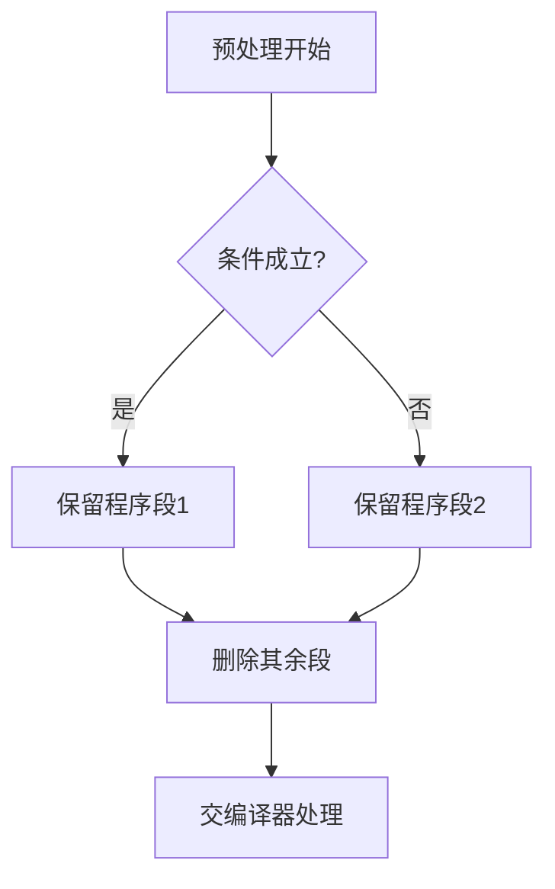

# 条件编译指令的两种常用格式

---
requires: [宏定义与宏替换]
---

如果程序要在 Windows 和 Linux 上运行，难道要维护两份代码？有没有办法让编译器“看情况”决定编译哪一段？这就是条件编译指令要解决的问题。

## 两种常用格式

条件编译是==编译预处理阶段==的指令，由预处理器根据条件决定哪些代码参与编译，哪些被直接剔除。

**格式一：`#ifdef` 判断宏是否已定义**

```c
#ifdef 标识符
    程序段1
#else
    程序段2
#endif
```
当 `标识符` 已被 `#define` 定义过时，编译 `程序段1`；否则编译 `程序段2`。其中 `#else` 及 `程序段2` 可省略。与之对应的是 `#ifndef`（若未定义则编译）。

**格式二：`#if` 判断常量表达式**

```c
#if 常量表达式
    程序段1
#else
    程序段2
#endif
```
当 `常量表达式` 的值非 $0$ 时，编译 `程序段1`；为 $0$ 时编译 `程序段2`。

> [!IMPORTANT]
> `#if` 后面必须是==常量表达式==，在预处理阶段就能算出结果，绝不能包含变量或函数调用。



## 为什么需要它

| 场景 | 做法 |
| :--- | :--- |
| 跨平台适配 | 用 `#ifdef _WIN32` 区分系统专属 API |
| 调试开关 | 定义 `DEBUG` 宏输出日志，发布前取消定义即可一键关闭 |
| 防止头文件重复包含 | 配合 `#ifndef` 实现头文件保护卫士 |

相比运行时才做判断的 `if-else`，条件编译的优势在于：不满足条件的代码根本不会生成目标代码，既减小了可执行文件体积，又避免了未定义符号引发的链接错误。

## 与相近概念的区别

> [!NOTE]
> **条件编译 vs 运行时 `if-else`**
> - **执行时机**：前者在编译前由预处理器处理；后者在程序运行时由 CPU 执行。
> - **产物差异**：前者未命中的分支彻底消失；后者所有分支都在可执行文件中。
> - **条件限制**：前者只能用宏或常量表达式；后者可用任意合法表达式。

## 常见易错坑

> [!CAUTION]
> 忘记写 `#endif`！每个 `#ifdef` 或 `#if` 必须有配对的 `#endif`，否则编译器会报语法错误，且报错位置往往在文件末尾，极难排查。

> [!WARNING]
> 误将变量用于 `#if`。例如 `int x = 1; #if x == 1` 是错误的，因为预处理器不认识变量 `x`，会将其视为 $0$。

## 一个算对了的例子

阅读下列代码，写出运行结果：

```c
#define DEBUG 1
#define LEVEL 2

int main() {
#if DEBUG && (LEVEL > 1)
    printf("A");
#else
    printf("B");
#endif

#ifdef RELEASE
    printf("C");
#endif
    return 0;
}
```

**分析步骤：**

1. 遇到 `#if DEBUG && (LEVEL > 1)`，代入宏展开得 `#if 1 && (2 > 1)`，即 `#if 1 && 1`，值为 $1$（真），保留 `printf("A");`，跳过 `else` 分支。
2. 遇到 `#ifdef RELEASE`，前面并未 `#define RELEASE`，因此该段被剔除，`printf("C");` 不参与编译。

最终输出结果为：

```text
A
```

> [!TIP]
> 做题口诀：“先代换，再计算，只看真假定去留”。拿到条件编译的题目，先把宏全部替换成具体数值，再按 C 语言表达式规则求值即可。
