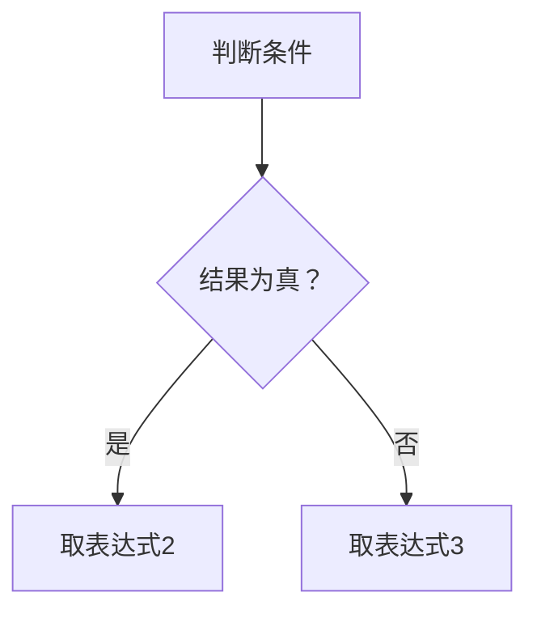

# 条件运算符（三目运算符）

## 运算符形式与作用

条件运算符又称三目运算符，是 C 语言中==唯一的三目运算符==，基本形式为：

```c
表达式1 ? 表达式2 : 表达式3
```

先计算 `表达式1` 的值：

- 若结果为真（ nonzero ），计算并返回 `表达式2`；
- 若结果为假（0），计算并返回 `表达式3`。

它相当于把简单的二选一分支写成表达式，因此常用于赋值、函数返回值等场合。



## 与 if 语句的对应关系

条件运算符只适合表达“==根据一个条件，在两个值中选择一个==”的逻辑，不能完全代替包含多条语句的 `if-else`。

例如：

```c
if (x > y)
    z = 0;
else
    z = 1;
```

可以写成：

```c
z = (x > y) ? 0 : 1;
```

也可以利用关系表达式的结果为 `0` 或 `1`，写成：

```c
z = x <= y;
```

两种写法的结果相同：

| 条件 | 原 `if-else` | `(x > y) ? 0 : 1` | `x <= y` |
|---|---:|---:|---:|
| $x>y$ | 0 | 0 | 0 |
| $x\le y$ | 1 | 1 | 1 |

> [!TIP]
> 记忆口诀：**条件真，取中间；条件假，取右边。** 三目运算符的顺序是“条件—真值—假值”。

## 结合方向与优先级

条件运算符的优先级：

- 高于赋值运算符；
- 低于关系运算符、逻辑与和逻辑或；
- 低于所有算术及关系等常用运算。

它采用==右结合==，即从右向左计算。例如：

```c
a ? b : c ? d : e
```

等价于：

```c
a ? b : (c ? d : e)
```

而不是：

```c
(a ? b : c) ? d : e
```

> [!WARNING]
> 实际编程中应适当加括号。右结合是语言规则，但写成嵌套形式通常更直观。

## 特殊运算规则

条件运算符属于具有特殊运算规则的运算符：表达式中的某些部分可能不参与计算。

```c
int a = 1;
int b = 0;
int r = a ? 10 : b / 0;
```

因为 `a` 为真，只计算真值表达式 `10`，`b / 0` 不执行，所以不会产生除零错误。这也说明：不能认为两个分支一定会都被计算。

若两个分支类型不同，结果会按 C 语言的类型转换规则转换，通常由低类型向高类型转换。例如：

```c
int i = 2;
double d = 1.5;
double r = i ? i : d;
```

条件表达式的整体类型为 `double`。

## 常见易错点

> [!CAUTION]
> 条件表达式的假值是 **0**，非零值都为真；“真”并不一定表示数值 `1`。

| 错误认识 | 正确解释 |
|---|---|
| 真值只能是 `1` | 任何非零值都为真 |
| 假分支也会执行 | 只计算被选中的那个分支 |
| `?:` 中使用 `=` | 条件运算符使用 `?` 和 `:` |
| `?:` 优先级高于 `=` | 赋值优先级更低，必要时加括号 |
| 可以代替任意 `if-else` | 适合二选一，不适合复杂多分支 |

此外，条件表达式中的关系表达式若不加括号，可能使结构不清晰。例如：

```c
z = x > y ? 0 : 1;
```

建议写成：

```c
z = (x > y) ? 0 : 1;
```

## 计算示例

宏定义：

```c
#define MIN(x,y) (x)<(y)?(x):(y)
```

则：

```c
10 * MIN(1,2)
```

宏展开后为：

```c
10 * (1)<(2)?(1):(2)
```

根据优先级，先计算乘法，得到：

```c
10 < 2 ? 1 : 2
```

条件 `10 < 2` 为假，因此取假值 `2`，最终结果是 **2**。

> [!WARNING]
> 该宏定义缺少整体括号，代入复杂表达式时容易出错。更可靠的写法是：
>
> ```c
> #define MIN(x, y) (((x) < (y)) ? (x) : (y))
> ```
>
> 宏参数还应加括号，避免传入含低优先级运算符的表达式时产生意外结果。
