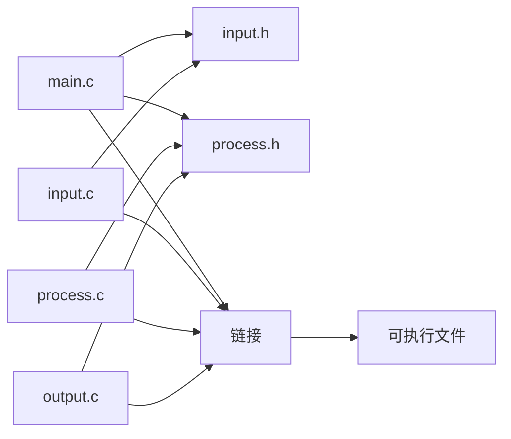

# 程序模块的划分原则与方法

## 什么是程序模块的划分

程序模块的划分，是指把一个完整程序按功能拆成若干相对独立的部分，分别编写、编译和维护。在 C 语言多文件工程中，通常把**函数定义、变量定义和主要处理流程**放在 `.c` 源文件中，把**函数声明、类型定义、宏定义等共享信息**放在 `.h` 头文件中。

例如，一个学生成绩管理程序可以划分为：

| 模块 | 主要职责 | 可放置的内容 |
| :--- | :--- | :--- |
| 主控模块 | 组织程序流程 | `main` 函数、菜单选择 |
| 输入模块 | 读取并检查数据 | 输入函数的定义 |
| 处理模块 | 排序、统计、查找 | 各处理函数的定义 |
| 输出模块 | 显示或保存结果 | 输出函数的定义 |
| 公共头文件 | 提供模块间接口 | 函数声明、结构体定义、宏 |

==模块划分的核心不是“文件越多越好”，而是让每个模块职责清楚、接口明确。==

## 为什么需要划分模块

如果所有代码都写在同一个 `.c` 文件中，程序规模增大后，容易出现函数难以查找、修改相互影响、代码重复等问题。合理划分模块可以带来三个好处：

- **降低复杂度**：每次只需关注一个功能。
- **便于协作**：不同人员可以分别实现不同模块。
- **便于复用和维护**：其他源文件包含相应头文件后，即可使用已经写好的功能。



## 怎样划分和组织模块

可以按下面的步骤进行：

1. **按功能划分**：把输入、处理、输出等不同职责分开，相关度高的函数放在同一模块。
2. **确定模块接口**：明确每个函数“接收什么、完成什么、返回什么”。
3. **分离声明与定义**：头文件主要写函数声明，源文件写函数定义。
4. **减少模块间依赖**：尽量通过函数参数和返回值传递数据，不滥用全局变量。
5. **分别编译，再统一链接**：每个 `.c` 文件生成目标文件，最后链接成可执行文件。

例如，`process.h` 中写：

```c
#ifndef PROCESS_H
#define PROCESS_H

double average(int a[], int n);

#endif
```

`process.c` 中写函数定义：

```c
#include "process.h"

double average(int a[], int n)
{
    int i, sum = 0;
    for (i = 0; i < n; i++)
        sum += a[i];
    return (double)sum / n;
}
```

`main.c` 只需 `#include "process.h"`，便可调用 `average`。这里头文件提供“使用说明”，源文件提供“具体实现”。

> [!TIP]
> 可以记成：**头文件管声明，源文件管实现；模块靠接口合作，不靠随意访问内部细节。**

## 与相近概念的区别

| 概念 | 含义 | 与模块划分的关系 |
| :--- | :--- | :--- |
| 函数 | 完成某项具体操作的代码单位 | 模块通常由若干相关函数组成 |
| 源文件 `.c` | 存放函数定义等，可独立编译 | 一个模块常对应一个或多个源文件 |
| 头文件 `.h` | 存放共享声明、类型和宏 | 用于描述模块接口 |
| 编译 | 将源文件翻译成目标文件 | 各源文件可分别编译 |
| 链接 | 合并目标文件并解决外部引用 | 将多个模块组成可执行程序 |

> [!IMPORTANT]
> `#include` 是**文件包含**，发生在编译前；链接是在各源文件编译之后进行。包含头文件并不等于已经完成链接。

对于 `#include "process.h"`，通常==先在源程序所在目录搜索，再按系统设定的标准方式搜索==；而 `#include <stdio.h>` 通常直接按系统标准方式搜索。因此前面选择题应选 **B**。

## 常见的坑

> [!WARNING]
> 不要把同一个函数定义重复包含进多个 `.c` 文件，否则链接时可能出现重复定义。多个文件需要共同使用函数时，应包含它的**声明**，并只保留一处**定义**。

- 头文件重复包含可能导致类型或声明被重复处理，常用 `#ifndef`、`#define`、`#endif` 防止。
- 只写函数定义、不提前声明，其他文件调用时可能无法正确识别接口。
- 把大量全局变量作为模块间“公共通道”，会使修改一个模块影响其他模块。
- 工程只编译 `main.c` 却未加入其他实现文件，可能出现“声明存在，但链接找不到定义”。

## 一个正确的划分例子

若程序要输入 3 个整数并求平均值，可让 `main.c` 负责流程，`process.c` 负责计算，`process.h` 负责声明。主函数写：

```c
#include <stdio.h>
#include "process.h"

int main(void)
{
    int x[3] = {1, 2, 3};
    printf("%.2f\n", average(x, 3));
    return 0;
}
```

编译时把 `main.c` 和 `process.c` 都加入工程，再统一链接。计算结果为

$$
\frac{1+2+3}{3}=2.00
$$

这个例子中，主控模块不必知道求和循环的细节，只需按照头文件给出的接口调用函数，体现了模块划分的基本思想。
