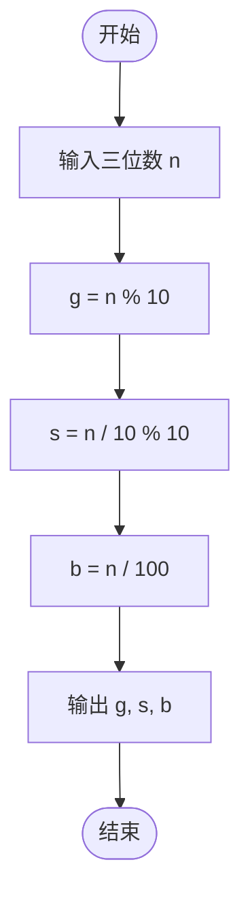
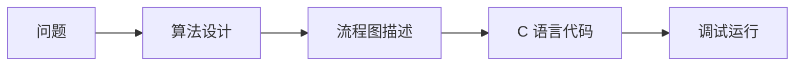

# 算法与流程图的图标符号表示

## 什么是算法

算法是**为解决某个问题而采取的有限操作步骤**。程序设计的本质，就是把算法用某种高级语言（本课程用 C 语言）表达出来。同一个算法可以有不同的描述方式，其中流程图是最直观的一种。

## 流程图的基本符号

流程图用标准化的图形符号来表示算法的执行流程，常用的符号如下：

| 符号 | 名称 | 含义 |
|------|------|------|
| 圆角矩形 | 起止框 | 表示算法的开始或结束 |
| 矩形 | 处理框 | 表示赋值、计算等操作 |
| 菱形 | 判断框 | 表示条件判断，有两个或多个出口 |
| 平行四边形 | 输入/输出框 | 表示数据的输入或输出 |
| 箭头 | 流程线 | 表示执行的流向 |

> [!IMPORTANT]
> 画流程图时，**判断框必须有明确的"是/否"分支标注**，流程线不能交叉混乱，起止框不能遗漏。

## 一个完整的例子：三位数拆分

以课件中的经典问题为例：从键盘输入一个三位数 $n$，输出它的个位、十位、百位。

**思路分析：**
- 个位数：$n \bmod 10$
- 十位数：$\left\lfloor \dfrac{n}{10} \right\rfloor \bmod 10$
- 百位数：$\left\lfloor \dfrac{n}{100} \right\rfloor$

> [!TIP]
> 取余 `%` 和整除 `/` 是拆分数字的两大法宝：**取余拿低位，整除去低位**。这个技巧在回文数判断、数字加密等问题中反复出现。

## 算法、流程图与代码的关系

三者是逐层细化的关系：算法是思想，流程图是算法的图形化表达，代码是算法的最终实现。

> [!WARNING]
> 常见误区：把"算法"等同于"代码"。算法是解决问题的步骤描述，与具体编程语言无关；代码只是算法在某种语言下的实现。考试写流程图时，框内应写**操作步骤**而非 C 语句。

> [!CAUTION]
> 流程图中判断框的出口必须标注条件（如"是/否"或"Y/N"），只画箭头不标条件会被扣分。
