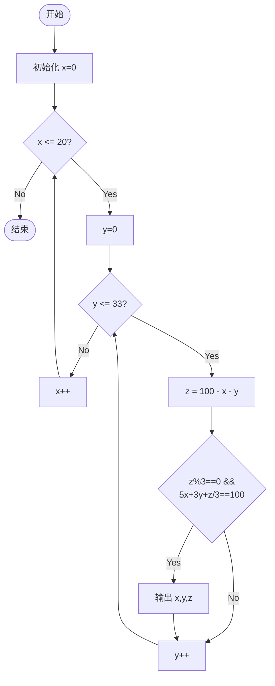

# 穷举法解百钱百鸡等多解方程问题

# 穷举法解百钱百鸡等多解方程问题

## 什么是穷举法？

当面对“百钱买百鸡”这类不定方程（未知数个数多于方程个数）时，解析法往往难以直接求出整数解。**穷举法（Brute Force）**的核心思想是：在有限的解空间内，逐一验证每个可能的组合，筛选出满足所有约束条件的解。

> [!IMPORTANT]
> ==核心逻辑==：利用计算机高速运算的特点，将数学上的“求解”转化为程序中的“遍历与判断”。

## 为什么需要它？

在《高级语言程序设计》中，这是理解**循环嵌套**与**条件判断**结合的最佳场景。对于 $x + y + z = 100$ 且 $5x + 3y + z/3 = 100$ 这样的问题，人脑难以快速试错，但计算机可以在毫秒级完成数千次验证。

## 怎么做：算法流程

以经典“百钱百鸡”为例：公鸡5文/只，母鸡3文/只，小鸡1文/3只。设公鸡 $x$、母鸡 $y$、小鸡 $z$。



### 关键优化步骤
1. **缩小范围**：由 $5x \le 100$ 可知 $x$ 最大为 20；由 $3y \le 100$ 可知 $y$ 最大为 33。
2. **消元降维**：利用 $x+y+z=100$，直接计算 $z = 100 - x - y$，将三重循环优化为**二重循环**。
3. **整除判断**：小鸡价格涉及除法，需确保 $z$ 能被 3 整除，即 `z % 3 == 0`。

> [!TIP]
> 记忆口诀：**定范围、减维度、判整除**。

## 常见坑与辨析

| 维度 | 正确做法 | 常见错误（坑） |
| :--- | :--- | :--- |
| **数据类型** | 使用 `int` 进行整除判断 | 直接用 `float` 比较金额，导致精度误差 |
| **循环边界** | `x <= 20`, `y <= 33` | 盲目使用 `x < 100`，增加无效计算 |
| **约束条件** | 先判 `z % 3 == 0` | 忽略小鸡必须为整数的隐含条件 |

> [!WARNING]
> 切勿使用三层循环！若对 $z$ 也进行遍历，时间复杂度将从 $O(N^2)$ 退化为 $O(N^3)$，虽能得出结果，但违背了算法优化的初衷。

## 算例演示

假设题目简化为：公鸡2文，母鸡1文，小鸡0.5文，共100钱买100只。
代码片段逻辑：
```c
for (int x = 0; x <= 50; x++) {       // 公鸡最多50只
    for (int y = 0; y <= 100; y++) {   // 母鸡最多100只
        int z = 100 - x - y;           // 剩余为小鸡
        if (z >= 0 && z % 2 == 0) {    // 小鸡数量为偶数(0.5文*2=1文)
            if (2 * x + y + z / 2 == 100) {
                printf("公鸡:%d, 母鸡:%d, 小鸡:%d\n", x, y, z);
            }
        }
    }
}
```
此例展示了如何通过数学关系消去变量 $z$，并利用取模运算处理非整数单价问题。
