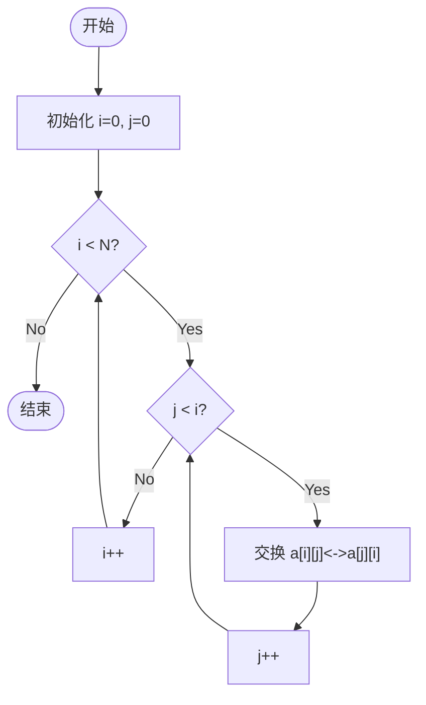

# 二维数组实现矩阵转置运算

# 二维数组实现矩阵转置运算

## 什么是矩阵转置？

矩阵转置是指将矩阵的**行**与**列**互换。若原矩阵 $A$ 为 $M \times N$ 维，则转置后的矩阵 $B$ 为 $N \times M$ 维，且满足 $B_{ij} = A_{ji}$。

> [!IMPORTANT]
> ==核心定义==：行变列，列变行。下标互换 $a[i][j] \leftrightarrow a[j][i]$。

为什么需要掌握它？在图像处理、线性代数计算及南邮《高级语言程序设计》考试中，这是考察**二维数组遍历**与**下标逻辑映射**的经典题型。

## 算法实现逻辑

假设有一个 $3 \times 3$ 的方阵（行列相等时最易考），存储在二维数组 `int a[3][3]` 中。



> [!TIP]
> **优化技巧**：只需遍历**上三角**或**下三角**区域（即 `j < i` 或 `j > i`）。若遍历全部元素（`j < N`），会导致元素被交换两次，恢复原状，等于没做操作。

### 代码示例

```c
void transpose(int a[][3], int n) {
    int i, j, temp;
    // 只遍历下三角，避免重复交换
    for (i = 0; i < n; i++) {
        for (j = 0; j < i; j++) { 
            temp = a[i][j];
            a[i][j] = a[j][i];
            a[j][i] = temp;
        }
    }
}
```

## 常见陷阱与辨析

| 维度 | 方阵 ($N \times N$) | 非方阵 ($M \times N, M \neq N$) |
| :--- | :--- | :--- |
| **存储方式** | 可在原数组就地转置 | **不能**在原数组就地转置 |
| **目标数组** | 无需额外空间 | 需定义新数组 `b[N][M]` |
| **赋值逻辑** | `swap(a[i][j], a[j][i])` | `b[j][i] = a[i][j]` |

> [!WARNING]
> **高危误区**：
> 1. **下标越界**：C语言数组下标从 $0$ 开始，最大下标为 $N-1$。循环条件必须是 `< N`，而非 `<= N`。
> 2. **非方阵处理**：若题目给出 $2 \times 3$ 矩阵，转置后为 $3 \times 2$。此时必须声明新数组，否则访问 `a[2][0]` 等位置可能导致内存错误或数据覆盖。

## 典型例题解析

**题目**：定义 `int a[3][3] = {{1,2,3},{4,5,6},{7,8,9}};`，执行上述转置函数后，输出 `a[1][2]` 的值是多少？

**推导过程**：
1. 原矩阵：
   $$
   \begin{bmatrix}
   1 & 2 & 3 \\
   4 & 5 & 6 \\
   7 & 8 & 9
   \end{bmatrix}
   $$
2. 转置后（行变列）：
   $$
   \begin{bmatrix}
   1 & 4 & 7 \\
   2 & 5 & 8 \\
   3 & 6 & 9
   \end{bmatrix}
   $$
3. 访问 `a[1][2]`：即第 2 行第 3 列的元素。
4. 结果为 **8**。

> [!NOTE]
> 记忆口诀：**“左上到右下对角线不变，其余关于对角线对称交换”**。主对角线元素 $a[i][i]$ 在转置中位置不变，可作为检查点。
