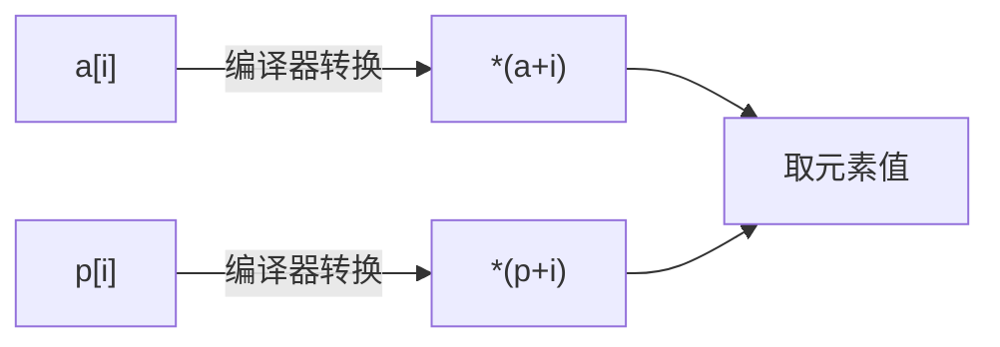

# *(a+i)或*(p+i)等指针访问数组元素的等价形式

## 指针访问数组的等价形式

在C语言中，当我们写下 `a[i]` 时，编译器究竟做了什么？为什么课件反复强调 `a[i] ⇔ *(a+i)`？理解这个等价关系，是掌握指针与数组关系的基石。

> [!IMPORTANT]
> ==数组名在表达式中代表首地址常量==。下标运算符 `[]` 本质上是指针偏移加解引用的语法糖，即 `a[i]` 完全等价于 `*(a+i)`。

### 两种访问方式对比

既然 `a[i]` 和 `*(p+i)` 都能访问元素，它们有何区别？

| 特性 | 下标法 `a[i]` / `p[i]` | 指针法 `*(a+i)` / `*(p+i)` |
| :--- | :--- | :--- |
| 语义 | 直观，表示“第i个元素” | 底层，表示“基址偏移i后取值” |
| 基址要求 | 数组名或指针变量均可 | 数组名或指针变量均可 |
| 可修改性 | `a` 不可变，`p` 可变 | `a` 不可变，`p` 可变 |
| 编译结果 | 完全相同 | 完全相同 |

[!NOTE]
> 无论用数组名 `a` 还是指针变量 `p` 作为基址，`*(基址+i)` 的计算逻辑一致：==地址 = 基址 + i × sizeof(类型)==，再对该地址解引用。

### 计算偏移量的关键步骤

遇到 `*(p+i)` 求值题时，如何快速算对？不妨先问自己两个问题：**p 当前指向哪里？目标元素与 p 相距几个单位？**

以真题为例：`int a[10]={0,1,2,3,4,5,6,7,8,9}, *p=a+1;`，求值为5的元素表达式。

1.  **定位基准**：`p=a+1`，即 `p` 指向 `a[1]`（值为1）。
2.  **计算偏移**：目标值5对应 `a[5]`，相对于 `a[1]` 偏移 $5-1=4$ 个单位。
3.  **构造表达式**：`*(p+4)` 即为 `a[5]`，答案为B。

[!TIP]
> 解题口诀：==先定基准再算差，偏移量 = 目标下标 - 基准下标==。选项中的 `a+5` 是地址而非值，`*p[5]` 因优先级等价于 `*(p[5])` 会导致编译错误。

### 常见陷阱与辨析

> [!CAUTION]
> ==数组名 a 是地址常量，不可被赋值==。`a=a+3` 非法，而 `p=p+3` 合法。这是选择题高频考点。

[!WARNING]
> 区分 `*p++` 与 `*(p++)`：前者等价于 `*(p++)`，先取 `p` 当前所指的值，再将 `p` 后移；若误认为先移动再取值，结果将错位一个元素。

> [!TIP]
> 指针减法仅对==同一数组==内的指针有意义，结果为两指针间相隔的元素个数，而非字节差。

掌握 `*(a+i)` 与 `a[i]` 的等价性，不仅能应对考试中的偏移计算题，更是后续理解字符串处理、函数参数传递及动态内存操作的前提。务必通过手推地址运算来巩固这一核心概念。
