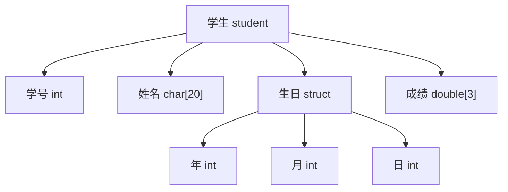

# 学生信息（学号、姓名、成绩）的结构体综合处理

## 它是什么

在 C 语言里，`int`、`char`、`double` 只能装一个单独的数据。可是要描述“一个学生”，我们有学号、姓名、性别、成绩、住址、生日，它们类型不同却属于同一个人。结构体 `struct` 就是把这些“不同类型但逻辑相关”的成员打包成一个新类型。课件里定义的典型学生类型是：

```c
struct {
    int ID;          /* 学号 */
    char Name[20];   /* 姓名 */
    char Sex;        /* 性别 */
    double Score;    /* 成绩 */
} stu1, stu2 = {1001, "zhang", 'F', 98.5};
```

其中 `stu2` 在定义时直接用初值表初始化，顺序必须和成员声明一致。

## 为什么需要

如果不用结构体，要存 10 个学生，就得开 `id[10]`、`name[10][20]`、`score[10]`……数据之间靠下标勉强对齐，写排序、找最高分都要同步搬动一堆数组。用结构体数组 `struct student cls[10]` 后，“一个学生”就是内存里的一整块，==排序时整体交换一个元素即可，不会让学号张冠李戴==。这也是课件例 10.6 和真题里“班级成绩排名”“手机销售收入排名”的底层思路。

## 怎么做：定义、嵌套、输入输出

成员可以是另一个结构体，比如生日含 `year`、`month`、`day`：



访问要用 `.` 逐级走：真题里嵌套后正确写法是 `student.birthday.year`，而不是直接 `year` 或 `birthday.year`。

[!IMPORTANT]
> ==核心结论==：结构体变量用 `.` 访问成员；嵌套时一层层点下去，如 `s.birthday.year`。

从键盘读入多个成员要注意：

```c
struct student s;
scanf("%d %s", &s.ID, s.Name);   // Name 是数组，不加 &
scanf("%lf", &s.Score);          // double 用 %lf，输入必须加 &
```

输出最高分学生信息的基本流程：


## 和相近概念的区别

| 概念 | 能否同时存多种类型 | 典型用途 | 内存/用法差异 |
|---|---|---|---|
| 结构体 `struct` | 能 | 一条学生/手机记录 | 成员各自独立空间，`.` 访问 |
| 数组 | 一般同类型 | 批量同构数据 | 下标访问，不能混合类型 |
| 共用体 `union` | 能但共享内存 | 节省空间、互斥字段 | 同时只有最后写的成员有效 |

## 常见的坑

[!WARNING]
> `scanf` 中 `char Name[20]` 本身是地址，别写成 `&s.Name`；`double` 输入必须用 `%lf`、输出可用 `%f`，而 `float` 用 `%f`。

[!CAUTION]
> 结构体之间可以用 `s1 = s2` 整体赋值（同类型），但**不能用 `==` 比较整体**，只能逐个成员比，找最高分时正是只比 `Score` 这一项。

## 一个算对了的例子

真题要输出 25 种手机里销售收入最高到最低的排名。核心：用结构体存型号、单价、销量并算 `income = price * sale`，再用选择法交换整个结构体。

```c
typedef struct mobile {
    char type[20]; int price, sale, income;
} mobile;

void input(mobile *a, int n) {
    for (int i = 0; i < n; i++) {
        scanf("%s %d %d", a[i].type, &a[i].price, &a[i].sale);
        a[i].income = a[i].price * a[i].sale;
    }
}
void sort(mobile *a, int n) {
    for (int i = 0; i < n-1; i++) {
        int max = i;
        for (int j = i+1; j < n; j++)
            if (a[j].income > a[max].income) max = j;
        mobile t = a[i]; a[i] = a[max]; a[max] = t; // 整块交换
    }
}
```

[!TIP]
> 解题技巧：题目给了函数原型，就严格照写；交换记录直接 `mobile t = a[i]` 整块赋值，不必手搬每个成员，这就是结构体综合处理最省事的地方。
