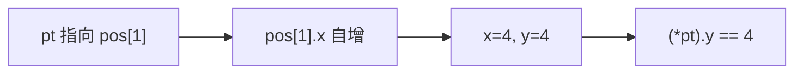

# 结构体变量成员的依次赋值与访问

## 结构体变量成员的依次赋值与访问

### 为什么要用结构体

一个学生有学号、姓名、年龄、生日等多类信息。学号是 `int`，姓名是 `char[]`，生日又包含年、月、日。如果各用独立变量，数据一多就散落各处，无法表达“这些信息属于同一个学生”。结构体把==相互关联的不同类型数据打包成一个整体==，既便于组织，也便于整体赋值、传参和存放。

### 怎么定义与访问成员

定义结构体类型和变量：

```c
struct Student {
    int no;
    int age;
    struct Date { int year, month, day; } birthday;
} s1;
```

访问成员用点运算符 `.`：

```c
s1.no = 1;
s1.age = 20;
s1.birthday.year = 2005;   // birthday 本身是结构体，再点一层
s1.birthday.month = 3;
```

> [!NOTE]
> 点运算符的左边必须是结构体变量名，不能是类型名或标签名。`Student.no`、`struct.no` 都是非法的。

### 用指针访问：`->` 与 `(*p).`

若有一个结构体指针：

```c
struct Student s = {1, 20, {2005, 3, 15}};
struct Student *p = &s;
```

以下三种写法完全等价：

```c
s.age;
(*p).age;   // 先解引用为结构体变量，再取成员
p->age;     // 箭头运算符，最常用
```

> [!IMPORTANT]
> `p->age` 等价于 `(*p).age`，==不是== `*p.age`。`*p.age` 会先算 `p.age`，而 `p` 是指针，根本没有成员，直接编译错误。

### 结构体数组的成员访问

```c
struct Student st[3] = {
    {1, 20, {2005, 3, 15}},
    {2, 19, {2006, 7, 1}},
    {3, 21, {2004, 1, 10}}
};
```

访问第 `i` 个元素的成员：

```c
st[i].no
st[i].birthday.year
```

用指针遍历时注意优先级：

```c
struct Student *pt = st;
(++pt)->age;    // 先让 pt 指向 st[1]，再取 age
pt->age++;      // 等价于 (pt->age)++，先取 age 再自增
++pt->age;      // 也等价于 ++(pt->age)，增的是成员值，指针没动
```

`->` 和 `.` 的优先级高于自增运算符，所以 `++pt->age` 不是 `(++pt)->age`。

### 结构体整体赋值

同类型的结构体变量可以直接赋值：

```c
struct Student a = {1, 20, {2005, 3, 15}};
struct Student b;
b = a;   // 逐个成员依次拷贝
```

这也说明结构体变量成员的“依次赋值”发生在初始化或整体赋值时，而单独赋值则要逐个成员写。

### 常见易错点

| 错误写法 | 问题 |
| :--- | :--- |
| `Student.no = 1;` | 左边是类型标签，不是变量 |
| `s1.stud.age = 20;` | `stud` 不是 `s1` 的成员，嵌套层级写反了 |
| `p.age` | `p` 是指针，必须用 `p->age` 或 `(*p).age` |
| `*p.age` | 优先级错误，等于 `*(p.age)`，编译失败 |
| `struct vt = {1,20};` | `vt` 没有定义过，类型名后必须跟变量名 |

> [!WARNING]
> 点运算符左边只能是结构体变量，箭头运算符左边只能是结构体指针，二者不能混用。

### 一个算对了的例子

```c
struct Point { int x, y; } pos[] = {{1,2},{3,4},{5,6}}, *pt = pos;
```

- `(++pt)->y`：`pt` 先指向 `pos[1]`，取 `y`，结果为 `4`。
- `++(pt->x)`：`pt` 仍指向 `pos[1]`，取 `x = 3`，自增得 `4`。
- `++pt->x`：同一表达式，`pt->x` 变为 `4` 后，`(*pt).x` 也是 `4`。
- `(*pt).y`：`pos[1].y` 仍是 `4`。



结构体成员的访问靠“**变量名后点点，指针后箭头**”，想清楚每一层访问的是哪个变量，多级嵌套时从外向内逐层剥开即可。
