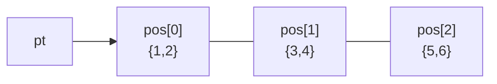

# 基类型为结构体的指针定义与使用

## 为什么需要结构体指针

结构体类型可以把姓名、学号、成绩等多种数据组织成一个整体。定义结构体类型后，它与 `int`、`char` 一样，既能定义变量和数组，也能定义指针。

使用结构体指针，可以间接访问结构体变量、遍历结构体数组，还能把结构体地址传给函数，避免复制整个结构体；它也是后续定义链表结点的基础。

## 定义与间接访问

```c
struct Student
{
    char name[20];
    int id;
    float score;
};

struct Student s = {"Tom", 101, 90.5};
struct Student *p = &s;
```

这里 `p` 是基类型为 `struct Student` 的指针，保存的是结构体变量 `s` 的地址。访问成员有两种等价写法：

```c
(*p).score = 95.0;
p->id = 102;
```

即：

$$p\text{->成员} \equiv (*p).\text{成员}$$

`.` 的左边必须是结构体变量，`->` 的左边必须是结构体地址或指针。

> [!IMPORTANT]
> ==`p->成员` 是结构体指针访问成员的标准写法==；`(*p).成员` 中的括号不能省略，因为 `.` 的优先级高于 `*`。

| 写法 | 含义 | 是否合法 |
|---|---|---|
| `s.id` | 直接访问变量成员 | 合法 |
| `p->id` | 通过指针访问成员 | 合法 |
| `(*p).id` | 先取所指变量，再访问成员 | 合法 |
| `*p.id` | 被理解为 `*(p.id)` | 错误 |
| `p.id` | 把指针当作结构体变量 | 错误 |

## 指向结构体数组

结构体指针也可以指向数组首元素，并通过指针移动访问后续元素：

```c
struct Point
{
    int x, y;
} pos[] = {{1, 2}, {3, 4}, {5, 6}}, *pt = pos;
```

此时 `pt` 指向 `pos[0]`，`pt + 1` 指向 `pos[1]`。指针加 $1$ 表示前进一个结构体元素，而不是只前进一个字节。



访问数组成员时，`pt[i].x`、`(pt+i)->x`、`(*(pt+i)).x` 等价；通常优先使用前两种，可读性较好。

## 算对一个连续求值题

仍使用上面的定义，初始时 `pt == pos`。

| 表达式 | 求值过程 | 结果 | 求值后的状态 |
|---|---|---:|---|
| `(++pt)->y` | `pt` 先移到 `pos[1]`，再取 `y` | $4$ | `pt` 指向 `pos[1]` |
| `++(pt->x)` | 取 `pos[1].x`，由 $3$ 增为 $4$ | $4$ | `pos[1].x == 4` |
| `++pt->x` | 等价于 `++(pt->x)`，再增 $1$ | $5$ | `pos[1].x == 5` |
| `(*pt).y` | 取当前 `pos[1].y` | $4$ | 指针不变 |

> [!WARNING]
> 这类题要按顺序连续计算，不能每次都把 `pt` 重置为 `pos`。`++pt->x` 中 `->` 优先于 `++`，所以增加的是成员 `x`，不是指针；若写 `++pt`，才会移动指针。

## 常见坑与相近概念

- **指针未初始化**：`struct Student *p; p->id = 101;` 可能访问非法地址，应先让 `p` 指向有效变量或数组元素。
- **越界移动**：`pt` 指向最后一个元素后，再执行 `++pt` 并访问成员会产生越界风险。
- **混淆指针与变量**：`pos.x` 对数组名不成立，应写 `pos[0].x` 或 `pt->x`。
- **嵌套结构体**：若成员本身也是结构体，要逐层访问，如 `p->birthday.year`，不能跳过中间成员。
- **链表中的递归定义**：结点可写为 `struct Node { int data; struct Node *next; };`，其中 `next` 指向同类型结点，遍历时常用 `p = p->next`。

> [!TIP]
> 判断表达式时先问两件事：==指针当前指向谁，运算符改变的是指针还是成员==。画出指向关系，再按优先级逐步求值，最不容易出错。
