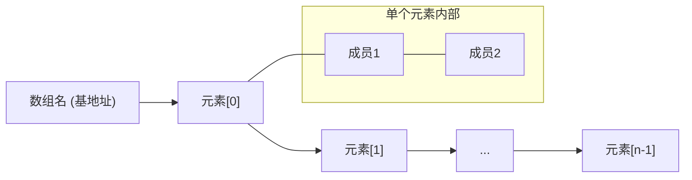

# 元素类型为结构体的数组定义与应用

## 结构体数组：批量数据的“集装箱”

在处理如班级成绩、员工信息等批量记录时，单一变量显得力不从心。结构体数组将**相同类型**的结构体变量连续存放，既保留了结构体封装不同数据类型的能力，又具备数组下标访问的便捷性。

> [!IMPORTANT]
> ==核心定义==：结构体数组是元素类型为结构体的数组。内存中各元素连续存储，每个元素内部成员也按定义顺序排列。

## 定义与初始化：三种姿势

南邮课程强调掌握以下三种定义方式，推荐结合 `typedef` 使用以提升代码可读性：

1.  **先类型后变量**：标准做法，逻辑清晰。
2.  **定义同时声明**：紧凑，但类型名可缺省（匿名结构体），不利于后续复用。
3.  **typedef 别名**：`typedef struct { ... } Student;`，之后可直接用 `Student s[10];` 定义。

初始化时，使用大括号嵌套：`struct Student stu[2] = {{1, "Alice"}, {2, "Bob"}};`。若部分初始化，剩余成员自动补零。

## 指针与访问：箭头的奥秘

这是考试的重灾区。当指针指向结构体数组时，需严格区分运算符优先级。

| 运算符 | 适用对象 | 示例 | 含义 |
| :--- | :--- | :--- | :--- |
| `.` | 结构体变量 | `stu[0].id` | 访问第1个学生的id |
| `->` | 结构体指针 | `p->id` | 等价于 `(*p).id` |

> [!WARNING]
> ==高危误区==：`->` 和 `.` 的优先级高于 `++` 和 `*`。
> 表达式 `++pt->x` 等价于 `++(pt->x)`，即**先取值再自增**，而非指针移动。
> 表达式 `(++pt)->y` 则是**先移动指针**到下一个元素，再访问其成员。

## 实战演练：指针运算陷阱

回顾练习题：`struct Point{ int x, y; } pos[] = {{1,2}, {3,4}, {5,6}}, *pt = pos;`

我们来逐步拆解关键表达式的值：

1.  **`(++pt)->y`**：
    *   `++pt`：指针先自增，从 `pos[0]` 移向 `pos[1]`。
    *   `->y`：访问 `pos[1]` 的 `y` 成员。
    *   结果：**4**。

2.  **`++(pt->x)`**：
    *   此时 `pt` 指向 `pos[1]`（假设上一步已执行，若独立执行则指向 `pos[0]`，通常题目语境为连续或独立初始状态，此处按独立初始状态 `pt=pos[0]` 分析更常见，但若承接上题则需注意上下文。*注：一般考题各空独立计算，初始 pt 均指向 pos[0]*）。
    *   若独立看：`pt` 指向 `pos[0]` (`x=1`)。`pt->x` 为 1，前缀 `++` 后变为 2。
    *   结果：**2**（且 `pos[0].x` 变为 2）。

3.  **`++pt->x`**：
    *   优先级：`->` 高于 `++`。等价于 `++(pt->x)`。
    *   若 `pt` 仍指向 `pos[0]` 且 `x` 未被修改：结果为 **2**。

4.  **`(*pt).y`**：
    *   `*pt` 解引用得到结构体变量，`.y` 访问成员。
    *   若 `pt` 指向 `pos[0]`，结果为 **2**。

> [!TIP]
> 记忆口诀：**箭头点，优先高；括号改，顺序倒。**
> 涉及指针移动务必加括号 `(++pt)`，涉及成员运算注意前缀/后缀区别。

## 综合应用提示

在《高级语言程序设计》中，结构体数组常与**排序算法**（如冒泡排序）结合。例如例10.6的成绩排名，外层循环控制轮数，内层循环比较相邻结构体元素的某成员（如分数），交换时需交换整个结构体或仅交换指针以提高效率。
