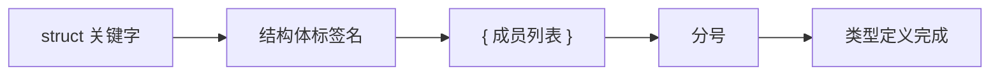

# 结构体类型的定义语法及分号不可省略规则

## 结构体类型的定义语法

结构体解决的问题很直接：一个学生有学号、姓名、成绩等多个属性，但它们是**同一个整体**。用单独的变量无法表达“这些数据属于同一个人”，用多个平行数组又割裂了它们之间的从属关系。结构体把若干可能类型不同的数据打包成一个新的数据类型。

定义结构体类型的一般形式为：

```c
struct 结构体标签名
{
    类型 成员名1;
    类型 成员名2;
    /* ... */
};
```

注意最后那个分号。这个分号是**结构体类型定义的组成部分**，不是可有可无的风格问题。考虑一下：编译器怎么知道类型定义结束了？它靠的就是`}`后面的这个分号。漏写它，后续代码会被编译器当成结构体定义的延续，往往报出一连串莫名其妙的错误。



## 三种定义变量的方式

定义结构体类型本身不分配内存，它只是告诉编译器“有这样一种数据布局”。真正分配内存的是定义变量。有三种写法：

| 方式 | 写法 | 说明 |
|---|---|---|
| 先定义类型，再定义变量 | `struct stud { int no; };` 然后 `struct stud vs;` | 类型与变量分开，最常用 |
| 定义类型的同时定义变量 | `struct stud { int no; } vs;` | `vs` 在类型定义时就已声明 |
| 定义匿名类型的变量 | `struct { int no; } vs;` | 没有标签名，以后无法再定义同类型变量 |

> [!IMPORTANT]
> 结构体**类型名**是 `struct stud`，`stud` 只是标签名（tag），不能单独作为类型名使用。在 C 语言（非 typedef 的情况下）写 `stud vs;` 是错的，必须写 `struct stud vs;`。

## 常见误区：标签名、类型名与变量名

来看一道典型选择题：

```c
struct stud
{
    int no, age;
} vs;
```

- `stud` 是**标签名**，不是变量名，所以 `stud.no = 1;` 错误。
- `vs` 是**变量名**，不是类型名，所以 `vs.stud.age = 20;` 错误——编译器会认为你在 `vs` 里找名为 `stud` 的成员，但 `stud` 根本不是成员。
- `struct vt` 从未被定义，不能直接用。
- 正确写法是 `struct stud va = {1, 20};`，定义新变量 `va` 并用初值列表初始化。

> [!WARNING]
> 成员访问必须通过**变量名**，不能通过标签名或类型名。`标签名.成员` 和 `变量名.类型名.成员` 都是编译错误；另外，定义结构体时漏掉末尾分号会导致后续代码全被吞进类型定义中，报错行号往往指向很远的地方。

## 一个算对了的例子

```c
struct Point
{
    int x, y;
};

struct Point p1 = {10, 20};   /* 定义并初始化 */
struct Point p2;

p2.x = p1.x + 5;              /* 成员访问 */
p2.y = p1.y - 5;

printf("p1=(%d,%d)\n", p1.x, p1.y);   /* p1=(10,20) */
printf("p2=(%d,%d)\n", p2.x, p2.y);   /* p2=(15,15) */
```

内存布局上，`p1` 占据连续的一段空间，`x` 在低地址，`y` 紧随其后。结构体变量的名字代表整个结构体，成员通过 `.` 运算符逐个访问。

> [!TIP]
> 记住这个判断顺序：看到 `A.B`，先确认 `A` 是不是**变量**，再确认 `B` 是不是**该结构体的成员**。两步都满足，访问才合法。若 `A` 是指针，则用 `A->B`，等价于 `(*A).B`。
