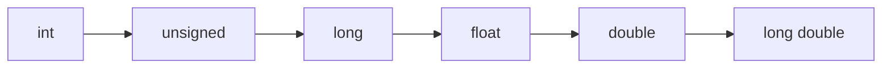

# 表达式中及赋值中的自动类型转换原则

## 它是什么

在 C 语言里，表达式求值和赋值时，==不同类型的数据会先自动转成同一类型再算或再存==。这就是自动类型转换。

- 表达式里：按“低精度向高精度看齐”逐步提升。
- 赋值里：右边的值无条件转成左边变量的类型。

> [!IMPORTANT]
> 核心结论
> $\text{char/short} \to \text{int} \to \text{unsigned} \to \text{long} \to \text{float} \to \text{double} \to \text{long double}$
> 赋值转换看“左值容器”，不看右边多高贵。

## 为什么需要

如果 `13.6 + 8` 不做转换，CPU 怎么把整数 8 和小数 13.6 直接加？==必须先把 8 变成 8.0==，结果才是 15.6 而不是乱码。

但注意：转换只发生在“运算那一刻”或“赋值那一刻”，**不会提前把整个表达式统一成 double**。

> [!WARNING]
> 易错坑
> `8 / 3 * 5 / 4` 全是 int，中途绝不因最后要和 `double a` 相加而提前变实数！

## 怎么做：规则与流程

表达式中的算术转换（两个操作数类型不同时）：

| 情况 | 转换方向 |
|---|---|
| 一边是 `double` | 另一边也转 `double` |
| 一边是 `float` | 另一边也转 `float` |
| 一边是 `long` | 另一边也转 `long` |
| 其余整型 | 一律先转 `int`（整型提升） |

赋值中的转换：

```text
double a;   int b = 8;
a = b;      // 8 → 8.0
b = 3.9;    // 3.9 截断成 3
```

可用 mermaid 表示表达式中的“逐级提升”：



## 和相近概念的区别

| 概念 | 发生时机 | 是否写代码 |
|---|---|---|
| 自动转换 | 编译隐式插入 | 不用写 |
| 强制转换 `(int)` | 程序员显式写 | 要写 |

`(int)(a-b)` 只把 `13.6-8=5.6` 截成 `5`，**不影响外层其它部分仍是 double**。

## 常见的坑：整数除法藏中间

来看南邮考过的题（填空 1 与填空 2 同源）：

```c
double a=13.6; int b=8;
a + b % 3 * (int)(a-b) / 4
```

先引导你问自己：`b%3` 是几？`(int)(a-b)` 是几？它们中间会遇到 double 吗？

一步步来：

1. `a-b = 13.6-8 = 5.6`
2. `(int)5.6 = 5`（int）
3. `b%3 = 8%3 = 2`（int）
4. `2 * 5 = 10`（int）
5. `10 / 4`：==4 是 int，10 是 int，整数除法得 2==
6. `13.6 + 2 = 15.6`

> [!TIP]
> 解题技巧
> 从左到右盯住“当前两操作数是不是全为整型”，全整型就整数除；碰到 double 才升 float/double。

所以结果是 `15.6`，不是 `15.6` 被误算成别的值，更中间那坨不是 `2.5`。

若把 `%3` 换成 `^0`（`8^0=8`）、`03`（八进制 3）也一样：

```c
a + (b^0) / 03 * (int)(a-b) / 4
= 13.6 + 8/3 * 5 / 4
= 13.6 + 2*5/4
= 13.6 + 10/4   // 整数除 → 2
= 15.6
```

## 再看赋值里的坑

```c
int a=10, b, n=7;
a /= (b=4, n%=b) + 1;
```

逗号表达式得 `3`，`a /= 4` 即 `a = a/4 = 10/4 = ==2==`（整数除！），不是 2.5。

> [!NOTE]
> 延伸辨析
> 想保留小数要写 `10/4.0` 或 `(double)10/4`；否则南邮卷面上答“4”而答案是 `4.0` 会判错。
