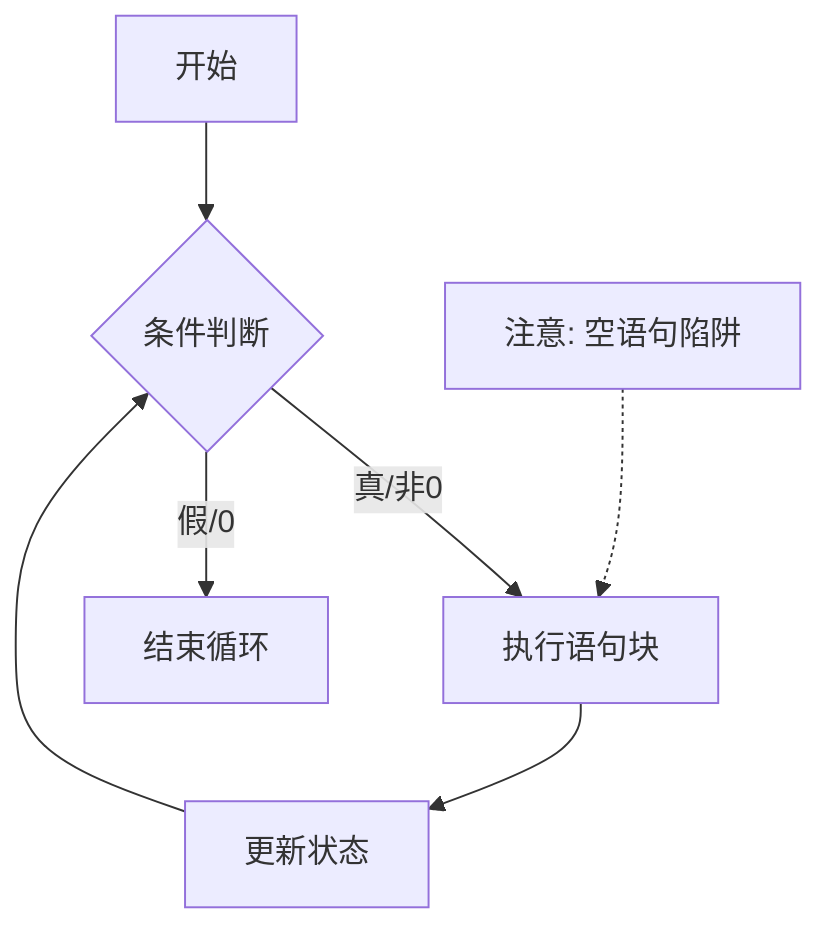

# 表达式语句、控制语句、复合语句与空语句

## 语句的分类与构成

在 C 语言中，**语句**是程序执行的基本单位。理解语句的形态是掌握流程控制的前提。

- **表达式语句**：由表达式加分号 `;` 构成。例如 `a = b + 1;`。注意，仅有表达式（如 `a+b`）不是语句，必须加 `;` 才成为完整语句。
- **空语句**：仅由一个分号 `;` 构成。它不执行任何操作，但占用一个语句位置。
- **复合语句**：用 `{}` 将多条语句括起来，语法上视为**一条语句**。

> [!IMPORTANT]
> ==复合语句的核心作用==：当语法规定只能出现一条语句（如 `if`、`while` 后），但逻辑需要执行多步操作时，必须使用 `{}` 将其包裹为复合语句。

## 控制语句与关键字

控制语句用于决定代码的执行顺序和次数。南邮《高级语言程序设计》重点考察以下三类循环及分支结构：

| 类型 | 关键字 | 特点 |
| :--- | :--- | :--- |
| 循环 | `for`, `while`, `do...while` | `for` 最常用；`while` 先判后执；`do...while` 先执后判 |
| 分支 | `if`, `else`, `switch` | `if` 后通常接复合语句；`switch` 需配合 `break` |
| 跳转 | `break`, `continue`, `goto` | `break` 跳出循环/switch；`continue` 跳过本次循环剩余部分 |



> [!TIP]
> 记忆技巧：C 语言中，**非 0 即真**。`while(1)` 是死循环，`while(0)` 一次都不执行。

## 常见陷阱与真题解析

### 陷阱 1：空语句导致的逻辑错误
在 `for` 或 `if` 后误加分号，会导致循环体或分支体变为空语句，后续代码脱离控制。

**真题回顾（循环 1）**：
```c
int i;
for (i=0; i<3; i++); // 注意这里的分号
s+=i;
```
- **解析**：`for` 后的 `;` 使循环体为空。循环变量 `i` 从 0 增至 3，循环执行 **3 次**（i=0,1,2）。退出循环时 `i=3`。
- **结果**：`s+=i` 仅在循环结束后执行一次，即 `s = s + 3`。

### 陷阱 2：`else` 匹配错误
`else` 总是与最近的、未匹配的 `if` 配对。若中间插入空语句或复合语句不当，会引发编译错误或逻辑偏差。

**真题回顾（选择 4）**：
```c
if(a); a++; else a--; // 编译错误
```
- **解析**：`if(a);` 是一个完整的 if 语句（ body 为空）。随后的 `a++` 是独立语句。`else` 找不到匹配的 `if`，导致编译报错 `'else' without a previous 'if'`。

> [!WARNING]
> ==高危误区==：在 `if(...)` 或 `for(...)` 后直接写 `;` 往往是 Bug 源头。除非刻意使用空语句（如延时或等待硬件状态），否则务必检查分号位置。

## 总结

1. **语句完整性**：表达式 + `;` = 语句。
2. **块的作用**：`{}` 将多行代码打包成“单条”逻辑单元，扩大控制范围。
3. **空语句慎用**：单独的分号 `;` 是合法语句，但会“吃掉”前面的控制结构主体。
