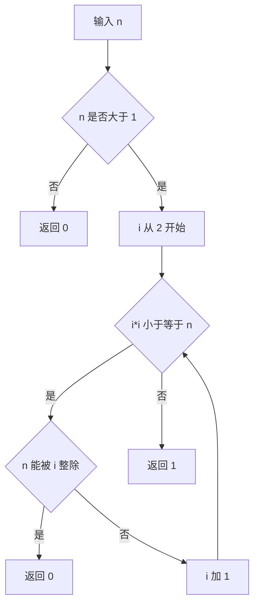

# 质数（素数）判断的经典算法实现

## 质数是什么

质数（素数）是大于 $1$，并且只能被 $1$ 和它本身整除的整数。例如 $2、3、5、7、11$ 都是质数；$1$ 不是质数，$4、9、15$ 也不是质数。

质数判断常用于循环、函数和数组综合题中，例如“统计数组中的质数元素”“找出不超过 $m$ 的所有质数”。

> [!IMPORTANT]
> 质数判断的核心结论：若 $n>1$ 不是质数，则它一定存在一个位于 $2\sim\sqrt n$ 的因子。

## 为什么只需检查到 $\sqrt n$

如果 $n=ab$，其中 $a,b>1$，那么 $a$ 和 $b$ 中至少有一个不大于 $\sqrt n$。因此，只需检查 $2$ 到 $\sqrt n$ 是否存在能够整除 $n$ 的数。



循环条件写成 `i * i <= n`，可以避免调用 `sqrt()` 时可能出现的浮点精度问题。

## 经典函数实现

按照课件约定，可定义函数：

```c
int prime(int n)
{
    int i;

    if (n <= 1)
        return 0;

    for (i = 2; i * i <= n; i++) {
        if (n % i == 0)
            return 0;
    }

    return 1;
}
```

其中：

- `n <= 1` 时，$n$ 不是质数；
- `n % i == 0` 表示 $n$ 能被 $i$ 整除；
- 一旦找到这样的 $i$，立即返回 `0`；
- 循环结束仍未找到，说明 $n$ 是质数，返回 `1`。

> [!TIP]
> 记忆口诀：先排一和二，再从二试；试到平方止，余数非零是质数。

## 判断 17 的过程

以 $n=17$ 为例，需要检查的除数只有 $2、3、4$：

| 除数 $i$ | $17 \bmod i$ | 能否整除 |
|---|---:|---|
| 2 | 1 | 否 |
| 3 | 2 | 否 |
| 4 | 1 | 否 |

由于 $4\times4=16\le17$，而 $5\times5=25>17$，循环结束，所以 $17$ 是质数。

> [!NOTE]
> 虽然 $4$ 并不是质数，但检查它并不会影响正确性；程序也可以进一步优化，只检查 $2$ 和 $2$ 以上的奇数。

## 找出范围内的所有质数

判断单个整数需要一层循环；寻找一个范围内的所有质数通常需要两层循环：外层枚举候选数，内层调用质数判断函数。

```c
#include <stdio.h>

int prime(int n)
{
    int i;
    if (n <= 1)
        return 0;

    for (i = 2; i * i <= n; i++)
        if (n % i == 0)
            return 0;

    return 1;
}

int main(void)
{
    int n, i, count = 0;

    scanf("%d", &n);
    for (i = 2; i <= n; i++) {
        if (prime(i)) {
            printf("%d ", i);
            count++;
        }
    }

    printf("\n%d\n", count);
    return 0;
}
```

若题目要求把质数存入数组，则先定义数组和计数器；每找到一个质数，就执行 `array[count++] = i`。

> [!WARNING]
> 常见错误包括：把 $1$ 当成质数；循环条件写成 `i < n`；漏写取模运算 `n % i`；把“不是质数”误返回为 `1`；数组下标与质数个数未正确对应。

> [!CAUTION]
> 不建议仅写成 `if (n % 2 == 0)`，因为它只能排除偶数，无法排除 $9、15、21$ 等奇合数。
