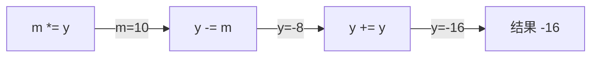

# 赋值运算符及复合赋值运算符

## 赋值运算符

赋值运算符 `=` 是把右侧表达式的值存入左侧变量。注意它不是数学里的“相等”，而是一个**动作**：先算右边，再存进左边。

```c
int a;
a = 3 + 5;   // 先算 3+5 得到 8，再把 8 存入 a
```

赋值表达式本身也有值——就是**赋值完成后左侧变量的值**。这一点在连续赋值和嵌入条件判断时经常用到。

```c
int a, b;
a = b = 10;
```

由于赋值运算符是**右结合**的，`a = b = 10` 等价于 `a = (b = 10)`。先执行 `b = 10`，这个表达式的值为 `10`，再赋给 `a`，最终 `a` 和 `b` 都是 `10`。

> [!IMPORTANT]
> 赋值表达式的值等于赋值后左侧变量的值，类型与左侧变量一致。

## 复合赋值运算符

形如 `+=`、`-=`、`*=`、`/=`、`%=` 的运算符称为复合赋值运算符。它们把“运算”和“赋值”合并为一步：

$$a \; op= expr \quad \Leftrightarrow \quad a = a \; op \; (expr)$$

其中 `op` 可以是 `+ - * / %` 等。括号不是可有可无的装饰——**右侧整个表达式先作为整体参与运算**，这是初学者最常掉进去的坑。

| 写法 | 等价展开 |
|------|----------|
| `a += b` | `a = a + (b)` |
| `a -= b` | `a = a - (b)` |
| `a *= b + c` | `a = a * (b + c)` |
| `a /= b - c` | `a = a / (b - c)` |

> [!WARNING]
> `a *= b + c` **不是** `a = a * b + c`，而是 `a = a * (b + c)`。漏掉这个隐式括号，结果完全不一样。

再看一题：设 `a = 6`，求 `a += a - a * a` 后 `a` 的值。

按展开规则：

1. `a += a - a * a` 等价于 `a = a + (a - a * a)`
2. 括号内：`a * a` 得 `36`，`6 - 36` 得 `-30`
3. 最终：`a = 6 + (-30) = -24`

所以答案是 `-24`，不是 `-30`——忘了加原来的 `a` 就会得到错误结果。

## 多个赋值连续出现时

当多个复合赋值连在一起，**结合性从右向左**，右侧表达式先算。

```c
int m = 5, y = 2;
y += y -= m *= y;
```

逐步拆解：



1. `m *= y`：`m = 5 * 2 = 10`，表达式值为 `10`
2. `y -= 10`：`y = 2 - 10 = -8`，表达式值为 `-8`
3. `y += (-8)`：`y = -8 + (-8) = -16`

> [!CAUTION]
> `y += y -= m *= y` 中右边的 `y` 在第二步已经变为 `-8`，第三步用的是**更新后**的 `y`，而不是最初的 `2`。赋值运算会实时修改变量值，后续运算看到的是新值。

## 复合赋值与整数除法

复合赋值的运算规则和普通运算完全一样。如果操作数都是整数，`/=` 执行的就是**整数除法**，小数部分直接截断。

```c
int a = 10;
a /= 4;      // a = 10 / 4 = 2
```

> [!TIP]
> `a /= b` 中只要 `a` 和 `b` 都是 `int`，结果就是整数除法。想得到小数，需先把操作数转为 `float` 或 `double`。

## 弄清赋值和判断的区别

`=` 是赋值，`==` 是判断相等。错把 `==` 写成 `=` 不一定会编译报错，因为赋值表达式也有值，可以放在 `if` 里——这正是很多隐蔽 bug 的来源。

```c
if (a = c)   // 赋值，不是判断！表达式值为 c，c 非 0 则条件为真
```

如果本意是“判断 a 是否等于 c”，这里必须写 `if (a == c)`。
