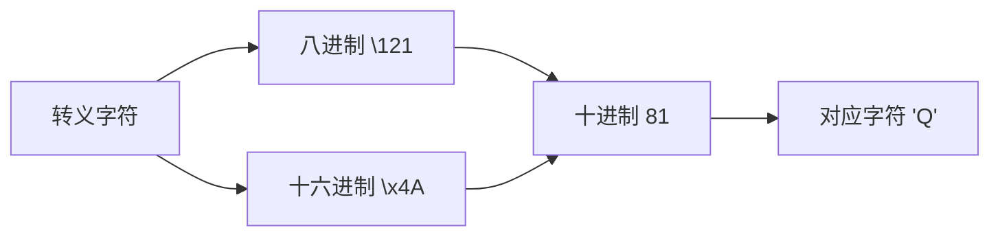

# 转义字符及其进制表示
字符常量是用一对单引号 `''` 括起的单个字符，如 `'A'`、`'a'`、`'0'`、`'\n'`。但键盘上能直接敲出的字符有限，遇到换行、制表符、引号本身，或者想用一个整数编码直接表示字符时怎么办？==转义字符就是以右斜杠 `\` 开头、用来表示那些无法直接书写或具有特殊控制含义的字符==，它仍然是"单个字符"，只占 1 个字节。

C 语言中转义字符有三种形式，课件要求必须掌握：

| 形式 | 含义 | 合法字符范围 | 示例 |
|------|------|------------|------|
| `\` + 字母 | 控制字符 | 特定字母 | `'\n'`（换行，ASCII 10） |
| `\` + 1~3 位八进制数 | 八进制 ASCII 码 | 数字 `0`~`7` | `'\121'`（即 `'Q'`） |
| `\x` + 1~2 位十六进制数 | 十六进制 ASCII 码 | `0`~`9`、`a`~`f` | `'\xa5'` |

> [!IMPORTANT]
> 字符常量的大小就是其 ASCII 码值的大小。必须记住：`'A'`=65、`'a'`=97、`'0'`=48、`'\n'`=10。大小写转换：`ch = ch - 32`（小写转大写），`ch = ch + 32`（大写转小写）。

## 三种进制表示怎么换算

八进制和十六进制转义本质上是==用 ASCII 码的数值直接写出字符==。换算路径如下：

例如 `'\121'`：$1\times 8^2 + 2\times 8^1 + 1 = 81$，查表得 `'Q'`。再如 `'\x4A'`：$4\times 16 + 10 = 74$，即 `'J'`。

> [!TIP]
> 判断合法性先看进制范围：八进制只含 `0`~`7`，十六进制含 `0`~`9` 和 `a`~`f`。`\483` 中出现 `8`，直接判错，不需要算值。

## 与字符串存储的关系

转义字符在字符串中同样适用，且==字符串在内存中自动在末尾追加结束符 `'\0'`==，它也要占 1 个字节。这是南邮考试的高频考点。

以 `strlen("a\012b\xab\0cd\n")` 为例逐步拆解：

| 写法 | 实际字符 | 占字节 |
|------|---------|--------|
| `a` | `'a'` | 1 |
| `\012` | 八进制 10，即 `'\n'` | 1 |
| `b` | `'b'` | 1 |
| `\xab` | 十六进制 AB | 1 |
| `\0` | 字符串结束符 | 1（但 `strlen` 到此为止） |
| `cd\n` | 不统计 | — |

`strlen` 遇到 `'\0'` 就停止，因此结果为 **4**，选 A。

> [!WARNING]
> 常见误区：`'a'` 是字符常量，占 1 字节；`"a"` 是字符串常量，含 `'a'` 和 `'\0'`，占 **2 字节`。二者类型不同，不可混用。

> [!CAUTION]
> `'\191'` 是非法字符常量：单引号内只能有一个字符，`\191` 虽由转义符引导，但数值 191 超出标准 ASCII 范围（0~127），且部分编译器会报错。写代码时务必确认转义值在合法区间内。
