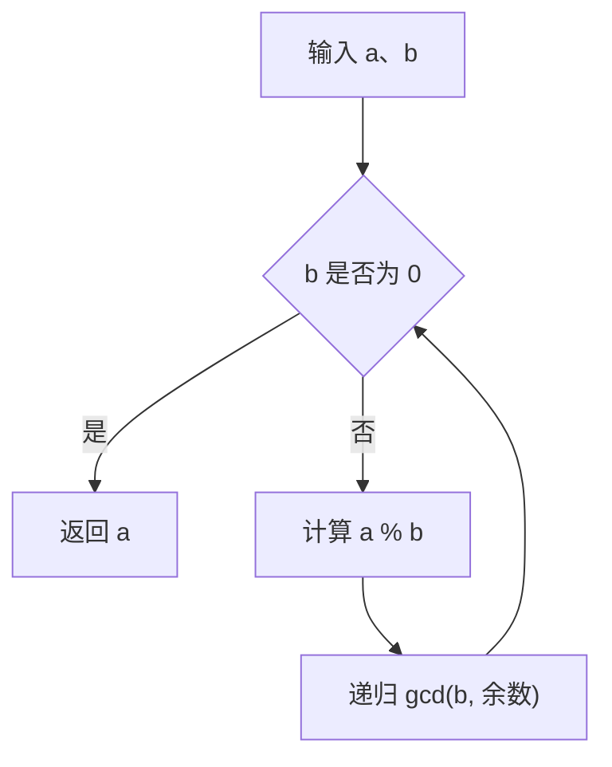

# 用辗转相除法求最大公约数

## 辗转相除法：为什么不用“逐个试除”

求最大公约数（GCD）时，最容易想到的是从 $\min(a,b)$ 开始往下试，找到第一个能同时整除 $a,b$ 的数。但辗转相除法更快，它只反复做一件事：**用余数缩小问题规模**。

核心依据是：

$$
\gcd(a,b)=\gcd(b,a\bmod b)
$$

因为若 $a=bq+r$，则 $a$ 与 $b$ 的公约数，也一定是 $b$ 与 $r$ 的公约数；反过来也成立。于是每次把较大的数换成余数，直到余数为 $0$，此时的除数就是最大公约数。

> [!IMPORTANT]
> ==当 $b=0$ 时，$\gcd(a,0)=a$==，这就是递归出口；否则继续求 $\gcd(b,a\bmod b)$。



## 递归函数怎么写

考试题要求“编写递归函数”，可以直接把上面的递推关系翻译成 C 语言：

```c
#include <stdio.h>

int gcd(int a, int b)
{
    if (b == 0)
        return a;
    else
        return gcd(b, a % b);
}

int main(void)
{
    int a, b;
    scanf("%d%d", &a, &b);
    printf("%d\n", gcd(a, b));
    return 0;
}
```

这里 `gcd(b, a % b)` 同时完成了两件事：把 $b$ 作为新的被除数，把 $a\bmod b$ 作为新的除数。每次递归都让第二个参数变小，最终会到达 `b == 0`。

## 一个算对的例子

以求 $\gcd(48,18)$ 为例：

| 递归调用 | 计算余数 | 下一步 |
|---|---:|---|
| $\gcd(48,18)$ | $48\bmod18=12$ | $\gcd(18,12)$ |
| $\gcd(18,12)$ | $18\bmod12=6$ | $\gcd(12,6)$ |
| $\gcd(12,6)$ | $12\bmod6=0$ | $\gcd(6,0)$ |
| $\gcd(6,0)$ | 满足递归出口 | 返回 $6$ |

所以 $\gcd(48,18)=6$。注意最后返回的是 ==$b=0$ 时的 $a$==，不是最后一次计算的余数 $0$。

## 和相近概念的区别

| 概念 | 含义 | 与辗转相除法的关系 |
|---|---|---|
| 最大公约数 GCD | 能同时整除两数的最大正整数 | 本算法直接求它 |
| 最小公倍数 LCM | 两数公倍数中的最小正整数 | 可由 $\operatorname{lcm}(a,b)=\dfrac{|ab|}{\gcd(a,b)}$ 求得 |
| 更相减损术 | 反复用较大数减较小数 | 思想相近，但通常比取余慢 |

> [!WARNING]
> 常见错误有三类：把递归出口写成 `a == 0`；误写为 `gcd(a % b, b)`，导致参数顺序不符合递推式；忘记余数最终为 $0$ 时应返回当前的 `a`。

> [!TIP]
> 记忆口诀：==大数取余变小数，小数接棒再取余；余数为零看除数==。若题目默认输入为正整数，上述写法即可；若允许负数，可在调用前用 `abs` 统一转为非负数，并注意 `0` 与 `0` 的最大公约数通常不讨论。
