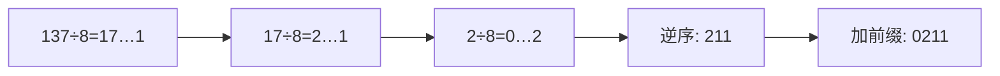

# 二进制等进制问题与转换

## 为什么计算机偏爱二进制

计算机底层由开关电路构成，只有“通/断”两种状态，天然对应二进制的 0 和 1。但人类习惯十进制，书写长串二进制又极易出错，于是引入了==八进制与十六进制作为二进制的“缩写”==。它们与二进制存在 $2^3=8$、$2^4=16$ 的幂次关系，转换时无需复杂计算，只需按位分组映射。在 C 语言中，理解这套机制是掌握整型常量表示、字符编码及位运算的前提。

## 进制识别与合法常量

C 语言通过==前缀==区分整型常量的进制，这是编译器解析代码的第一道关卡：

| 进制 | 前缀标识 | 合法数字范围 | 示例 |
| :--- | :--- | :--- | :--- |
| 十进制 | 无 | 0–9 | `137` |
| 八进制 | `0`（数字零） | 0–7 | `0211` |
| 十六进制 | `0x` 或 `0X` | 0–9, a–f/A–F | `0xa5` |

> [!WARNING]
> `068` 是非法常量！以 `0` 开头即被判定为八进制，而数字 `8` 超出八进制合法范围，编译将直接报错。

## 转换方法：除基取余与按权展开

进制转换的核心问题是：如何在不同基数间保持数值相等？

**十进制 → 二/八/十六进制**采用“除基取余，逆序排列”。以真题为例，将十进制 $25$ 转为八进制：
$$
25 \div 8 = 3 \dots 1 \\
3 \div 8 = 0 \dots 3
$$
余数逆序读取为 $31$，加上前缀得 `031`。转十六进制同理：$25 \div 16 = 1 \dots 9$，结果为 `0x19`。

**二/八/十六进制 → 十进制**采用“按权展开求和”。例如八进制 `0211` 转十进制：
$$
2 \times 8^2 + 1 \times 8^1 + 1 \times 8^0 = 128 + 8 + 1 = 137
$$

> [!TIP]
> 二↔八/十六转换无需经过十进制：二进制每 ==3 位==对应一位八进制，每 ==4 位==对应一位十六进制。如 `1000` 补齐为 `1000`，直接映射十六进制 `8`，比先转十进制再转十六进制快得多。

## 字符常量中的进制陷阱

转义字符本质是用进制表示 ASCII 码值，形式不同但内核一致：

-   `'\n'`：助记符形式，ASCII 码为 10
-   `'\121'`：==八进制==转义，对应十进制 $1\times64+2\times8+1=81$，即字符 `'Q'`
-   `'\xa5'`：==十六进制==转义，对应十进制 165

> [!IMPORTANT]
> 字符常量的大小就是其 ==ASCII 码值==。记住四个锚点：`'A'=65`、`'a'=97`、`'0'=48`、`'\n'=10`。大小写转换即加减 32，数字字符转数值即减 `'0'`。

## 一个算对了的例子

回顾经典考题：整型常量 137 的八进制表示是什么？

验证：$2\times8^2+1\times8^1+1\times8^0=137$ ✓。注意输出时必须带前缀 `0`，填空答案写 `0211` 而非 `211`，否则可能被判定为十进制数而失分。
