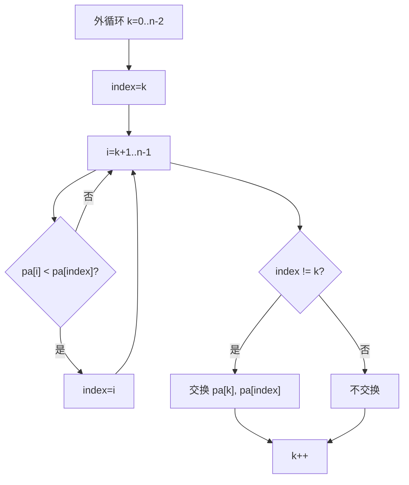

# 选择排序算法的实现

## 它是什么

在“第6章 数组”里，==选择排序（selection sort）== 是一种对一维数组按关键字（如整数大小、姓名字符串）由小到大重排的算法。南邮课件常写成：每一趟在“待排区间”里选出最小元素下标，再和区间首元素交换。

为什么需要它？冒泡排序一趟趟相邻交换太啰嗦；而选择排序每趟只交换一次，逻辑更直白，也正好用“数组 + 指针 + 下标”练手，所以考试频繁出现。

## 怎么做

先用一句话想清楚：

> 若数组有 $n$ 个元素，第 $k$ 趟（$k$ 从 $0$ 到 $n-2$）要在下标 $k\sim n-1$ 中找最小值位置 `index`，若 `index != k` 才交换。

流程图如下：



对整数升序，核心比较就是 `if (pa[i] < pa[index]) index = i;`；若按姓名字符串升序，则要用 `strcmp(pa[i].name, pa[index].name) < 0`。

## 和相近概念的区别

| 算法 | 每趟动作 | 交换次数 | 适合练什么 |
| --- | --- | --- | --- |
| 选择排序 | 选最小再放位 | 最多 $n-1$ 次 | 下标扫描、结构体 |
| 冒泡排序 | 相邻逆序就换 | 可能很多次 | 双重循环边界 |

> [!NOTE]
> 选择排序“找最小”是==一趟只定一个最终位置==，不是把小的往前“冒”。

## 常见的坑

> [!WARNING]
> 外循环写到 $i<n$ 会越界访问 `pa[n]`；必须是 $k \le n-2$。
>
> [!CAUTION]
> 忘记 `index != k` 判断仍可运行但多写无效交换；结构体排序用 `=` 整体赋值是可以的，但字符串比较**不能**用 `<`，要用 `strcmp`。

> [!TIP]
> 口诀：`==外定位、内找小、不同才换==`。

## 一个算对了的例子

考题要写：

```c
void sort(employee *pa, int n) {
    int k, i, index;
    employee t;
    for (k = 0; k < n - 1; k++) {
        index = k;
        for (i = k + 1; i < n; i++)
            if (strcmp(pa[i].name, pa[index].name) < 0)
                index = i;
        if (index != k) {
            t = pa[k]; pa[k] = pa[index]; pa[index] = t;
        }
    }
}
```

若 `n=3`，姓名为 `"li"`,`"an"`,`"chen"`：第0趟选 `"an"` 换到前，第1趟选 `"chen"`，结果 `an, chen, li`，正确。
