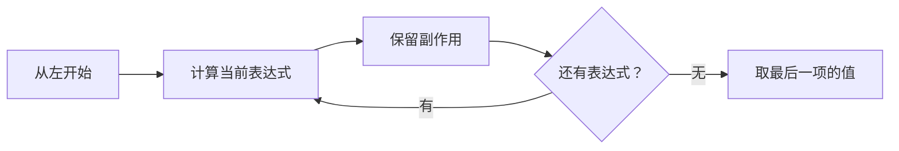

# 逗号运算符与逗号表达式

## 逗号运算符与逗号表达式

逗号运算符 `,` 是 C 语言中优先级最低的运算符，用于把多个表达式按顺序连接起来。由它构成的表达式称为**逗号表达式**，一般形式为：

$$\text{表达式1},\ \text{表达式2},\ \ldots,\ \text{表达式n}$$

计算时，==从左到右依次计算各子表达式，整个逗号表达式的值和类型由最后一个子表达式决定==。前面的表达式即使结果没有被使用，其赋值、自增等副作用仍然有效。

> [!IMPORTANT]
> 逗号表达式的核心规则是：**顺序计算，取最右值；中间过程，副作用保留。**

## 为什么需要它

逗号表达式可以把多个相关操作写在一个表达式中，常用于 `for` 语句的初始化和更新部分，例如：

```c
for (i = 0, j = 10; i < j; i++, j--)
```

这里 `i = 0, j = 10` 同时初始化两个变量，`i++, j--` 同时更新两个变量。它并不是为了提高计算速度，而是为了让相关操作集中书写。

## 怎样正确求值

可以按下面的顺序处理：



例如课件中的表达式：

```c
a = (b = 1 + 2, 3 * b)
```

先算 `b = 1 + 2`，得到 `b = 3`；再算 `3 * b`，得到 `9`。因此括号内逗号表达式的值为 `9`，再赋给 `a`，最终 `a = 9，b = 3`。

再看一个稍复杂的例子：

```c
int b, a = 10, n = 7;
a /= (b = 4, n %= b) + 1;
```

计算过程如下：

| 步骤 | 运算 | 结果与变量变化 |
|---|---|---|
| 1 | `b = 4` | `b` 变为 `4` |
| 2 | `n %= b` | 即 `n = 7 % 4`，`n` 变为 `3` |
| 3 | 取逗号表达式的值 | `(b = 4, n %= b)` 的值为 `3` |
| 4 | 加 `1` | 右侧整体为 `4` |
| 5 | `a /= 4` | 即 `a = 10 / 4`，整数除法得 `2` |

所以最终 `a` 的值为 `2`。

## 与相近写法的区别

逗号不一定都是逗号运算符，必须结合所在位置判断。

| 写法 | 逗号的作用 | 示例说明 |
|---|---|---|
| 逗号表达式 | 连接并顺序计算表达式 | `x = (a = 5, a * 2, a + 7)` |
| 函数实参列表 | 分隔不同实参 | `fun(x, y)` 有两个实参 |
| 变量声明 | 分隔变量 | `int a, b;` |
| `for` 语句内部 | 常作为逗号运算符 | `i++, j--` |

例如：

```c
func((exp1, exp2), exp3, (exp4, exp5));
```

外层逗号分隔实参，括号内的逗号才构成逗号表达式。因此三个实参依次是 `(exp1, exp2)`、`exp3` 和 `(exp4, exp5)`，==实参总数为 3==。

## 常见的坑

> [!WARNING]
> 不要只取最后一项而跳过前面的计算。`x = (a = 5, a * 2, a + 7)` 中，虽然 `a * 2` 的结果没有使用，但 `a = 5` 必须执行，所以最后一项为 `5 + 7 = 12`，整个赋值表达式的值也是 `12`。

> [!CAUTION]
> 逗号运算符优先级最低。`x = a, b` 应理解为 `(x = a), b`，不是 `x = (a, b)`。若要把整个逗号表达式的值赋给变量，通常必须加括号。

还要注意最后一项本身的求值规则。例如 `d` 为 `double` 型时：

```c
d = 2, d = 4, d++
```

依次执行后，`d++` 先取旧值 `4.0` 作为该子表达式的值，再使 `d` 变为 `5.0`。因此==整个逗号表达式的值是 `4.0`，而 `d` 的最终值是 `5.0==`。

> [!TIP]
> 解题口诀：**括号先定界，从左逐项算；赋值自增要保留，最后才取表达式值。**
