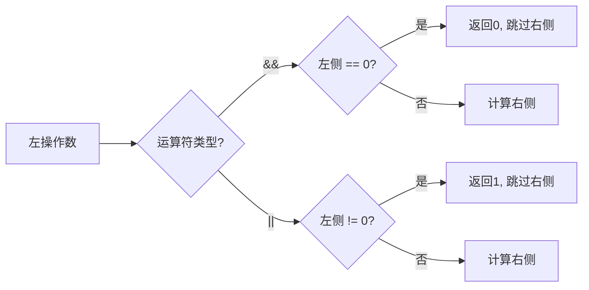

# 逻辑运算中的短路现象

## 什么是逻辑短路

在 C 语言中，`&&`（逻辑与）和 `||`（逻辑或）运算并非总是计算所有操作数。当左侧表达式的值已经能够==唯一确定整个逻辑表达式的结果==时，编译器将跳过右侧表达式的计算，这种现象称为“短路求值”（Short-Circuit Evaluation）。

为什么需要这种机制？除了提升运行效率外，它更是实现安全访问（如指针判空）和控制副作用执行顺序的关键手段。若不理解短路，不仅会误判表达式结果，还可能导致变量未被预期修改。

## 短路规则与执行流程

两种逻辑运算符的短路触发条件截然不同：

| 运算符 | 左侧值为 | 是否计算右侧 | 最终结果 |
| :--- | :--- | :--- | :--- |
| `&&` | 0 (假) | ❌ 跳过 | 0 |
| `&&` | 非0 (真) | ✅ 计算 | 取决于右侧 |
| `\|\|` | 非0 (真) | ❌ 跳过 | 1 |
| `\|\|` | 0 (假) | ✅ 计算 | 取决于右侧 |

> [!IMPORTANT]
> 短路求值是 C 语言的==语法规定==，而非编译器的可选优化。任何符合标准的编译器都必须保证右侧被跳过时，其副作用（如自增、赋值、函数调用）绝不发生。

## 真题中的短路陷阱

以复习题选择 7 为例：设 `int x = -1;`，执行 `++x || ++x || ++x` 后，`x` 的值是多少？

许多同学误以为三个 `++x` 都会执行而选 A(3)，但正确答案是 **C(1)**。推导如下：

1.  先算第一个 `++x`：`x` 变为 0，表达式值为 0（假）。
2.  `||` 左侧为 0，==不能短路==，必须计算第二个 `++x`。
3.  第二个 `++x`：`x` 变为 1，表达式值为 1（真）。
4.  `||` 左侧为 1，==触发短路==，第三个 `++x` 被完全跳过。
5.  最终 `x = 1`。

> [!WARNING]
> 切勿将“关系运算符链式写法”与短路混淆。例如 `a < b < c` 中 `<` 是左结合的，等价于 `(a < b) < c`，这里==不存在短路==，而是数学语义错误。只有 `&&` 和 `||` 才具备短路特性。

## 与按位运算的区别

初学者常将逻辑运算与按位运算混淆，二者在短路行为上存在本质差异：

| 对比维度 | 逻辑运算 `&&` `\|\|` | 按位运算 `&` `\|` |
| :--- | :--- | :--- |
| 操作对象 | 整体真假（0/非0） | 逐二进制位 |
| 短路特性 | ✅ 有 | ❌ 无，两侧必算 |
| 返回值 | 仅 0 或 1 | 任意整数值 |
| 典型用途 | 条件判断、流程控制 | 掩码、标志位操作 |

> [!TIP]
> 解题口诀：“==与零或一才短路==”。即 `&&` 遇左 0 短路，`||` 遇左 1 短路；其余情况右侧必算。遇到含自增/赋值的逻辑表达式，务必逐步标记每个子表达式是否真正被执行。

## 一个完整正确的分析示例

回顾选择 6：`int a=3, b=5, m;` 执行 `(m = a<=3) && a+b<8` 后 `m` 的值。

-   先算 `a<=3` → `3<=3` 为真(1)，赋值给 `m`，故 `m=1`。
-   `&&` 左侧为 1，不短路，继续算 `a+b<8` → `8<8` 为假(0)。
-   整个表达式值为 0，但 ==`m` 已在短路判定前完成赋值==，不受影响。
-   答案：**B. 1**。

此例说明：短路只影响==右侧==是否执行，左侧的副作用永远发生。做题时应从左到右严格按优先级和结合性逐步推演，切忌凭直觉跳步。
