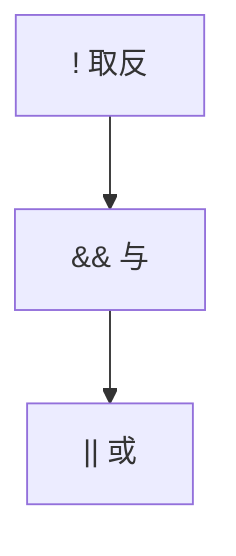
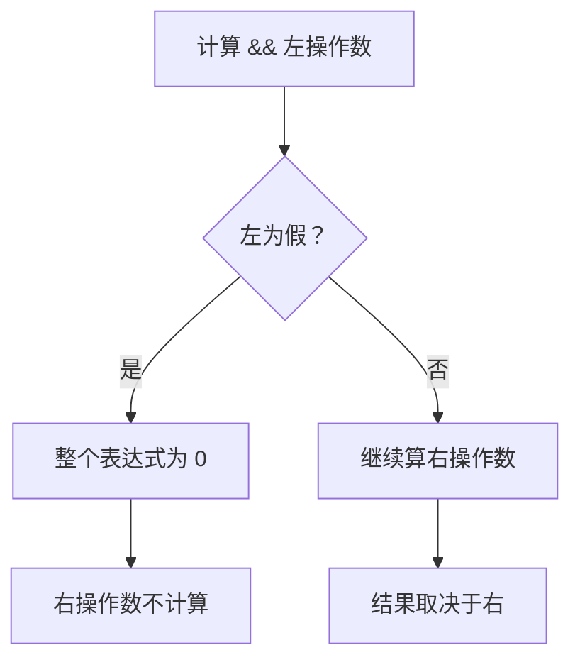

# 逻辑运算符与逻辑表达式
### 为什么需要逻辑表达式

程序里经常要同时判断多个条件。比如“某一年是闰年”，要满足两个条件之一：能被 400 整除，或者能被 4 整除但不能被 100 整除。这种“并且”“或者”“不是”的判断，单靠关系运算符（`>`、`<`、`==` 等）没法一步写出来，需要逻辑运算符把它们组合成==逻辑表达式==。

在 C 语言中，逻辑表达式的值只有两种情况：**真**（用 `1` 表示）和**假**（用 `0` 表示）。判断规则是：表达式的值非 `0` 即为真，等于 `0` 即为假。

> [!IMPORTANT]
> 逻辑运算的结果一定只有 `0` 或 `1`，不可能是其他整数。

### 三个逻辑运算符

| 运算符 | 名称 | 含义 | 优先级 |
|---|---|---|---|
| `!` | 逻辑非 | 取反：真变假，假变真 | 最高 |
| `&&` | 逻辑与 | 两个操作数都为真，结果才为真 | 居中 |
| `\|\|` | 逻辑或 | 两个操作数有一个为真，结果就为真 | 最低 |

三者的优先级顺序是：`!` 高于 `&&` 高于 `||`。

==逻辑非 `!` 是一元运算符==，只作用于一个操作数，所以它排在所有二元运算符前面。而 `&&` 和 `||` 都低于关系运算符，这样 `a < b && c > d` 会先算两个关系式，再算逻辑与——符合直觉。



### 优先级总览

逻辑运算符在整个运算符体系中的位置，大致如下：


考题里常问“优先级最高的是谁”，记住：==一元 `!` 的优先级高于 `&&`、`||` 和赋值类运算符==。

### 逻辑断路现象

这是 C 语言逻辑运算里最容易踩的坑。



- 对 `A && B`：如果 `A` 已经为假，整个表达式必为假，**`B` 不会被计算**。
- 对 `A || B`：如果 `A` 已经为真，整个表达式必为真，**`B` 不会被计算**。

> [!WARNING]
> 断路时被跳过的表达式若有赋值、自增等副作用，副作用不会发生。例如 `(m = a <= 3) && a + b < 8` 中，赋值 `m = a <= 3` 先执行；若它结果为 `0`，右侧 `a + b < 8` 不会计算；但赋值本身已经执行，`m` 的值已确定。

### 典型例子：判断小写字母

要判断字符 `ch` 是否是小写英文字母，正确写法是：

$$(\texttt{'a'} \le \texttt{ch}) \texttt{ \&\& } (\texttt{ch} \le \texttt{'z'})$$

**不能**写成：

$$\texttt{'a'} \le \texttt{ch} \le \texttt{'z'}$$

原因：关系运算符是左结合的。上式先算 `'a' <= ch`，得到一个 `0` 或 `1`，再拿这个结果和 `'z'` 比较。无论 `ch` 是什么字符，`0 <= 'z'` 或 `1 <= 'z'` 恒为真，==判断逻辑完全失效==。

### 算对一个题

设有：

```c
int a = 3, b = 5, m;
(m = a <= 3) && a + b < 8;
```

执行后 `m` 的值是多少？

逐步分析：

1. 先算括号内的赋值右侧：`a <= 3`，由于 `a` 是 3，`3 <= 3` 为真，结果是 `1`。
2. 赋值 `m = 1` 完成，此时 `m` 已经是 `1`。
3. `&&` 左侧的值为 `1`（真），所以需要计算右侧。
4. 右侧 `a + b < 8` 即 `3 + 5 < 8`，结果是 `8 < 8`，为假（`0`）。
5. 整个表达式值为 `1 && 0`，结果是 `0`。

但 `m` 的值在第二步已经确定为 `1`，后续计算不改变它。所以答案是 `1`。

> [!TIP]
> 做这类题先看赋值发生在哪个位置：`&&` 左侧的赋值一定执行；如果右侧还有赋值，就要先判断断路条件是否成立。

### 和 `=` 与 `==` 的区分

| 符号 | 含义 | 示例 | 表达式值 |
|---|---|---|---|
| `=` | 赋值 | `x = 3` | 赋完后 `x` 为 3，表达式的值也是 3 |
| `==` | 判等 | `x == 3` | 若 `x` 为 3 则为 `1`，否则为 `0` |
| `!` | 逻辑非 | `!x` | 等价于 `x == 0` |

`if (x)` 等价于 `if (x != 0)`；`if (!x)` 等价于 `if (x == 0)`。这是条件判断里最常见的简化写法。
