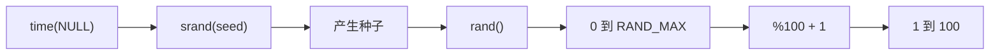

# 使用rand()函数产生随机数

## 随机数从哪里来

程序里很多场景需要“不可预测”的数据：模拟掷骰子、生成验证码、给数组填充测试数据。但计算机本身是确定性的机器——同样的输入永远产生同样的输出。`rand()` 解决的就是这个问题：它用一个递推公式，从上一个数算出下一个数，产生一串看起来杂乱无章、均匀分布的伪随机序列。

```c
#include <stdlib.h>   // rand、srand
#include <time.h>     // time
#include <stdio.h>

int main(void) {
    srand(time(NULL));
    for (int i = 0; i < 5; i++)
        printf("%d ", rand());
    return 0;
}
```

每次运行，`time(NULL)` 返回的当前秒数不同，种子不同，序列就不同。

> [!IMPORTANT]
> `rand()` 产生的是 ==伪随机数==：种子相同，序列完全一样。想让每次运行结果不同，必须先用 `srand(time(NULL))` 播种。

## 关键两步：srand 与 rand 如何配合



**`srand(unsigned int seed)`**：设置递推公式的起点，只调用一次，通常在 `main` 开头。

**`rand()`**：返回 `0` 到 `RAND_MAX`（至少 32767）之间的整数。每次调用自动更新内部状态。

## 映射到目标区间

`rand()` 范围太大，考试常见需求是 [1,100]，用的是取模加偏移：

```c
rand() % 100 + 1
```

- `rand() % 100` 产出 {0,1,…,99}
- 整体 `+1` 后变成 {1,2,…,100}

一般公式：若要把 `rand()` 映射到 `[a, b]`，写作 `rand() % (b - a + 1) + a`。

> [!WARNING]
> `rand() % n` 在 `n` 不能整除 `RAND_MAX+1` 时会引入轻微不均匀，但课程与考试范围内完全可接受。

## 一个算对了的例子

以南邮考试题为模板：用 `input` 函数生成 10 个 [1,100] 的随机数，排序后输出。

```c
#include <stdio.h>
#include <stdlib.h>
#include <time.h>
#define N 10

void input(int *ptr, int n) {
    for (int i = 0; i < n; i++)
        ptr[i] = rand() % 100 + 1;   // [1,100]
}

void output(int *ptr, int n) {
    for (int i = 0; i < n; i++)
        printf("%5d", ptr[i]);
    printf("\n");
}

int sort(int *ptr, int n) {
    for (int i = 0; i < n - 1; i++)          // 冒泡
        for (int j = 0; j < n - 1 - i; j++)
            if (ptr[j] > ptr[j + 1]) {
                int t = ptr[j];
                ptr[j] = ptr[j + 1];
                ptr[j + 1] = t;
            }
    return 0;
}

int main(void) {
    int arr[N];
    srand(time(NULL));   // 只需播种一次
    input(arr, N);
    printf("The former array:\n");
    output(arr, N);
    sort(arr, N);
    printf("The latter array:\n");
    output(arr, N);
    return 0;
}
```

一次运行可能输出：

```text
The former array:
   42   17   89    3   66   91   25    8   73   54
The latter array:
    3    8   17   25   42   54   66   73   89   91
```

## 常见坑

> [!CAUTION]
> 把 `srand(time(NULL))` 放进循环或函数里反复调用，如果同一秒内多次执行，种子相同，会产生重复序列。只调用一次，放在 `main` 开头。

> [!CAUTION]
> 忘记包含 `<stdlib.h>` 和 `<time.h>`，部分编译器会给出隐式声明警告，运行时可能得到错误结果。

> [!TIP]
> 考试常见写法：`srand(time(NULL));` 放 `main`；`rand()%100+1` 放生成函数；取模与加偏移写在一行，不要拆开多步再存。

`rand()` 本身不需要理解递推公式内部细节，掌握“==播种一次、取模加偏移、头文件齐全==”就能应对考试中的编程题。
