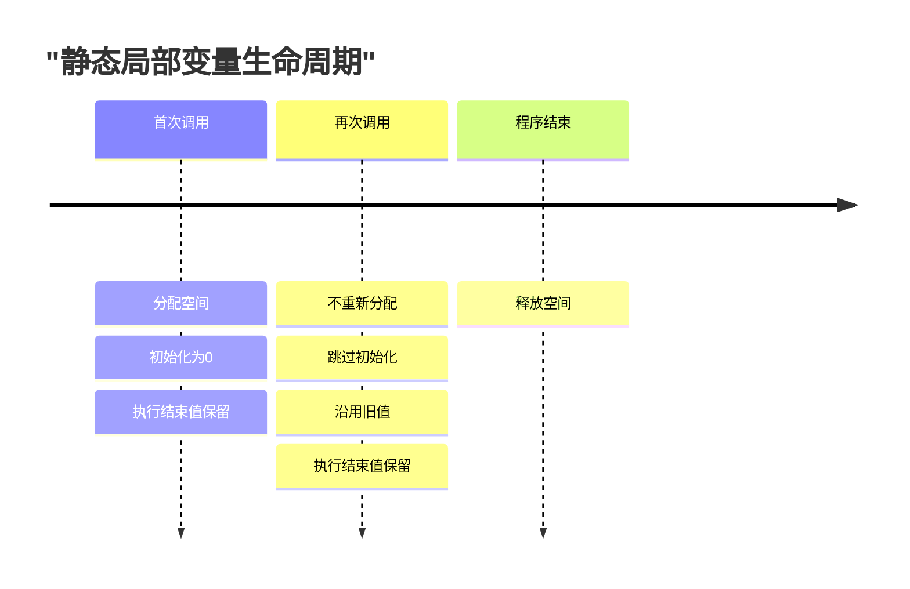

# 用static定义静态局部变量及其特点

> [!IMPORTANT]
> 在函数内部定义的变量，默认每次调用都会“重生”并丢失上次的值。如果希望一个局部变量在函数多次调用之间**记住上一次的结果**，该怎么办？

这就需要用到 `static` 关键字来定义==静态局部变量==。

## 它是什么与怎么做

在局部变量的类型前加上 `static`，该变量就从默认的自动变量（`auto`）变成了静态局部变量。

```c
void counter() {
    static int n = 0; // 静态局部变量
    n++;
    printf("%d\n", n);
}
```

静态局部变量有三大核心特点：

1. **存储位置**：存放在==静态存储区==，而不是栈区。
2. **初始化时机**：只在程序运行中==第一次进入作用域时初始化一次==，后续调用不再执行赋初值的语句。若未显式初始化，系统会自动将其初始化为 $0$（整型）或 $0.0$（浮点型）。
3. **生命期与作用域**：生命期延长至整个程序运行期间；但作用域依然局限在定义它的函数（或复合语句）内部。

用时间线来看它在多次调用中的状态变化：



## 为什么需要它

普通的 `auto` 局部变量在函数返回后就会被销毁，无法保存状态。如果不用全局变量（会破坏封装性、容易被意外修改），又想跨多次调用保留数据，`static` 局部变量就是最佳选择。例如统计某个函数被调用的次数，或者实现简单的状态机。

## 与相近概念的区别

考试中极易将静态局部变量与其他变量混淆，请对比下表：

| 比较维度 | 自动局部变量 (`auto`) | 静态局部变量 (`static`) | 外部变量 (全局变量) |
| :--- | :--- | :--- | :--- |
| **存储区** | 动态存储区（栈） | 静态存储区 | 静态存储区 |
| **生命期** | 函数调用期间 | ==整个程序运行期间== | 整个程序运行期间 |
| **作用域** | 定义所在的块 | 定义所在的块 | ==整个程序== |
| **未初始化默认值**| 不确定（垃圾值） | $0$ | $0$ |

> [!NOTE]
> 静态局部变量的“静态”指的是**存储期和生命期**的延长，而**不是**作用域的扩大。它的作用域与自动局部变量完全相同，出了函数依然不可见。

## 常见的坑

> [!WARNING]
> **读程序题的最大陷阱**：看到 `static int n = 0;` 就以为每次调用函数都会把 `n` 清零。请记住，赋值语句只在==首次调用==时执行！

> [!CAUTION]
> 不要误以为加了 `static` 就能在其他函数里访问这个变量。其他函数即使知道名字也无法直接访问它，因为它的==作用域没有改变==。

## 算对了的例子

结合南邮历年真题，我们来看看如何准确判断：

**【真题再现】** 下面关于静态局部变量的描述，不正确的是 \_\_\_\_。
A. 静态局部变量只做一次初始化
B. 静态局部变量的作用域为整个程序
C. 静态局部变量生命期与全局变量相同
D. 静态局部变量作用域与自动局部变量相同

**分析过程：**
- A 正确：仅在首次进入作用域时初始化。
- B 错误：==作用域仍局限于定义它的函数内部==，只是生命期延长了。
- C 正确：两者生命期都是从程序开始到结束。
- D 正确：两者的作用域都仅限于当前函数块。

因此答案选 **B**。

> [!TIP]
> **解题口诀**：`static` 局部变量是“寿命变长，地盘不变；不写初值，默认给零”。填空题问“未初始化自动为 $0$ 的局部变量存储类别”，直接填 `static`。
