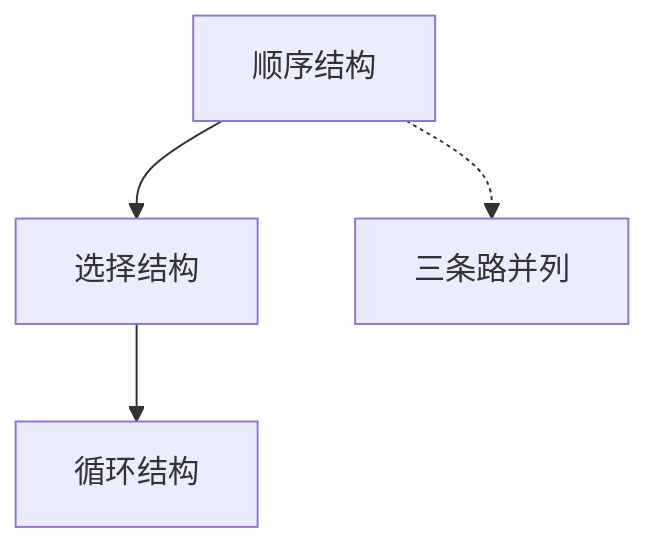

# 顺序结构程序设计

程序从头到尾一条条执行，中间不拐弯不回头——这种"直肠子"的写法就是**顺序结构**。它是三种基本控制结构中最简单、最基础的一种，也是读懂一切复杂程序的起点。想清楚一件事：不管代码多长，只要没有 `if`、`switch`、循环，它一定是顺序执行的。

## 三种基本结构

1966 年 Böhm 与 Jacopini 证明：任何算法都可以只用 ==顺序、选择（分支）、循环== 三种结构组合而成。这也是《高级语言程序设计》填空题反复考的送分点。



| 结构 | 控制语句 | 特点 |
| --- | --- | --- |
| 顺序结构 | 无 | 逐条执行 |
| 选择结构 | `if` / `switch` | 走一条分支 |
| 循环结构 | `while` / `for` / `do…while` | 反复执行 |

## 顺序结构的样子

```c
#include <stdio.h>
int main() {
    int a, b, sum;
    scanf("%d %d", &a, &b);   // 读入
    sum = a + b;               // 运算
    printf("%d\n", sum);       // 输出
    return 0;
}
```

三条语句 ==按书写顺序逐条执行==：`scanf` 先于 `sum = a + b`，后者又先于 `printf`。没有跳转，也没有回退。

## 常见的坑

> [!WARNING]
> 顺序结构的"陷阱"不在于执行顺序，而在于**变量必须先声明、先赋值再使用**。上面程序若删掉 `sum = a + b;`，`printf` 打出的就是随机垃圾值。

> [!TIP]
> 记忆口诀："**自上而下，逐条执行，不走回头路**。"遇到难读的程序，先用铅笔从 `main` 起点一行行划线走一遍，比死盯代码更有效。

## 与相邻知识点的分界

| 相近概念 | 区别 |
| --- | --- |
| 选择结构 | 顺序结构不分叉，选择结构会分叉 |
| 循环结构 | 顺序结构不回头，循环结构会回跳 |
| 复合语句 `{}` | 只是"打包"，不改变顺序执行 |

## 一个算对了的例子

题目："已知变量 `tf` 为整型，下列五个条件语句哪个与其他不等价？"答案是 **E**。推导过程本身就是顺序思维：

1. `if (tf)` 等价于 `if (tf != 0)`，故 A 与 C 同；
2. `if (tf == 0)` 与 `if (!tf)` 同，故 B 与 D 同，且恰是 A、C 的取反分支；
3. 只有 `if (tf == 1)` ==只在 `tf == 1` 时走分支==，`tf == 2` 等非 0 值会落空，与前四个不同。

> [!IMPORTANT]
> 三种基本结构 = **顺序、选择、循环**。顺序结构的执行规律是"自上而下、逐条执行"，这是后续所有流程控制的底座。
