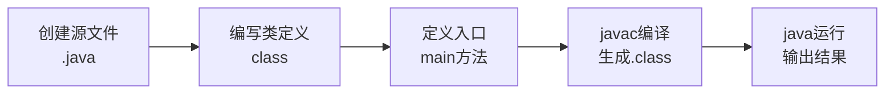

# 第一个Java程序（源文件创建、javac编译、类定义、main方法）

> [!IMPORTANT]
> 核心结论：每个 Java 应用程序都必须包含一个 `main` 方法，它是程序的执行入口。没有它，程序无法运行。

## 它是什么与为什么需要

写代码之前先想一个问题：计算机怎么知道从哪一行开始执行你的程序？

在 C 语言中是 `main()` 函数，而在 Java 中，==`main` 方法是 Java 应用程序的入口，由解释器进行调用==。当你执行命令 `java 类名` 时，Java 虚拟机（JVM）就会启动并寻找该类中的 `main` 方法来执行。

## 怎么做：从零到输出 Hello World

开发第一个 Java 程序分为四个关键步骤，流程如下：



### 源文件创建与类定义

用关键字 `class` 定义了一个类，类定义由 `{ }` 括起来。**类是 Java 的基本封装单元**，类中封装了类的变量和类的方法。

将以下代码保存为 `HelloWorldApp.java`：

```java
public class HelloWorldApp {
    public static void main(String args[]) {
        System.out.println("Hello World!");
    }
}
```

### javac 编译与运行

1. **编译**：在命令行输入 `javac HelloWorldApp.java`，将源代码编译成为 `.class` 字节码文件。
2. **运行**：输入 `java HelloWorldApp`，启动虚拟机执行该类中的 `main` 方法。

> [!TIP]
> 在 NetBeans 等 IDE 中，点击“运行”按钮会自动完成上述编译和运行的过程，但底层原理完全一致。

## 解剖 main 方法

课件要求 `main()` 方法必须用语句 `public static void main(String args[])` 定义。每个修饰符都有严格含义：

| 关键字 | 含义 | 为什么这么规定 |
| :--- | :--- | :--- |
| `public` | 公共的 | 表示 `main` 方法可以被任何一个对象调用，JVM 在外部才能访问到它 |
| `static` | 静态的 | 表示 `main` 方法是一个类方法，无需创建对象即可直接通过类名调用 |
| `void` | 无返回值 | 表示 `main` 方法没有返回值，因为它是起点，不需要向调用者返回数据 |
| `String args[]` | 参数 | 接收命令行传入的字符串数组参数 |

## 常见的坑

> [!WARNING]
> 虽然一个程序文件中可以有多个类，但**只能有一个 public 类**，该类为主类。且 ==主类名和程序文件名相同（包括字母的大小写）==。例如 `public class HelloWorldApp` 必须保存在 `HelloWorldApp.java` 中，否则 `javac` 会报错。

> [!CAUTION]
> 一个应用程序中可以有多个方法，但**只能有一个 `main()` 方法**。如果没有该方法，编译能通过，但运行时会提示“找不到或无法加载主类”。

> [!NOTE]
> 当源文件无 `package` 语句时，系统会给源文件创建一个无名包（缺省包），该 java 文件中定义的所有类都隶属于这个无名包。初学练习时通常先不写 `package`。

## 算对了的例子

根据课程作业要求，计算从 1 到 1000 的所有整数的和，并采用和 HelloWorld 程序相同的方式输出：

```java
public class SumApp {
    public static void main(String args[]) {
        // 选择合适的数据类型，1到1000的和为500500，int足够容纳
        int sum = 0; 
        for (int i = 1; i <= 1000; i++) {
            sum += i;
        }
        System.out.println(sum);
    }
}
```

> [!TIP]
> 提交作业时，务必确保截图中同时包含**源代码编辑窗口**和**结果输出窗口**，且命名严格遵守 `学号_姓名_第X次作业.JPG` 格式。
