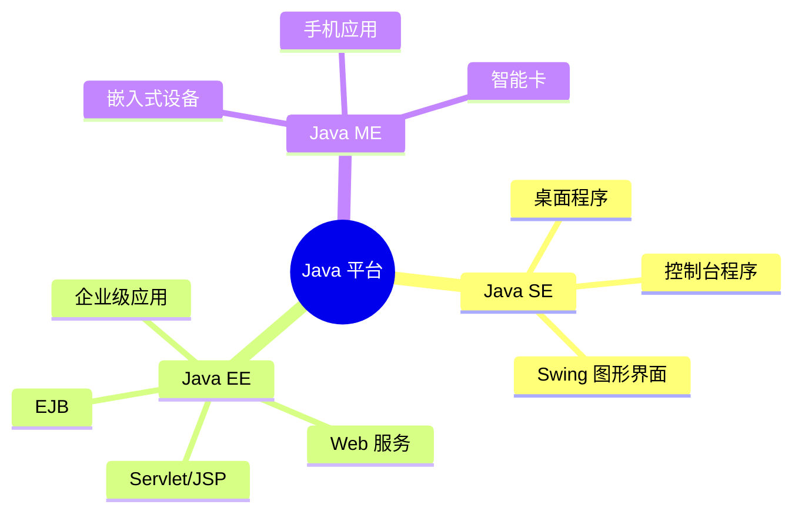

# Java SE、Java EE、Java ME的区别与应用领域

## Java SE、Java EE、Java ME 的区别与应用领域

在开始学习 Java 之前，你可能会注意到：同一个“Java”，在不同的资料里却分别被称为 Java SE、Java EE 或 Java ME。它们是三种不同的语言吗？其实不是——它们共享同一套 Java 语法和核心类库，区别在于==面向的应用场景和内置的 API 集合不同==。如果把 Java 语言比作一套基础工具，那么 Java SE、Java EE、Java ME 就是针对不同工作台面配置的三套工具箱。

### Java SE（Standard Edition）

Java SE 即 Java 标准版，是整个 Java 技术体系的==核心基础==。它提供了 Java 语言的基本语法、核心类库（如 `java.lang`、`java.util`、`java.io`）、JVM 虚拟机以及基础的 GUI 工具包（如 AWT、Swing）。无论你以后学习 Java EE 还是 Java ME，都必须先掌握 Java SE。

它的典型应用领域是==桌面程序和命令行控制台程序==。例如，一个用 Swing 编写的学生信息管理窗口程序，一个在终端运行的批处理工具，都属于 Java SE 的应用范畴。

> [!IMPORTANT]
> Java SE 是一切 Java 开发的地基。没有 Java SE，Java EE 和 Java ME 都无法运行，因为 JVM 和核心语法都定义在 Java SE 规范之中。

### Java EE（Enterprise Edition）

Java EE 即 Java 企业版，它在 Java SE 的基础上==额外提供了一整套面向服务器端和企业级应用开发的 API==。企业中常见的 Web 网站后端、分布式系统、消息队列、事务处理等场景，都离不开 Java EE 提供的组件与规范。

它包含的核心技术有：

| 组件/规范 | 作用 |
|---|---|
| Servlet | 处理 HTTP 请求与响应 |
| JSP | 动态生成网页内容 |
| EJB | 封装业务逻辑与事务管理 |
| JPA | 数据库对象关系映射 |
| Web Services | 跨系统服务调用 |

> [!TIP]
> 记忆口诀：**S**tandard 管桌面，**E**nterprise 管服务器，**M**icro 管小设备。

> [!NOTE]
> Java EE 不是一个独立的“版本”，它只是一组附加的 API 规范，实际运行时依然依赖于 Java SE 的 JVM。这一点在初学时容易被误解。

### Java ME（Mobile Edition / Micro Edition）

Java ME 即 Java 微型版，它针对==资源受限的嵌入式设备==（如早期的功能手机、智能卡、传感器、小家电等）做了裁剪和定制。Java ME 提供了相比 Java SE 更小的运行环境和类库集合，以便在内存和计算能力有限的设备上运行。

你可能会联想到早期的手机小游戏或者手机上的 Java 应用程序（Midlet），它们就是 Java ME 的典型应用。此外，Java 智能卡程序（Cardlets）也属于 Java ME 技术领域。

> [!WARNING]
> Java ME 和 Android 开发不是一回事。Android 虽然使用 Java 语言，但其运行在 Android Runtime（ART/Dalvik）上，并不是传统意义上的 Java ME 平台。

### 三者的核心区别

| 对比项 | Java SE | Java EE | Java ME |
|---|---|---|---|
| 定位 | 标准核心 | 企业级扩展 | 嵌入式裁剪 |
| 运行环境 | 桌面/服务器 JVM | 服务器 + Java EE 容器 | 嵌入式 JVM（KVM 等） |
| 典型应用 | 桌面程序、控制台 | 网站后端、分布式系统 | 手机、智能卡、小设备 |
| 典型技术 | `javax.swing`、`java.net` | Servlet、JSP、EJB、JPA | Midlet、Cardlet |

### 一个典型的考试题

**简答题：Java SE、Java EE、Java ME 指什么？各自的典型应用领域是什么？**

参考答案：

- ==Java SE（Java Standard Edition）== 主要用于桌面程序、控制台开发，是 Java 的标准核心版本，包含 Java 语言基础、JVM 和核心 API。
- ==Java EE（Java Enterprise Edition）== 是 Java 的企业级扩展，在 SE 之上提供 Servlet、JSP、EJB 等服务器端组件，用于企业级 Web 与分布式系统开发。
- ==Java ME（Java Mobile Edition）== 面向资源受限的嵌入式设备，用于手机、智能卡、小家电等嵌入式应用开发。

> [!CAUTION]
> 答题时不要把 Java EE 写成“比 Java SE 更高级的语言”。它们不是渐进的语言版本差异，而是面向不同应用场景的 API 集合扩展关系。

### 常见误区

- 以为 Java SE、EE、ME 是三套独立的编程语言——实际上==语法完全一样==，区别在于可用的类库和运行环境不同。
- 以为 Java EE 可以脱离 Java SE 单独安装运行——==不可以==，所有 Java EE 应用都必须运行在 Java SE 提供的 JVM 之上。
- 把 Android 开发归入 Java ME——Android 使用 Java 语言，但运行机制和类库体系独立于 Java ME。

明确这三个概念的区别后，后续学习中遇到的“为什么这个类在 SE 里有、在 ME 里没有”之类的问题，就有了清晰的判断依据。
