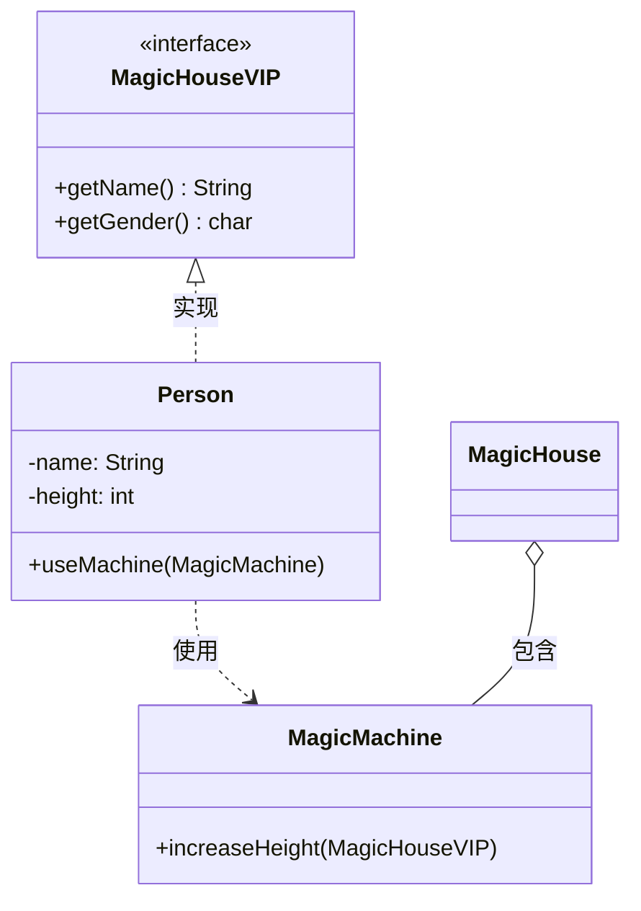

# UML主要模型（用例图、类图、时序图、状态图）

## UML 主要模型概述

在编写“魔法屋”这类面向对象程序前，你是否思考过：如何在不写一行代码的情况下，向他人清晰表达系统有哪些角色、类之间如何协作、对象状态如何变化？UML（统一建模语言）正是解决这一问题的==标准化可视化工具==。它将抽象的 OO 设计转化为四类核心模型，分别对应系统的不同视角。

> [!IMPORTANT]
> UML 不是画图任务，而是==面向对象设计的思维外化==。课件明确将模型分为功能模型（用例图）、静态结构模型（类图）和动态行为模型（时序图、状态图），考试与作业均要求先设计再编码。

## 四大模型定位与区别

| 模型 | 视角 | 核心问题 | 作业6关联点 |
| :--- | :--- | :--- | :--- |
| 用例图 | 用户/功能 | 谁用系统？做什么？ | VIP注册、使用机器 |
| 类图 | 静态结构 | 有哪些类？关系如何？ | MagicHouseVIP接口、Person类 |
| 时序图 | 交互顺序 | 消息何时传递？ | 小芳调用机器增高流程 |
| 状态图 | 对象生命周期 | 状态如何迁移？ | 会员：未注册→已注册 |

> [!NOTE]
> 类图描述==静态关系==，时序图描述==动态消息流==。两者互补：类图定义“有什么”，时序图说明“怎么用”。

## 类图关键：关联 vs 聚合

在“魔法屋”设计中，`MagicHouse` 与 `MagicMachine` 是什么关系？`Person` 与 `MagicHouseVIP` 接口又该如何表示？

- **关联（Association）**：普通结构联系，如 `Person` “使用” `MagicMachine`，用实线箭头表示。
- **聚合（Aggregation）**：弱拥有关系，如 `MagicHouse` “包含” `MagicMachine`，整体可独立于部分存在，用==空心菱形+实线==表示。

> [!WARNING]
> 聚合≠组合！组合是强拥有（实心菱形），部分不能脱离整体。作业中魔法屋与机器是聚合，因为机器可被替换或移除，而魔法屋仍存在。

## 实战示例：魔法屋类图设计

以作业6为例，正确类图应包含：

> [!TIP]
> 接口用 `<<interface>>` 标注，实现关系用==虚线空心三角箭头==；关联/聚合用实线。作业提交的设计图必须体现这些规范符号。

## 常见误区与避坑指南

- **混淆时序图与活动图**：时序图强调==对象间消息的时间顺序==，活动图描述业务流程。作业要求的是时序图。
- **忽略接口在类图中的表示**：`MagicHouseVIP` 必须作为独立接口元素，而非普通类。
- **状态图缺失触发条件**：如“注册会员”状态迁移必须标注事件 `register()`，否则不符合有限状态机规范。

> [!CAUTION]
> 作业6明确要求“先设计类图再编码”。若直接写代码再补图，极易遗漏接口约束或关系错误，导致违反开闭原则——这正是UML预防的核心问题。
