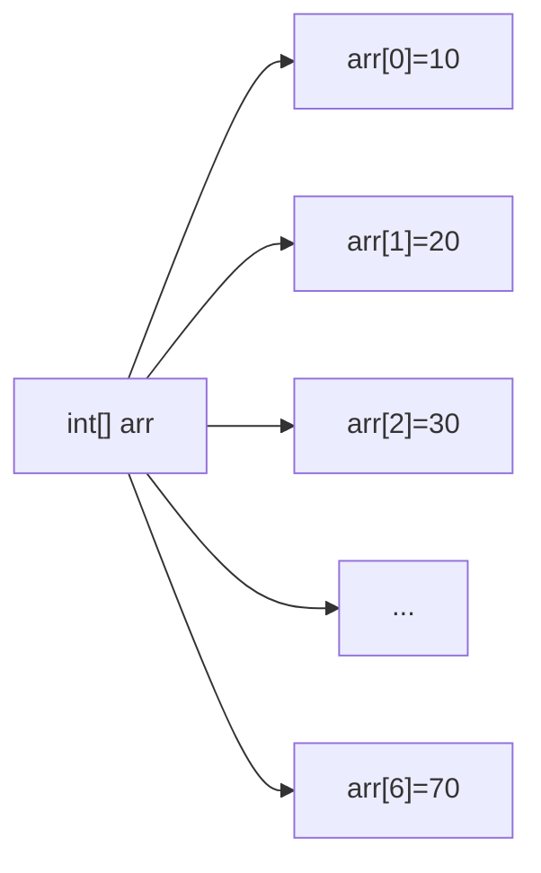

# 数组的声明、初始化、访问、数组复制及数组的数组

数组是**同类型元素的有序集合**，一旦创建，长度固定，通过下标（索引）访问。它解决了"用一个变量管理一批同类型数据"的问题——比如记录 100 名同学的成绩，不必声明 100 个变量。

## 数组的声明

声明只是**告诉编译器"有这么一个数组变量"**，此时还未分配内存空间。语法有两种等价写法：

```java
int[] MyIntArray;    // 类型在前，推荐
int MyIntArray[];    // 数组符号在后，C 风格
```

两者完全等价，但第一种写法更清晰，尤其在同时声明多个数组时不易混淆。

## 数组的初始化

数组初始化有三种常见方式：

```java
// ① 声明 + 用初始值直接初始化（系统自动确定长度）
int[] a = {10, 20, 30, 40, 50, 60, 70};

// ② 声明 + new + 逐元素赋值
int[] b = new int[3];
b[0] = 1;  b[1] = 2;  b[2] = 3;

// ③ 先声明，再用 new 创建
int[] c;
c = new int[4];
```

> [!IMPORTANT]
> 数组引用变量的默认值是 ==null==；`new` 创建后，若未逐元素赋值，所有元素自动获得其类型的默认值（`int`→0，`double`→0.0，`boolean`→false，引用类型→null）。

> [!WARNING]
> 局部数组变量使用前必须初始化（至少 `new` 一次），否则编译报错。方法参数和例外处理器参数不能用 `=` 直接初始化，只能通过调用时传参赋值。

## 数组访问

通过 **下标** 访问元素，下标范围是 $[0,\; \text{length}-1]$。数组自带只读属性 `length` 表示元素个数。

```java
int sum = 0;
for (int i = 0; i < MyIntArray.length; i++) {
    sum += MyIntArray[i];    // 逐元素累加
}
System.out.println(sum);     // 输出 280
```



> [!CAUTION]
> 下标越界会抛出 ==ArrayIndexOutOfBoundsException==。例如数组长度 7，访问 `arr[7]` 就会越界；==合法下标是 0 到 length-1==。

## 数组复制

Java 不支持数组整体赋值给另一个数组变量（`b = a` 只复制了引用），需要用系统方法：

| 方法 | 说明 |
|------|------|
| `System.arraycopy(src, srcPos, dest, destPos, length)` | 从源数组复制到目标数组 |
| `java.util.Arrays.copyOf(src, length)` | 复制并可指定新长度 |
| `java.util.Arrays.copyOfRange(src, from, to)` | 复制指定区间的元素 |

> [!NOTE]
> `b = a` ==不会创建新数组==，两个变量指向同一块内存；此后 `b[0] = 99` 也会改变 `a[0]`。只有 `copyOf` 等方法才会真正产生独立的新数组。

## 数组的数组（二维数组）

二维数组可以理解为"数组的数组"——外层数组的每个元素本身又是一个数组。适合表示矩阵。

```java
int[][] matrix = {
    {1, 2, 3},
    {4, 5, 6},
    {7, 8, 9}
};
int diagSum = 0;
for (int i = 0; i < matrix.length; i++) {
    diagSum += matrix[i][i];          // 主对角线
}
System.out.println(diagSum);           // 1 + 5 + 9 = 15
```

> [!TIP]
> 二维数组求主对角线之和：用下标 `matrix[i][i]`；求次对角线之和用 `matrix[i][n-1-i]`（$n$ 为列数）。这是考试常见考点。

## 算对了的例子

> **题目**：`int MyIntArray[] = {10, 20, 30, 40, 50, 60, 70};` 若执行 `MyIntArray[0]+MyIntArray[1]+MyIntArray[2]`，输出结果是？
>
> **解答**：下标从 0 开始，`MyIntArray[0]=10`、`MyIntArray[1]=20`、`MyIntArray[2]=30`，三者之和 $=10+20+30=60$。

> [!WARNING]
> 若题目换成 `MyIntArray[1]+MyIntArray[2]+MyIntArray[3]`，结果是 $20+30+40=\mathbf{90}$；换成 `MyIntArray[3]+MyIntArray[4]+MyIntArray[5]`，结果是 $40+50+60=150$。 ==务必数清下标==，这是填空题最常见的失分点。
