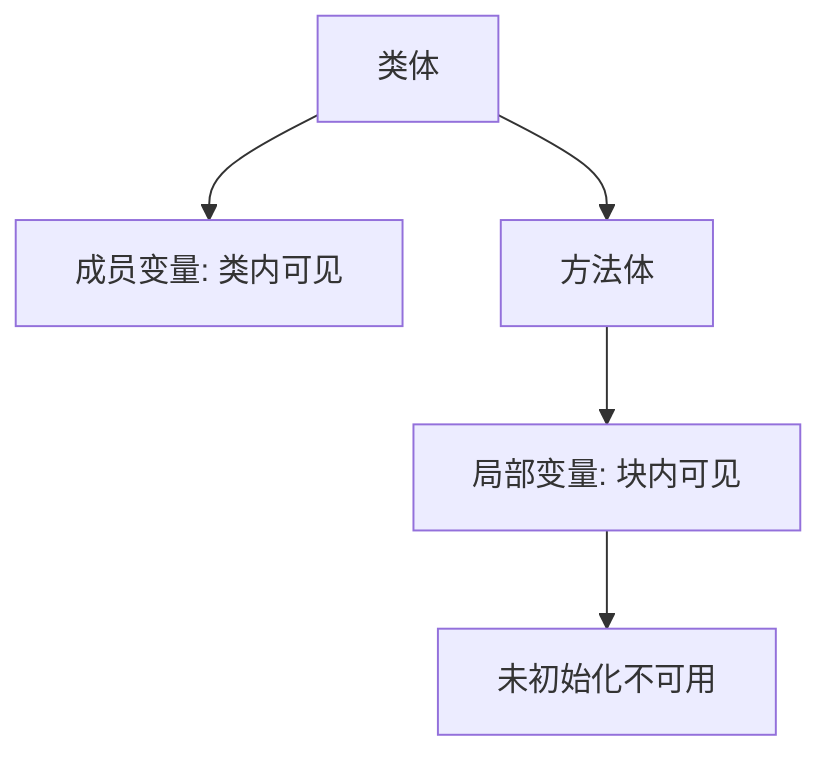

# 成员变量与局部变量的作用范围、默认值及final终止变量

## 它是什么

在 Java 类体里声明的变量叫==成员变量==（member variable），描述对象的数据状态；在方法、构造方法或代码块内部声明的变量叫==局部变量==（local variable）。成员变量定义格式为：`成员变量的修饰符 数据类型 成员变量名；`，如 `private double radius;`。局部变量没有访问控制修饰符，也没有 `static` 之类修饰（除 `final` 外）。

## 为什么需要区分

类要描述一类对象的共同属性（如 `Student` 的学号、姓名），必须把数据放在类体里作为成员变量，这样每个对象都有自己一份拷贝；而方法里临时计算用的中间结果，没必要也不该长期挂在对象上，所以放在栈帧里作为局部变量。作用范围不同，决定了你能在哪里访问它，以及谁负责给它初值。

## 作用范围与默认值

| 变量类型 | 作用范围 | 默认值 | 示例 |
|---------|---------|--------|------|
| 成员变量 | 整个类声明范围 | 有（0 / false / null） | `int age;` → 0 |
| 局部变量 | 从声明处到所属块结束 | 无，必须显式初始化 | `int p;` 后直接 `j=p;` 报错 |



## final 终止变量

被定义成 `final` 的变量==不能再改变值==。成员变量加 `final` 必须在声明或构造方法中赋初值；局部变量加 `final` 则赋值后不可改。`final` 和 `abstract` 不能同时修饰成员。

## 常见的坑

> [!WARNING]
> 局部变量没有默认值，未初始化就使用会产生编译错误。

看这道考题：
```java
class B {
    public static void main(String args[]) {
        int p;
        int j = 10;
        j = p;
    }
}
```
`p` 是局部变量，声明后没赋值，`j = p;` 让编译器报 “variable p might not have been initialized”，只有 1 处编译错误，选 A。若 `p` 是成员变量，则系统默认给它 0，不会出现这个错误。

> [!NOTE]
> 若局部变量或参数与成员变量同名，成员变量被屏蔽，可用 `this.成员变量` 访问，如 `this.radius`。

## 一个算对了的例子

布尔与字符赋值题：`boolean b2 = false;` 正确；`char c = 99;` 正确（99 对应字符 `'c'`）；而 `boolean b = -1;` 错，boolean 只能取 `true`/`false`；`int i = 019;` 错，八进制不含 9。答案为 B、D。局部变量即使赋这种字面值，也必须先写 `=` 初始化才能用。
