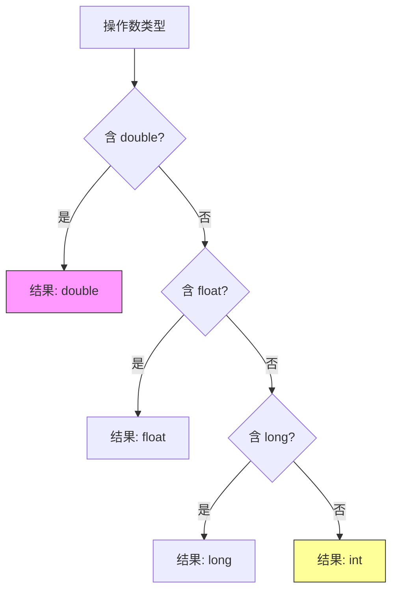

# 基本数据类型（整型、浮点型、字符型、布尔型）及Unicode编码

## 基本数据类型与 Unicode 编码

Java 语言具有==强类型==和==平台无关性==，这要求所有变量在使用前必须声明类型，且严格规定了各基本数据类型的位宽。理解这些类型是编写健壮代码的基础。

### 为什么需要区分类型？
计算机内存是有限的。如果存储一个小整数（如 10）却分配 64 位空间，会造成浪费；若存储大数却只给 8 位，则会溢出。Java 通过固定位宽（如 `int` 恒为 32 位）确保了程序在不同硬件上的行为一致（可移植性）。

### 核心类型概览
Java 共有 8 种基本数据类型，本章重点掌握以下四类：

| 类型 | 关键字 | 位数 | 取值范围/说明 | 默认值 |
| :--- | :--- | :--- | :--- | :--- |
| **整型** | `byte` | 8 | $-2^7 \sim 2^7-1$ | 0 |
| | `short` | 16 | $-2^{15} \sim 2^{15}-1$ | 0 |
| | `int` | 32 | $-2^{31} \sim 2^{31}-1$ | 0 |
| | `long` | 64 | $-2^{63} \sim 2^{63}-1$ | 0L |
| **浮点** | `float` | 32 | 单精度 | 0.0f |
| | `double` | 64 | 双精度（默认） | 0.0d |
| **字符** | `char` | 16 | Unicode `\u0000`~`\uFFFF` | `\u0000` |
| **布尔** | `boolean` | - | `true`, `false` | false |

> [!IMPORTANT]
> Java 中 `char` 采用 **Unicode 编码**（16 位），因此可以表示中文等全球字符，这与 C 语言的 ASCII（8 位）不同。

### 运算中的类型提升规则
当不同数据类型混合运算时，系统会自动进行类型提升。规则如下：



> [!WARNING]
> 1. **整数除法陷阱**：`int / int` 结果仍为 `int`（截断小数）。例如 `2/4` 结果为 `0`。若需保留小数，须强制转换：`(double)2/4` 得 `0.5`。
> 2. **取余限制**：虽然课件提到“只有整型才能取余”，但在现代 Java 中 `float/double` 也可取余，但考试常考整型语境。注意 `%` 操作数通常为整数。
> 3. **布尔隔离**：`boolean` 类型**不能**与 `int` 互转，也不能参与算术运算。`if(result != 0)` 是非法的，因为 `result` 是布尔值。

### 常见坑与辨析
*   **字面量格式**：`025` 是八进制（合法），`019` 是非法八进制（含数字 9）。
*   **字符赋值**：`char c = 99;` 是合法的，99 对应 ASCII/Unicode 字符 `'c'`。但 `char c = 'ab';` 非法，单引号只能包单个字符。
*   **Switch 穿透**：如考题所示，`switch` 若无 `break` 会顺序执行后续 case，可能导致逻辑错误甚至 `NullPointerException`。

### 典型示例
计算 1 到 1000 的和。由于 $1000 \times 1001 / 2 = 500500$，在 `int` 范围内（$< 2^{31}-1$），故选用 `int` 即可。

```java
int sum = 0;
for (int i = 1; i <= 1000; i++) {
    sum += i;
}
System.out.println(sum); // 输出 500500
```

若计算更大范围（如 1 到 10 万），累加和可能超出 `int` 上限，此时应升级为 `long` 以防止溢出。
