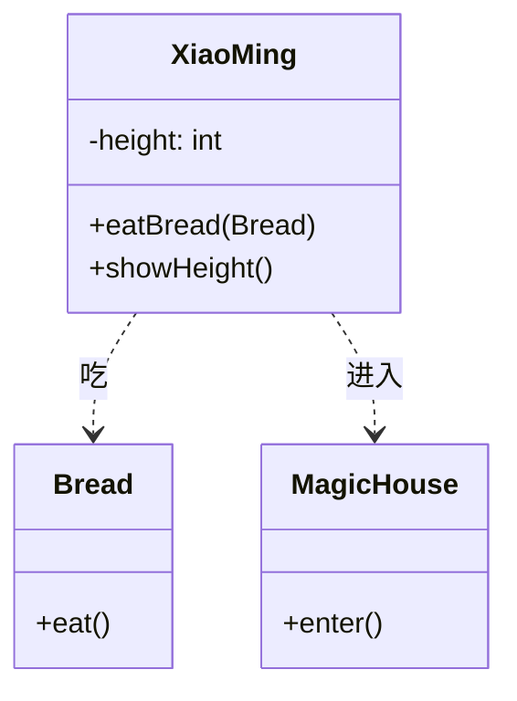
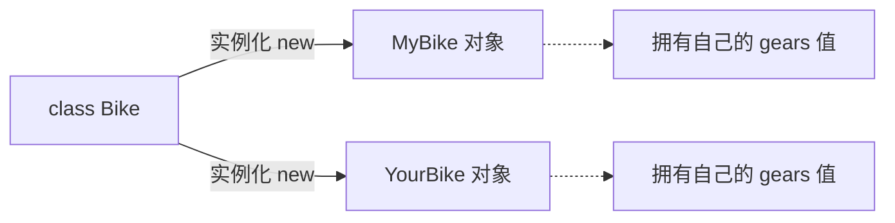

# 对象(Object)和类(Class)的概念、实例变量与方法

## 对象与类

### 从“魔法屋”说起

设想你要用程序讲述一个故事：小明走进魔法屋，吃了一片面包，身高从 140 厘米变成 141 厘米。如果只用一个个零散的变量去描述，代码很快就会失控——小明的名字、身高、吃的动作散落各处，魔法屋、面包各自的数据也纠缠不清。

面向对象编程给出的答案很简单：**把数据和处理数据的方法打包在一起**。这正是 Alan Kay 在 70 年代设计 Smalltalk 语言时的核心思想——程序好比一个个生物分子，通过信息相互连接。

> [!IMPORTANT]
> ==对象（Object）是包含变量和方法在内的软件体。变量存储状态，方法定义行为。== 类（Class）则是创建对象的蓝图，定义了同类对象共有的变量和方法。

比如在“魔法屋”程序里，可以设计三个类：



`XiaoMing` 类中有一个实例变量 `height` 记录身高，方法 `eatBread()` 改变身高。`Bread` 对象被传给 `eatBread()`，身高加 1。每个对象都拥有类中定义的实例变量的一份拷贝——小明的身高是 140，如果再来一个“小芳”对象，她的 `height` 是 130，两者互不干扰。

### 为什么需要封装

把变量和方法包装在一个软件体里，称为**封装（encapsulation）**。其收益有两层：

| 好处 | 含义 |
| --- | --- |
| 模块化 | 对象是一个独立单元，可以单独开发、测试、替换 |
| 信息隐藏 | 外部通过方法访问数据，内部实现可以自由修改 |

`XiaoMing` 类的 `height` 若声明为私有变量，外部就不能直接写 `xm.height = 200`，而必须通过 `eatBread()` 等方法间接改变。这样未来若想加“每吃一片面包体重也增加”，只需改方法内部，调用方代码毫发无损。

> [!WARNING]
> 不要将“变量直接公开”与“封装”混为一谈。直接暴露实例变量等于放弃了信息隐藏，外部任何代码都能随意篡改状态，==对象就不再是“提供服务的黑盒子”==。

### 类与对象的关系



类是模板，对象是具体的实例。`MyBike` 和 `YourBike` 都从 `Bike` 类创建，各自持有 `gears` 变量的一份拷贝，但数值可以不同。没有类的对象、没有对象的类，都无法构成完整的面向对象程序。

### 一个算对了的例子

**题目**：`Bike` 类有实例变量 `gear` 和方法 `changeGear(int newGear)`。创建两个对象，分别换挡并输出。

```java
class Bike {
    private int gear = 1;               // 实例变量
    void changeGear(int newGear) {      // 实例方法
        gear = newGear;
    }
    int getGear() {
        return gear;
    }
}

public class Test {
    public static void main(String[] args) {
        Bike myBike = new Bike();
        Bike yourBike = new Bike();
        myBike.changeGear(3);
        yourBike.changeGear(5);
        System.out.println("MyBike gear: " + myBike.getGear());     // 3
        System.out.println("YourBike gear: " + yourBike.getGear()); // 5
    }
}
```

两个对象独立持有 `gear`，调用同一个方法、传入不同参数，互不影响。这就是对象与类最基础也最重要的关系。

> [!TIP]
> 判断“什么该做成类”时，看概念是否同时拥有**状态**（名词）和**行为**（动词）。魔法屋有地址、招牌等状态，有 `enter()` 等行为；面包有类型、保质期等状态，有被吃的效果。“小明”也一样。只要同时具备状态和行为，就适合建类。
