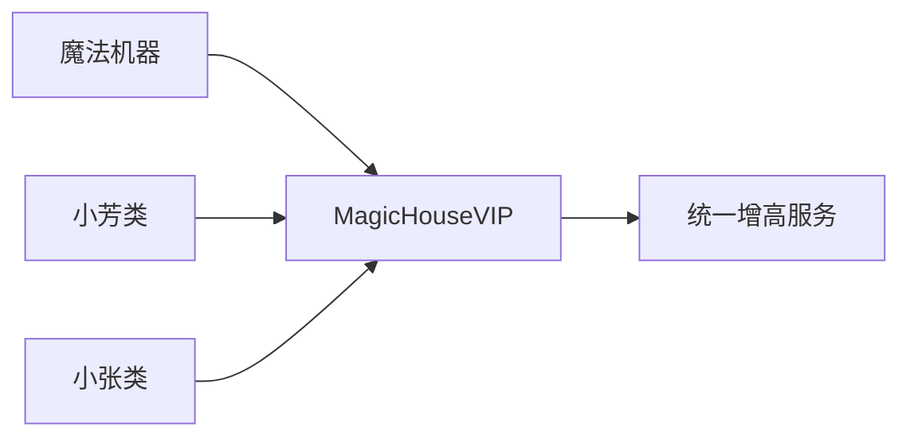

# 接口(Interface)用于定义协议或行为的作用

接口（Interface）是 Java 中定义**协议（protocol）或行为**的抽象类型：它只规定“对象必须提供哪些操作”，不关心对象属于哪个类、内部怎样实现。因此，互不相关的类只要实现同一接口，就能按统一方式交互。接口在系统设计中的核心价值是==降低耦合并实现可插入性（Pluggability）==：调用方依赖接口，运行时再决定使用哪一种实现。

## 为什么需要接口

假设魔法机器只认某个具体学生类，那么新增小芳、小张等使用者时，就可能不断修改机器代码。若先约定“会员必须提供个人信息，并能接受增高服务”，机器只面向 `MagicHouseVIP` 编程，不同类实现该协议后即可使用机器，原有代码也更容易保持不变。



这里，接口像会员注册单：它描述双方行为上的一致，而不是描述学生的全部属性。一个类还可以同时实现多个接口，从而具备多种彼此独立的能力。

## 怎样定义和实现

按本课程基础阶段的抽象接口模型，接口方法隐式为 `public abstract`，数据成员隐式为 `public static final`，通常可省略这些修饰符。接口不能直接 `new`，但接口引用可以指向实现类对象。

```java
interface Function {
    int evaluate(int x);
}

class Half implements Function {
    @Override
    public int evaluate(int x) {
        return x / 2;
    }
}

class TwoTimes implements Function {
    @Override
    public int evaluate(int x) {
        return x * 2;
    }
}

public class Demo {
    public static void main(String[] args) {
        Function f = new Half();       // 向上转型
        System.out.println(f.evaluate(10)); // 5

        f = new TwoTimes();            // 动态更换实现
        System.out.println(f.evaluate(10)); // 20
    }
}
```

变量 `f` 的声明类型始终是 `Function`，实际执行的方法由它当前引用的对象决定，这体现了接口与多态的配合。魔法屋题也可采用同样思路：让小芳、小张所在类实现 `MagicHouseVIP`，魔法机器通过接口引用获取性别并修改身高，女生增加 $30$ 厘米、男生增加 $40$ 厘米，于是得到 $130+30=160$、$145+40=185$。

## 接口与抽象类

| 比较点 | 接口 | 抽象类 |
|---|---|---|
| 主要作用 | 定义可跨类体系实现的协议 | 提取一类对象的公共特征 |
| 方法 | 基础模型中均为抽象方法 | 可有抽象方法，也可有具体方法 |
| 成员变量 | 只能是 `public static final` | 可有普通实例变量 |
| 构造器 | 没有 | 可以有 |
| 类间关系 | 一个类可实现多个接口 | 一个类只能继承一个父类 |
| 实例化 | 不能直接实例化 | 不能直接实例化 |

==类只支持单继承，但可实现多个接口；接口之间可用 `extends` 多继承。== 若 `C extends A, B`，实现 `C` 的普通类必须实现 A、B、C 中的全部抽象方法。

> [!WARNING]
> 实现接口方法时必须写 `public`，不能缩小访问权限；非抽象实现类必须覆写全部抽象方法，否则编译失败。接口引用也只能直接调用接口中声明的方法。

> [!NOTE]
> Java 8 以后接口还可包含 `default`、`static` 等方法；考试若明确依据课件中的“完全抽象接口”模型，应按题干和课程要求作答。

> [!TIP]
> 设计时优先问：“这是同一类对象的公共模板，还是不同对象都要遵守的能力协议？”前者多考虑抽象类，后者多考虑接口。给已有接口直接加方法会迫使所有实现类修改，课件推荐通过子接口扩展协议。
