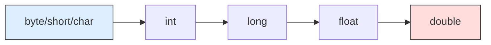

# 基本数据类型的隐式转换与强制转换规则
在 Java 中，不同类型的数据经常需要混合运算或相互赋值。比如，一个 `int` 和一个 `double` 相加，结果应该是什么？又比如，你想把一个 `double` 赋值给一个 `int` 变量，能直接写吗？这些问题的答案都指向 Java 的**类型转换**规则。

### 为什么要进行类型转换

**问题引入**：当一个小杯子里的水，要倒进一个大瓶子，这很安全，水不会溢出，系统可以直接帮你做。但如果要把大缸里的水倒进小杯子，就可能溢出，编译器会要求你明确地表示“我知道有风险，但我还是想这么做”。

这就是类型转换的核心思想。Java 是强类型语言，所有数据都得先明确类型，不同类型间的赋值和运算必须遵循转换规则，以确保数据精度和程序安全。

### 隐式转换（自动类型转换）

**它是什么**：当把取值范围小的类型赋值给取值范围大的类型时，或低精度与高精度数据运算时，系统会自动完成类型提升，你不需要写任何额外代码。

**转换规则（从小到大）**：
`byte → short/char → int → long → float → double`

> [!IMPORTANT]
> `char` 类型在实际运算中会首先被转换为 `int` 型（`char` 型代表字符本质是其对应的 Unicode 整数）。
> 例如，字符 `'2'` 的 ASCII 码是 50，运算中会被直接提升为 `int` 值 50。

**遵循的路径**：顺滑的、精度无损的升舱。



**常见场景**：
1.  **赋值**：`double d = 10;` （int 自动转为 double）
2.  **运算**：`3.14 + 2` 中，2 会先变为 2.0 再计算，结果是 `double` 型的 5.14。
3.  **字符串拼接**：`"Hello" + 100` 中，100 会自动转为 `"100"` 并拼接。

> [!WARNING]
> `float` 和 `long` 谁的取值范围大？`float` 能表示的数据范围确实比 `long` 更广，但其有效数位精度不如 `long`。当 `long` 转为 `float` 时，**可能丢失最低几位的精度**，这算隐式转换中的一个隐形坑。

### 强制转换（强制类型转换）

**它是什么**：当你需要逆着自动转换的方向，把取值范围大、精度高的类型转为取值范围小、精度低的类型时，必须手动指出要转成什么类型。这本身意味着可能有风险，比如**数据溢出**或**精度丢失**。

**为什么需要它**：有两个常见的“不得不转”的情况：
- 子类对象被父类引用指向后，想调用子类特有方法，需要父类强转回子类。
- 从高精度数字到低精度数字的赋值。

**怎么做**：格式为 `(目标类型) 值`。
例如：`int a = (int) 3.14;` 这里小数部分会被无情截断，a 的值是 3。

> [!CAUTION]
> 浮点数转整数，并不是四舍五入，而是直接截掉小数部分。这是高频考点！

> [!IMPORTANT]
> 强制转换能不能成功，根本要看==对象的本质类型==。
> 比如，一个真实身份是“猫”的对象，被“动物”类型的变量引用。你可以把这个父类变量强转回“猫”，但不能强转成“狗”，即使 `Dog` 也是 `Animal` 的子类。因为对象的本质在 `new` 猫的时候就已经确定了。

**基本数据类型间强转的危险操作**：
- **精度丢失**：`int score = (int) 99.9;` -> score 为 99。
- **数据溢出**：`byte b = (byte) 128;` byte 范围是 -128~127，所以 128 溢出后会变成 -128。

> [!NOTE]
> 布尔类型 `boolean` 是个特例，它完全不参与任何与其他 7 种基本数据类型的转换。

### 一个算对了的例子

```java
int x = 1, y = 2, z = 3;
y += z-- / ++x;
```

结果是多少？我们一步步拆解：

1.  **后缀自减 `z--`**：先参与运算再自减。因此表达式里 `z--` 的值是 **3**，之后 z 变为 2。
2.  **前缀自增 `++x`**：先自增再参与运算。因此 x 变为 **2**，`++x` 的值也是 2。
3.  **除法运算**：`3 / 2` 是两个 `int` 相除，结果仍是 `int`，小数截断，得到 **1**。
4.  **复合赋值 `y += 1`**：等价于 `y = y + 1`。原 y 是 2，所以 y 最终变为 **3**。整个表达式的值也是 y 的新值 3。

> [!TIP]
> **解题口诀**：
> - 强制转换有风险，四舍五入是谎言，小数全被你砍掉。
> - 单字符号自提升，`'1'` 加 `1` 得 50。
> - 复合赋值 `+=`，隐藏了悄悄的类型转换（`y += 1` 等价于 `y = (int)(y + 1)`），不显式写出来它也会自动帮你做。
