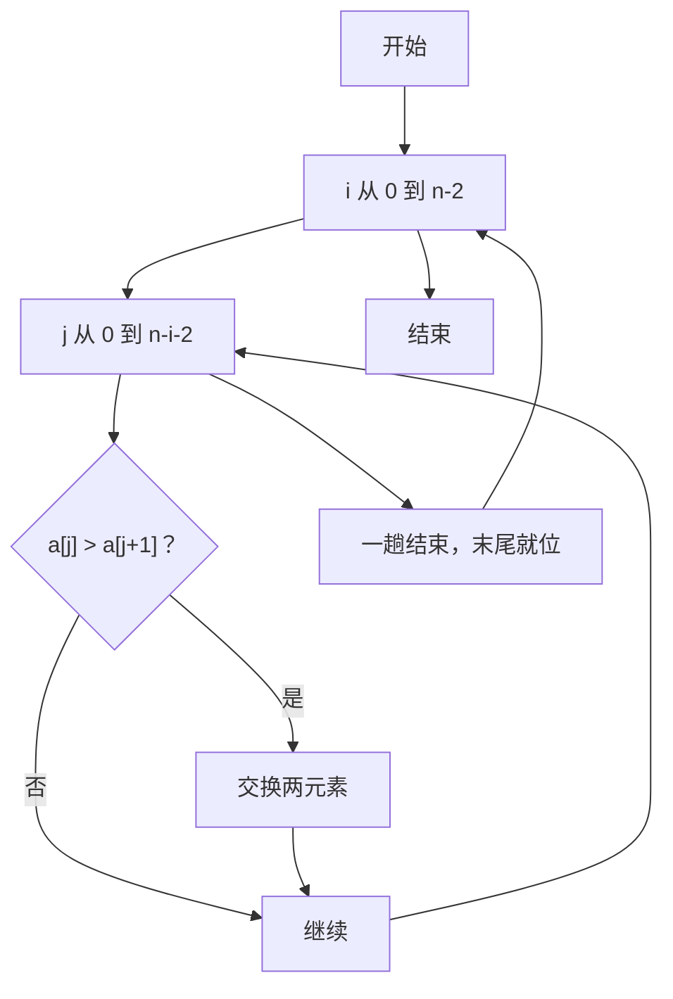
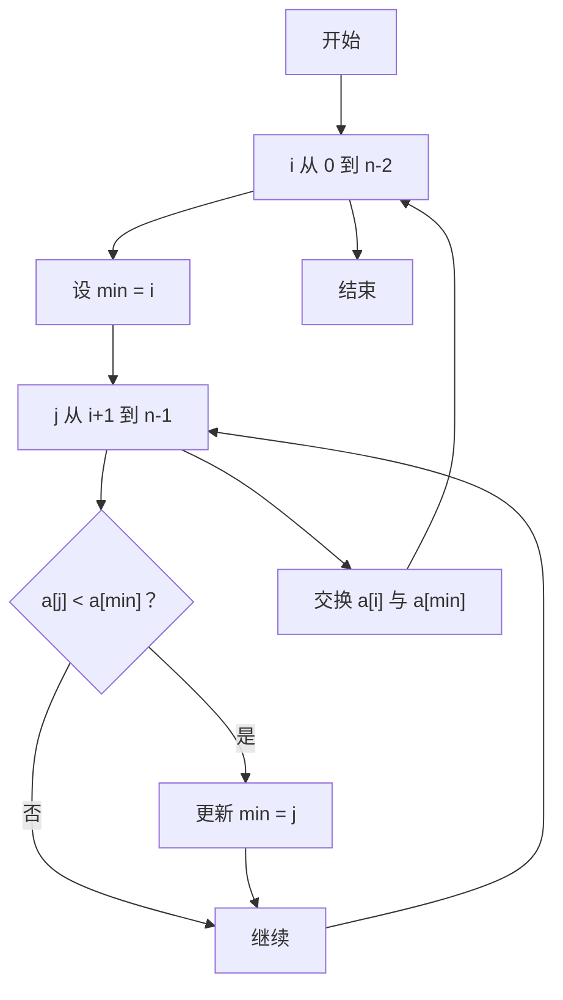

# 冒泡排序与选择排序的实现

## 冒泡排序与选择排序的实现

排序是把一组无序数据按关键字从小到大（或从大到小）重新排列的过程。数组本身没有“自动排好序”的能力，必须借助排序算法。==冒泡排序和选择排序是最基础的两类交换/选择思想算法==，也是后续学习快速排序、归并排序的铺垫。

## 冒泡排序：相邻比较，大数下沉

基本思想：从前往后比较相邻两个元素，若逆序则交换，==每一趟把当前最大值“冒泡”到数组末尾==。



以数组 `{5, 3, 8, 2}` 为例：

| 趟数 | 比较与交换过程 | 结果 |
|---|---|---|
| 第 1 趟 | 5>3 换，5<8 不换，8>2 换 | `{3, 5, 2, 8}` |
| 第 2 趟 | 3<5 不换，5>2 换 | `{3, 2, 5, 8}` |
| 第 3 趟 | 3>2 换 | `{2, 3, 5, 8}` |

核心代码：

```java
for (int i = 0; i < a.length - 1; i++) {
    for (int j = 0; j < a.length - 1 - i; j++) {
        if (a[j] > a[j + 1]) {
            int t = a[j]; a[j] = a[j + 1]; a[j + 1] = t;
        }
    }
}
```

## 选择排序：每趟选最小，放到前面

基本思想：第 $i$ 趟从 $i \sim n-1$ 中找到最小值，与 `a[i]` 交换。==交换次数少，最多 $n-1$ 次==。



## 两者对比与常见坑

| 对比项 | 冒泡排序 | 选择排序 |
|---|---|---|
| 基本操作 | 相邻元素比较交换 | 找最小值再交换 |
| 交换次数 | 多，最坏 $O(n^2)$ 次 | 最多 $n-1$ 次 |
| 稳定性 | ==稳定== | ==不稳定== |
| 时间复杂度 | $O(n^2)$ | $O(n^2)$ |

> [!WARNING]
> 冒泡排序的内层循环上限是 `a.length - 1 - i`，不是固定的 `a.length - 1`，否则数组越界。

> [!TIP]
> 判断稳定性：冒泡只交换相邻逆序对，相等元素不会跨越；选择排序可能把后面的相等最小值换到前面，因此不稳定。

> [!IMPORTANT]
> ==冒泡排序每趟确定一个最大值到末尾，选择排序每趟确定一个最小值到前面==，写代码前先想清楚“这一趟结束后，哪个位置被确定下来”。
