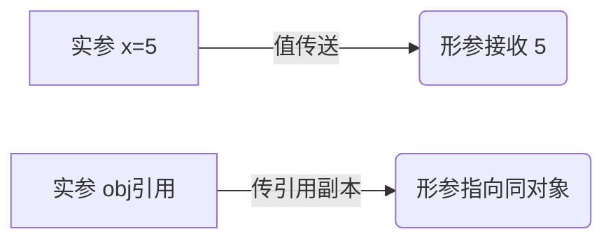

# 方法的声明、调用、按值/按引用参数传递及方法的重载(Overloading)

> [!IMPORTANT]
> 方法是实现程序具体功能的基本单元。表达式由若干变量、操作符以及方法调用构成，掌握方法的声明、调用与重载是编写 Java 程序的核心基础。

## 方法的声明与调用

思考一下：如果一段计算逻辑要在多处使用，难道每次都要重写一遍吗？这就需要把代码封装成方法。

方法声明的语法格式为：`[修饰符] 返回值类型 方法名(参数列表) { 方法体 }`。

```java
public int add(int a, int b) {
    return a + b;
}
```

> [!WARNING]
> 课件中明确指出：**方法参数和例外处理器参数不能用默认值初始化**，必须在调用的时候通过参数传递进行赋值。同时，访问修饰符（如 `public`）必须写在返回值类型之前，且不能同时使用两个访问修饰符。

调用普通成员方法需要通过对象引用：`instance.method1(B)`；而 `static` 方法属于整个类，只能处理本类中的 `static` 变量或调用 `static` 方法，不需要创建对象即可调用。

## 按值与按引用参数传递

Java 中方法调用时，参数是怎么传递的？记住一条铁律：==Java 只有按值传递==。

- **基本类型参数**：是值传送。传递的是变量的副本，方法内修改不影响实参。
- **对象引用参数**：传递的是“引用的副本”（即内存地址的值）。方法内可以通过该引用修改对象的属性，但无法让原引用指向新对象。



## 方法的重载（Overloading）

当我们需要对不同类型的数据执行相似操作时该怎么办？这时就需要方法的重载。

> [!IMPORTANT]
> 方法的重载定义为：在一个类中定义多个同名的方法，但要求各个方法具有不同的参数的类型或参数的个数。

重载属于==编译时多态==，由编译器在编译时根据参数的区别来绑定方法体。构造方法也经常被重载，以便针对给定的不同参数调用不同的构造方法来初始化对象。

| 比较维度 | 重载 Overloading | 重写 Overriding |
| :--- | :--- | :--- |
| 发生位置 | 同一个类中 | 子类与父类之间 |
| 方法名 | 必须相同 | 必须相同 |
| 参数列表 | ==必须不同==（类型/个数） | 必须相同 |
| 返回值类型 | 无强制要求 | 相同或协变 |
| 绑定时机 | 编译时多态 | 运行时多态 |

## 典型例题解析

来看课件中的一道经典选择题：

类 A 定义如下，可正确替换 `//here` 的选项是 ( )
```java
public class A {
    public void amethod(int i) { }
    //here 
}
```
A. `public int amethod(int z){ }`
B. `public int amethod(int i, int j){return 99;}`
C. `protected void amethod(long l){ }`
D. `private void anothermethod(){ }`

**分析过程：**
- A 选项：参数名改为 `z` 不改变参数类型，签名依然是 `(int)`。仅返回类型从 `void` 变为 `int`，不构成合法重载，会导致编译错误。
- B 选项：参数列表变为 `(int, int)`，与原方法参数个数不同，构成合法重载。
- C 选项：参数类型变为 `long`，与原方法参数类型不同，构成合法重载。
- D 选项：方法名完全不同，这是一个全新的方法，当然合法。

> [!TIP]
> 判断重载的唯一标准是看“参数列表”（类型或个数），千万不要被参数变量名或返回值类型迷惑！

正确答案为 **BCD**。
