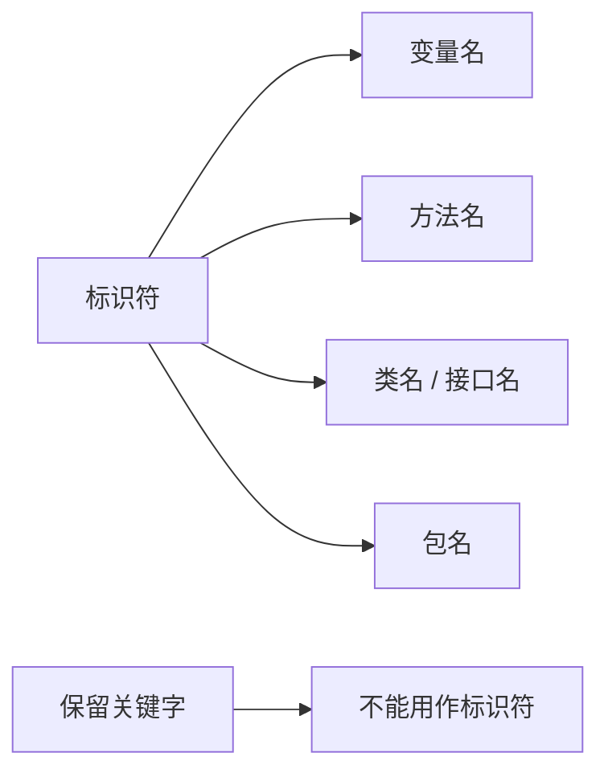
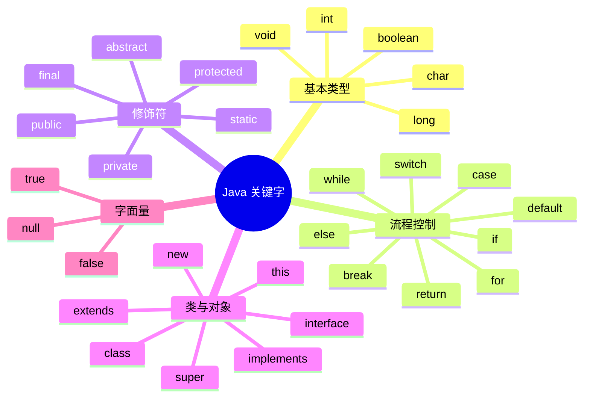

# Java标识符命名规则与保留关键字

# Java 标识符命名规则与保留关键字

## 它是什么

在 Java 中，标识符（Identifier）是程序员为**变量、方法、类、接口、包**等元素起的名字。它本质上是一个符号，用来在代码中引用某个已声明的实体。比如 `int studentAge = 20;` 中的 `studentAge` 就是一个标识符。

保留关键字（Reserved Keywords）则是 Java 语言**预先占用、不能用作标识符**的单词集合，例如 `int`、`class`、`public`、`if`、`return` 等。这些词对编译器有特殊含义，一旦你试图将它们用作变量名或方法名，编译器会直接报错。



> [!IMPORTANT]
> 标识符是**给人读的符号**，保留关键字是**编译器认领的单词**，二者不可重叠。

## 为什么需要规则

试想：如果每个人写 Java 都随心所欲地命名——有人用空格，有人用 `@`，有人把方法名叫 `class`——编译器该如何区分“这是一个名字”还是“这是一条语法指令”？

规则的存在有两个目的：

1. **让编译器能无歧义地解析代码**：`int class = 5;` 这句话在编译器眼里是“用关键字 `class` 来声明一个 int 变量”，语法直接冲突。
2. **让人类读者能快速理解代码**：`a1` 不如 `studentAge` 表达清晰，但两者都合法；`1a` 则连合法都谈不上。

## 怎么做：规则清单

### 合法标识符必须同时满足

| 规则 | 说明 | 合法示例 | 非法示例 |
|------|------|----------|----------|
| 只能以**字母、下划线 `_`、美元符号 `$`** 开头 | 不能以数字开头 | `_count`、`$price`、`name` | `1name`、`@name` |
| 后续字符可以是**字母、数字、下划线、美元符号** | 中间可以出现数字 | `user2`、`max_value` | `user-name`（`-` 是运算符） |
| **不能是保留关键字** | 包括 `true`、`false`、`null` | — | `class`、`int`、`void` |
| **严格区分大小写** | `Name` 与 `name` 是两个不同标识符 | `Value` ≠ `value` | — |
| **长度无限制** | 但工程上建议不超过 30 字符 | `thisIsAVeryLongIdentifier` | — |

### 保留关键字速查（常见）



> [!WARNING]
> `true`、`false`、`null` 在 Java 中**不是类型**，但它们同样属于保留关键字/字面量，不能用作标识符。很多学生误以为它们可以当变量名。

### 命名约定（非编译强制，但强烈推荐）

| 元素 | 约定 | 示例 |
|------|------|------|
| 类名 / 接口名 | 大驼峰 PascalCase | `StudentManager`、`HttpRequest` |
| 方法名 / 变量名 | 小驼峰 camelCase | `getName()`、`studentAge` |
| 包名 | 全小写 + 点分层 | `com.njupt.java` |
| 常量 | 全大写 + 下划线 | `MAX_SIZE`、`PI` |

> [!TIP]
> 记忆口诀：**“字母下划线美元开头，数字不能打头阵，关键字打死不能用，大小写是两路人。”**

## 和相近概念的区别

很多同学把**标识符**和**字面量**（Literal）搞混。

| 概念 | 是什么 | 例子 |
|------|--------|------|
| 标识符 | 你**起的名字**，指向某个实体 | `int age = 20;` 中的 `age` |
| 字面量 | 代码中**直接写出的值**，本身就是一个数据 | `20`、`"hello"`、`true`、`025` |

再看一道真题选项：

```java
int z = 025; // 025 是八进制字面量，合法
```

这里的 `z` 是标识符，`025` 是字面量。二者各走各的规则：标识符看命名规则，字面量看数据类型的合法表示。

另一个混淆点是**标识符与注释**。注释是给人和工具看的，编译器完全忽略；标识符则参与编译和运行。

## 常见的坑

### 坑 1：数字开头 + 特殊字符

```java
int 1stPlace = 10;   // 编译错误：数字开头
int user-name = 5;   // 编译错误：'-' 被解析为减号
int #price = 3;      // 编译错误：'#' 不是合法字符
```

### 坑 2：大小写误判

```java
int Value = 10;
int value = 20;
System.out.println(value + Value); // 30，两个完全不同的变量
```

Java 是**大小写敏感**语言，`Value` 和 `value` 是两个独立变量。这与 SQL、VB 等语言不同。

### 坑 3：关键字当名字

```java
int class = 5;      // 错误
void public();      // 错误
boolean true = false; // 错误：true 和 false 都是保留字
```

### 坑 4：中文标识符

Java **语法上允许**使用中文等 Unicode 字符作为标识符：

```java
int 年龄 = 20; // 编译通过，但不推荐
```

> [!CAUTION]
> 不要因为“能编译”就觉得“该这么写”。工程上中文标识符会导致编码问题、跨平台兼容性差、团队协作困难。南邮考试中不会考中文标识符的合法性边界，默认**不要写中文标识符**即可。

## 一个算对了的例子

回到真题：

```java
public class A{
    public void amethod(int i){ }
    //here 
}
```

要在 `//here` 处插入合法代码，我们需要同时考虑**标识符命名**和**方法重载**。假设插入：

```java
private void anothermethod(){ }
```

这里 `anothermethod` 是一个合法标识符：
- 以字母 `a` 开头 ✅
- 后续全是字母 ✅
- 不是关键字 ✅
- 方法名小写开头 ✅

它与原方法 `amethod` 名字不同，是一个全新方法，不涉及重载，因此完全合法。这对应真题 D 选项。而 B 选项 `public int amethod(int i, int j){return 99;}` 中 `amethod` 虽然名字合法，但**参数列表不同**（两个 int），构成重载，也是合法的。

---

**总结一句话**：标识符的规则只有“**开头什么能写、中间什么能写、什么绝对不能写**”这三件事；保留关键字就是那个“绝对不能写”的红线清单。
