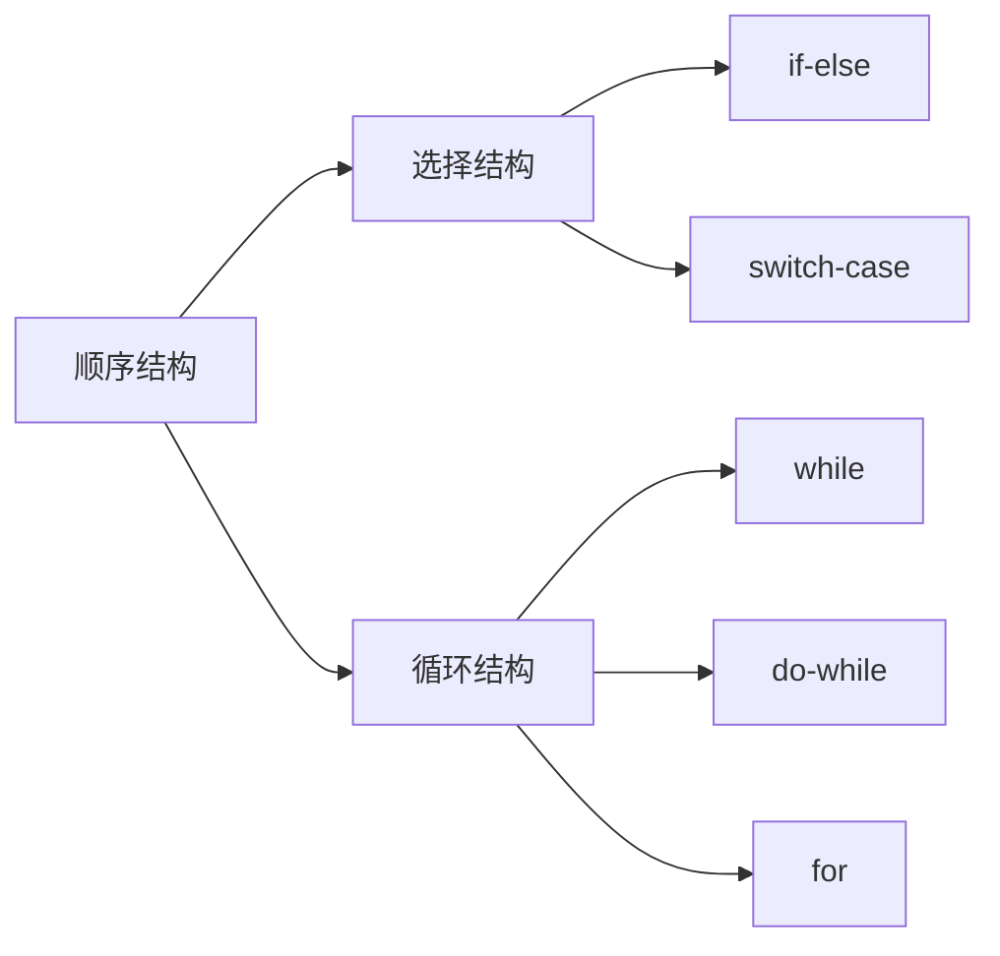
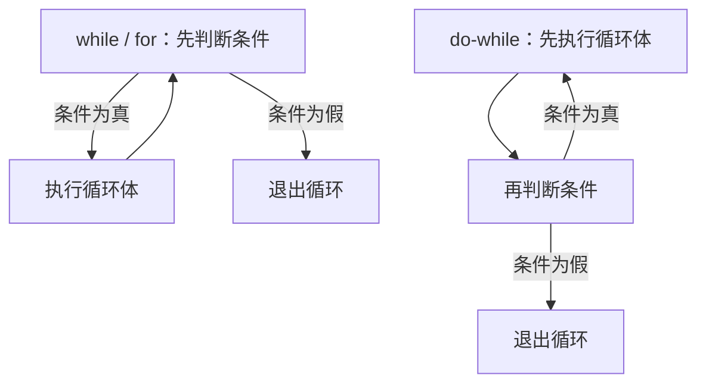

# if-else、switch、while、do-while、for语句及break/continue/return分支控制

## 三种基本结构

Java 程序的执行流程只有三种：==顺序结构、选择结构、循环结构==。顺序结构按代码书写顺序逐条执行；选择结构根据条件决定走哪条分支；循环结构在条件满足时反复执行某段代码。掌握本章内容，就是把这三种结构写对、用熟。



## 选择结构

**if-else** 是最基本的分支语句，条件必须是 **boolean 类型**——这是 Java 与 C/C++ 的重要区别：

```java
boolean result = true;
if (result) {          // 正确：直接判断布尔变量
    System.out.println("Yes");
}
// if (result != 0)    // 编译错误！boolean 不能与 int 比较
// result = 1;         // 编译错误！boolean 不能赋值为 1
```

> [!WARNING]
> Java 中 `if` 的条件表达式**必须是 boolean 型**，不能是整数（C 语言中 `if(1)` 合法，Java 中不行）。这是考试常见陷阱。

当分支较多时，用 **switch-case** 更清晰：

```java
switch (表达式) {
    case 值1: 语句1; break;
    case 值2: 语句2; break;
    default:  默认语句;
}
```

> [!IMPORTANT]
> ==switch 的穿透（fall-through）行为==：如果某个 `case` 后**没有 `break`**，程序会继续执行后面所有 `case` 的语句，直到遇到 `break` 或 switch 结束。

来看一道经典考题：

```java
switch(m) {
    case 0: System.out.println("Case 0");
    case 1:
    default: System.out.println("Default");
}
```

| $m$ 的值 | 执行路径 | 输出 |
|---------|---------|------|
| 0 | case 0 → 穿透到 default | `Case 0` + `Default` |
| 1 | case 1（空）→ 穿透到 default | 仅 `Default` |
| 2 | 无匹配 → 直接到 default | 仅 `Default` |
| 3 | 无匹配 → 直接到 default | 仅 `Default` |

因此 $m$ 取 **1、2、3** 时仅输出 `Default`。

> [!TIP]
> 写 switch 时，**每个 case 末尾都写 `break`**，需要穿透时再加注释说明。忘记 `break` 是 switch 最常见的 bug。

## 循环结构

三种循环各有适用场景：

| 循环 | 语法 | 特点 |
|------|------|------|
| while | `while (条件) { … }` | 先判断，可能一次都不执行 |
| do-while | `do { … } while (条件);` | 后判断，**至少执行一次** |
| for | `for (初始化; 条件; 更新) { … }` | 循环次数已知，最常用 |



计算 $1+2+\cdots+1000$ 的和，用 for 循环最自然：

```java
int sum = 0;
for (int i = 1; i <= 1000; i++) {
    sum += i;
}
System.out.println(sum);  // 输出 500500
```

> [!NOTE]
> 变量类型要选对：$1$ 到 $1000$ 的和为 $500500$，int 足够；但若范围更大，应使用 `long` 防止溢出。

## 分支控制语句

| 语句 | 作用 | 影响范围 |
|------|------|---------|
| `break` | 跳出**整个循环**或 switch | 最内层循环 |
| `continue` | 结束**本次循环**，进入下一次迭代 | 最内层循环 |
| `return` | 结束**整个方法**，返回结果 | 整个方法 |
| `label:` | 给循环命名，配合 break/continue 使用 | 指定外层循环 |

```java
outer:
for (int i = 0; i < 3; i++) {
    for (int j = 0; j < 3; j++) {
        if (j == 1) continue outer;  // 跳到外层循环的下一次迭代
        if (i == 2) break outer;     // 跳出外层循环
    }
}
```

> [!CAUTION]
> `break` 只跳出**最内层**循环。要跳出外层循环，必须用 `label:` 标记。`continue` 同理——这是嵌套循环中最容易出错的地方。

> [!TIP]
> 记忆口诀：**break 跳出整个循环，continue 跳过本次循环，return 结束整个方法**。
