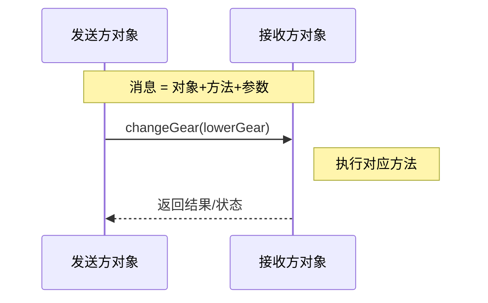

# 消息(Message)的组成及其在对象通信中的作用

在面向对象编程中，单个对象往往能力有限，复杂的应用程序需要多个对象协同工作。那么，这些彼此独立的对象是如何“交流”并共同完成任务的呢？答案就是==消息（Message）==。

## 消息的本质与组成

如果把对象看作现实世界中的实体，消息就是它们之间的“对话”。在 Java 中，发送消息在代码层面表现为==方法调用==。一个完整的消息由三个核心部分组成：

1.  **接收消息的对象**：即方法调用的目标实例（如 `yourBicycle`）。
2.  **方法名**：标识要执行的具体行为（如 `changeGear`）。
3.  **参数列表**：传递行为所需的上下文数据（如 `lowerGear`）。



> [!IMPORTANT]
> 消息传递是对象交互的唯一合法途径。对象的行为通过其方法表达，因此消息传递支持了对象间所有可能的交互。对成员变量的访问一般也应该通过方法进行，以维护封装性。

## 为什么需要消息机制

直接操作另一个对象的内部数据会破坏封装，导致系统耦合度极高。消息机制带来了两个关键好处：

-   **解耦与封装**：发送方只需知道接收方“能做什么”（方法签名），无需了解“怎么做”（内部实现）。
-   **平台无关性**：彼此发送和接收消息的对象==不一定要位于同一个进程或同一台机器中==。这为分布式系统（如 RPC、Kafka、RabbitMQ）奠定了理论基础，尽管在基础理论章节我们主要关注本地 JVM 内的消息传递。

## 消息与多态的关系

当不同类的对象收到同一条消息时，它们会如何响应？这就引出了==多态==的概念。多态指允许不同类的对象对同一消息做出响应，即同一消息可以根据发送对象的不同而采用多种不同的行为方式。

> [!TIP]
> 多态存在的三个必要条件：① 继承；② 重写；③ 父类引用指向子类对象。三者缺一不可。

结合历年真题辨析：

| 选项 | 内容 | 正误 | 解析 |
| :--- | :--- | :--- | :--- |
| A | 不同类对象对同一消息做出相同响应 | ❌ | 多态强调==不同==的行为方式 |
| B | 多态需继承、重写、父类引用指向子类 | ✅ | ==三个必要条件== |
| C | 编译时多态在运行时确定方法 | ❌ | 编译时多态在==编译时==确定 |
| D | this.show(O) 优先级低于 super | ❌ | this 优先级==最高== |

在继承链中，方法调用的优先级顺序为：
$$ \text{this.show}(O) > \text{super.show}(O) > \text{this.show}((\text{super})O) > \text{super.show}((\text{super})O) $$

## 常见误区与注意事项

> [!WARNING]
> Java 语言中，方法调用==并非一律都是传址的引用调用==。基本数据类型传递的是值的副本，只有对象引用传递的才是引用的副本。这是考试高频判断题陷阱。

> [!CAUTION]
> 不要将“消息”与后续章节的“消息队列中间件”混淆。本章的消息是 OOP 基础理论中的==方法调用抽象==；而 Kafka/RabbitMQ 中的 Message 是包含 Header、Body、Routing Key 的网络通信实体，属于分布式系统范畴。

## 实战示例：魔法屋增高故事

以真题背景为例，创建魔法屋、面包、小明三种对象，通过消息完成交互：

```java
class Bread {
    void eat() { System.out.println("面包被吃掉，身高+1cm"); }
}
class MagicHouse {
    Bread provideBread() { return new Bread(); } // 返回面包对象
}
class XiaoMing {
    int height = 140;
    void grow(Bread b) {      // 接收消息：吃面包
        b.eat();              // 向面包发送消息
        height++;
    }
}
// 主程序中的消息传递链
MagicHouse house = new MagicHouse();
XiaoMing ming = new XiaoMing();
Bread bread = house.provideBread(); // 消息1：获取面包
ming.grow(bread);                   // 消息2：吃面包长高
```

此例清晰展示了对象间通过==消息链==协作的过程：每个对象只负责自己的行为，通过消息串联形成完整的业务逻辑，这正是面向对象设计的精髓所在。
