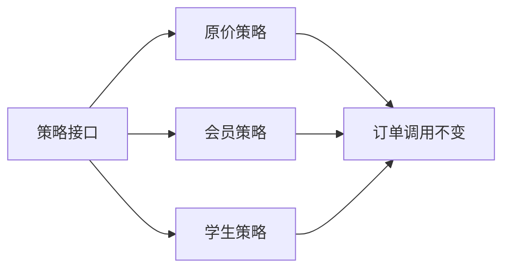

# 类之间的继承、聚合、合成、依赖关系及开闭原则(OCP)

## 继承：复用并扩展已有类

继承是从已有类（父类或超类）派生新类（子类），子类能够继承父类中可继承的数据成员和方法，也可以增加新的成员或重写父类的方法。它表达的是一种“is-a”关系，即子类对象也是父类对象的一种特殊情况。

```java
class Animal {
    protected String name;
    public void eat() {
        System.out.println(name + " 正在进食");
    }
}

class Dog extends Animal {
    public void bark() {
        System.out.println(name + " 正在叫");
    }
}
```

Java 类只支持==单继承==，一个子类最多直接继承一个父类；但一个类可以实现多个接口，因此接口常用于弥补类不能多继承的限制。接口还支持类似“多继承”的类型关系。

继承的主要价值是代码复用和建立一般到特殊的层次结构。不过，如果子类仅为复用少量代码而强行继承，或者多层继承造成父子类强耦合，设计往往并不合理。此时可优先考虑组合。

## 聚合、合成与依赖

类之间常见的关系包括依赖、聚合和合成。它们都可能在代码中表现为成员变量或方法参数，但对象的生命周期和语义不同。

| 关系 | 语义 | 整体与部分的生命周期 | 常见实现 |
|---|---|---|---|
| 依赖 | “使用” | 临时使用，无长期持有 | 方法参数、局部变量 |
| 聚合 | 弱拥有、整体包含部分 | 部分可独立存在，也可属于其他整体 | 成员变量引用 |
| 合成 | 强拥有、强组合 | 部分通常随整体创建和销毁 | 成员变量并在整体中创建 |
| 继承 | is-a | 子类是一种父类 | `extends` |

```java
class Engine {}

class Car {
    private Engine engine;          // 聚合：Engine 可独立存在
    public void start() { }
}

class Driver {
    public void drive(Car car) { } // 依赖：临时使用 Car
}
```

==聚合强调整体与部分可以分离==。例如，学校可以拥有多个学生，学生也可以脱离学校独立存在；部分对象甚至可以同时参与其他整体的关系。

==合成表示更强的整体—部分关系==，整体通常负责部分对象的生命周期。例如，一篇文章由多个段落组成，段落随文章创建，并在文章销毁时失去存在意义。实现时，合成对象通常直接在构造函数中创建：

```java
class Paragraph {}

class Article {
    private final Paragraph[] paragraphs;

    Article(int count) {
        paragraphs = new Paragraph[count];
        for (int i = 0; i < count; i++) {
            paragraphs[i] = new Paragraph();
        }
    }
}
```

判断关系时可追问：

1. 是否只是方法执行时临时使用对象？若是，通常是==依赖==。
2. 整体是否长期持有部分？若是，可能是聚合或合成。
3. 部分能否独立存在，并被其他整体共享？若能，通常是聚合；若不能，通常是合成。

聚合与合成在 UML 中也常用空心菱形和实心菱形区分；普通依赖一般画成虚线箭头。

## 开闭原则（OCP）

开闭原则要求软件实体==对扩展开放，对修改关闭==。也就是说，增加新功能时，应通过增加新模块、扩展抽象或实现新接口完成，尽量不要修改已经稳定、正在被大量调用的原有代码。

```java
interface DiscountStrategy {
    double apply(double price);
}

class OriginalPrice implements DiscountStrategy {
    public double apply(double price) {
        return price;
    }
}

class MemberDiscount implements DiscountStrategy {
    public double apply(double price) {
        return price * 0.9;
    }
}

class Order {
    private final DiscountStrategy strategy;

    Order(DiscountStrategy strategy) {
        this.strategy = strategy;
    }

    double calculate(double price) {
        return strategy.apply(price);
    }
}
```

新增“学生九折”时，只需增加 `StudentDiscount` 并在创建 `Order` 时传入，无须修改 `Order`。这就是 OCP 的典型实现。



> [!IMPORTANT]
> OCP 不是“永远不能修改代码”，而是尽量让变化发生在扩展点，避免修改稳定核心逻辑。

> [!WARNING]
> 常见误区是仅把一个 `if` 改成 `switch`，然后宣称实现了 OCP。若新增类型仍必须修改原有分支，核心代码依然对修改关闭失败。

> [!TIP]
> 判断步骤：需求变化时，能否新增一个类或方法完成扩展，而不改动已有调用方？若可以，设计较符合 OCP；若必须到处增加条件判断，则应考虑抽象、多态或策略模式。

继承适合建立稳定的“is-a”层次；聚合和合成适合表达“拥有、包含”关系；依赖适合表达临时使用。实际设计时，应让关系语义与对象生命周期一致，并让新增功能尽量通过扩展实现，以保持系统稳定、可维护。
