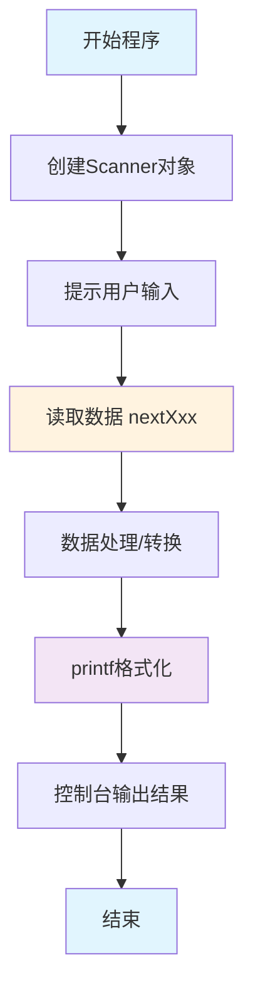

# System.out.printf格式化输出与Scanner类输入

## 交互式程序的输入与输出

在 Java 基础开发中，程序不再是单向执行，而是需要与用户进行**数据交互**。这就涉及两个核心类：负责“听”的 `Scanner` 和负责“说”且讲究格式的 `System.out.printf`。

> [!IMPORTANT]
> ==核心结论==：`Scanner` 用于从标准输入流读取数据，`printf` 用于按指定格式美化输出。两者配合是实现命令行交互的基础。

### 为什么需要格式化输出？

直接使用 `System.out.println()` 拼接字符串虽然简单，但在处理对齐、精度控制时显得笨拙。例如，打印表格或货币金额时，手动补空格极易出错。`printf` 借鉴了 C 语言的格式控制，通过**格式说明符**精准控制数据类型和显示样式。

常用格式说明符如下：

| 说明符 | 含义 | 适用类型 | 示例值 |
| :--- | :--- | :--- | :--- |
| `%s` | 字符串 | String | "Hello" |
| `%d` | 十进制整数 | int, long | 123 |
| `%f` | 浮点数 | float, double | 3.14 |
| `%c` | 单个字符 | char | 'A' |
| `%b` | 布尔值 | boolean | true |

### 怎么做：Scanner 与 printf 的配合

#### 1. 输入：Scanner 类
使用前需导入 `java.util.Scanner`。通常绑定 `System.in` 创建对象。

```java
Scanner sc = new Scanner(System.in);
int age = sc.nextInt();      // 读取整数
String name = sc.next();     // 读取字符串（遇空格停止）
```

> [!WARNING]
> **常见坑**：`next()` 与 `nextLine()` 混用。若先调用 `nextInt()` 再调用 `nextLine()`，后者会直接读取遗留的换行符导致“跳过输入”。建议统一使用 `nextLine()` 读取后转换，或在中间加一次空的 `nextLine()` 消耗换行符。

#### 2. 输出：printf 格式化
语法为 `System.out.printf("格式串", 参数列表);`。

```java
double price = 19.5;
// %.2f 表示保留两位小数
System.out.printf("价格: %.2f 元\n", price); 
```

### 流程与交互逻辑

以下 Mermaid 图展示了典型的交互流程：



### 算对了的例子：字符转换与输出

结合课件中的回文程序背景，假设我们需要读取一个混合字符串，将其中的字母转为大写，数字加 1，并格式化输出。

**场景**：输入 `"hello1234"`，期望输出 `"HELLO2345"`。

```java
import java.util.Scanner;

public class FormatDemo {
    public static void main(String[] args) {
        Scanner sc = new Scanner(System.in);
        System.out.print("请输入字符串: ");
        String input = sc.next();
        
        StringBuilder sb = new StringBuilder();
        for (char c : input.toCharArray()) {
            if (Character.isLetter(c)) {
                sb.append(Character.toUpperCase(c));
            } else if (Character.isDigit(c)) {
                // 字符转数字，加1后再转回字符
                int num = Character.getNumericValue(c);
                sb.append((num + 1) % 10); 
            }
        }
        
        // 使用 %s 输出最终字符串
        System.out.printf("转换结果: %s\n", sb.toString());
    }
}
```

> [!TIP]
> **记忆技巧**：`printf` 中的 `f` 代表 **format**（格式）。看到 `%` 就要想到后面跟着的是“占位符”，顺序必须与参数列表一一对应。

### 与 println 的区别

| 特性 | `println` | `printf` |
| :--- | :--- | :--- |
| **自动换行** | 是 | 否（需手动加 `\n`） |
| **格式控制** | 弱（依赖字符串拼接） | 强（支持宽度、精度、对齐） |
| **性能** | 内部调用 print+newline | 直接格式化，较高效 |

掌握这两个工具，是完成南邮 Java 课程中各类算法验证作业（如第 4、5 次作业）的前提，确保你的程序不仅能跑通，还能以清晰的格式呈现结果，满足截图提交的规范要求。
