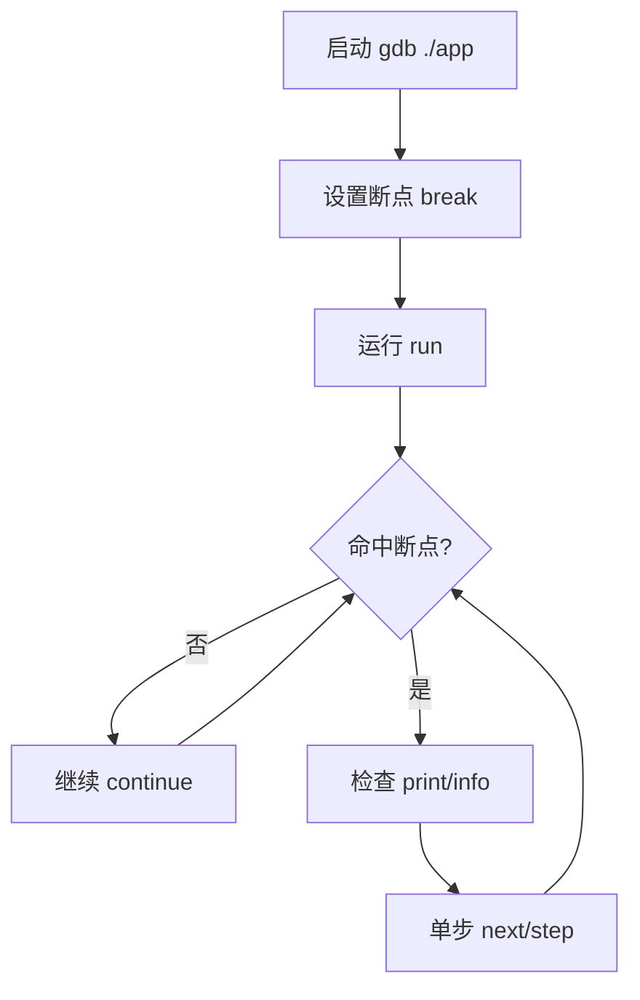

# GDB调试器的基本命令与断点调试

## GDB 是什么与为何需要

当程序编译通过却运行出错，或逻辑结果不符合预期时，仅靠 `printf` 打印变量往往效率低下且污染代码。GDB（GNU Debugger）是 Linux 下标准的源码级调试器，它允许开发者==在程序运行时暂停执行、检查内存与寄存器状态、动态修改变量值==。相比单纯的日志输出，GDB 能精确定位段错误（Segmentation Fault）发生的具体指令行，是掌握 Linux C/C++ 开发的必备技能。

> [!IMPORTANT]
> GDB 调试的前提是编译时必须加 `-g` 选项生成调试符号表，否则无法映射源码行号与变量名。

## 核心命令与断点机制

调试过程可抽象为“设断点→运行→检查→步进”的循环。若程序崩溃，如何快速找到出错位置？若某函数被调用千次，如何只在特定条件下暂停？



| 命令 | 缩写 | 功能说明 |
| :--- | :--- | :--- |
| `break main` | `b main` | 在函数入口或行号设断点 |
| `run` | `r` | 启动程序执行 |
| `next` | `n` | 单步执行，==不进入==函数内部 |
| `step` | `s` | 单步执行，==进入==函数内部 |
| `continue` | `c` | 继续运行至下一断点 |
| `print var` | `p var` | 打印变量当前值 |
| `backtrace` | `bt` | 查看函数调用栈帧 |
| `condition 1 i==10` | - | 为1号断点添加条件 |

> [!TIP]
> 区分 `next` 与 `step`：`next` 将函数调用视为一条语句跳过；`step` 则深入函数体逐行调试。循环中验证逻辑用 `n`，排查函数内部错误用 `s`。

## 实战示例：定位数组越界

假设以下程序编译后运行报段错误：

```c
// gcc -g -o test test.c
int main() {
    int arr[5] = {0};
    for (int i = 0; i <= 5; i++) { // 注意此处边界
        arr[i] = i * 2;
    }
    return 0;
}
```

使用 GDB 调试的正确流程：

```bash
(gdb) b main          # 在main函数设断点
(gdb) r               # 运行，停在main入口
(gdb) n               # 单步至for循环
(gdb) p i             # 检查i的初始值 → 0
(gdb) condition 1 i==5 # 设条件断点，仅当i=5时暂停
(gdb) c               # 继续运行，命中i=5
(gdb) p arr[5]        # 访问越界元素，确认非法地址
(gdb) bt              # 查看调用栈，确认出错位置在第4行
```

通过条件断点跳过前5次正常迭代，==直接定位到 `i==5` 时的越界写入==，避免了重复单步的低效操作。

> [!WARNING]
> 常见坑：未加 `-g` 编译导致 `No symbol table`；对优化级别 `-O2` 以上的代码调试时变量可能被优化掉，显示 `<optimized out>`，建议调试阶段使用 `-O0 -g`。

> [!CAUTION]
> `step` 进入系统库函数（如 `printf`）时可能陷入汇编代码，此时应立即用 `finish` 命令返回上层函数，避免迷失在底层实现中。
