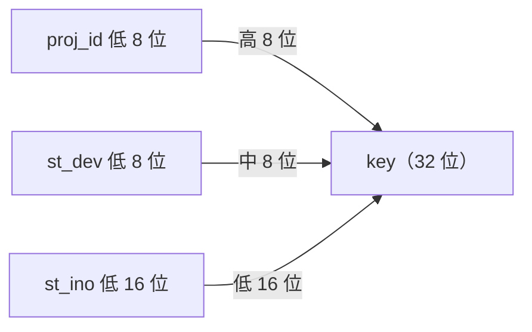

# System V IPC的键值key与ftok()函数

## 为什么需要 key

System V IPC 包含三种通信对象：消息队列、共享内存、信号量。它们与文件不同——没有“路径名”可以直接打开。多个进程要使用**同一个** IPC 对象，必须先解决一个问题：双方如何“约到”同一个对象？

答案就是给每个 IPC 对象分配一个**键值（key）**。`key` 是一个整数，进程创建或获取 IPC 对象时都要用 `msgget(key, ...)`、`shmget(key, ...)`、`semget(key, ...)` 这类调用传入 key。

这就引出下一个问题：key 怎么约定？

> [!NOTE]
> 最“土”的办法是双方直接写死同一个整数，例如都用 `0x1234`。问题在于：**别的程序可能正好也用了 `0x1234`**，导致两个完全无关的项目鬼使神差地拿到同一个消息队列。这正是需要 `ftok()` 的原因。

## ftok() 做了什么

`ftok()` 的职责是：**从一个真实存在的文件路径和一个项目编号，生成一个 key**。

```c
#include <sys/types.h>
#include <sys/ipc.h>

key_t ftok(const char *pathname, int proj_id);
```

生成规则（Linux 实现）：


$$
key = (proj\_id \text{ 的低 } 8 \text{ 位}) \ll 24 \;\;|\;\; st\_dev \text{ 的低 } 8 \text{ 位} \ll 16 \;\;|\;\; st\_ino \text{ 的低 } 16 \text{ 位}
$$


也可以直观理解为：



其中 `st_dev` 和 `st_ino` 来自对 `pathname` 执行 `stat()` 的结果。只要路径不变、文件不变、项目号不变，生成的 key 就确定不变。

> [!TIP]
> 记忆：`ftok` = **f**ile **to** **k**ey。同一路径 + 同一 `proj_id` ⇒ 同一 key，这是不同进程成功共享 IPC 对象的前提。

## 一个算对了的例子

假设 `ftok("/home/njupt/ipcfile", 8)` 对文件 `stat` 得到：

```c
st_dev = 0x802;
st_ino = 0x1234;
proj_id = 8;   // 二进制低 8 位 = 0x08
```

按规则拼接：


$$
\begin{aligned}
key &= (0x08 \ll 24) \;\;|\;\; (0x02 \ll 16) \;\;|\;\; 0x1234 \\
&= 0x08000000 \;\;|\;\; 0x00020000 \;\;|\;\; 0x00001234 \\
&= 0x08021234
\end{aligned}
$$


所以返回的 key 是 `0x08021234`。传给 `msgget()` 或 `shmget()` 即可。

## 高频考点：`proj_id` 位移之后的低 8 位

一道常见的题会这样出：`ftok(path, 258)` 返回 key 的高 8 位是多少？

`proj_id = 258`，但 **只有低 8 位参与计算**。先写二进制：


$$
258 = 1\;0000\;0010_2
$$


低 8 位是 `0x02`，所以 key 高 8 位 = `0x02`，而不是 `0x0102` 截一半之类。

> [!IMPORTANT]
> 核心考点：==`proj_id` 只取低 8 位==。因为 `int` 有 32 位，但生成 key 时它被左移 24 位，**超过 8 位的高位全部被移出而丢弃**。所以 `proj_id = 258` 和 `proj_id = 2` 产出完全相同的 key。

## 易错坑

> [!WARNING]
> `ftok()` 中的路径必须是**真实存在、且进程有 `stat` 权限**的文件。路径不存在或无法访问时，`ftok()` 返回 `(key_t)-1`，同时 `errno` 给出具体错误。很多学生写代码时路径写了随意一个字符串，结果 IPC 对象“怎么都拿不到”。

> [!CAUTION]
> 同一个路径配同一个 `proj_id` 才能保证同一 key。**路径相同但 `proj_id` 不同，key 不同；路径不同但 `proj_id` 相同，key 也可能不同**，因为 `st_dev` 和 `st_ino` 可能不同。

> [!WARNING]
> `proj_id` 为 0 是合法的，但可读性差，实际项目中通常用字符如 `'A'`（对应 65）或小整数。有些系统（如老式 BSD）限制 `proj_id` 从 1 开始，Linux 允许 0~255，但南邮考试以 Linux 语义为准：==低 8 位有效==。

## ftok 与 key 的关系小结

| 概念 | 含义 | 谁提供 |
|---|---|---|
| `pathname` | 任意存在的文件路径 | 程序员指定 |
| `proj_id` | 项目编号，只取低 8 位 | 程序员指定 |
| `key` | IPC 对象的“名字” | `ftok()` 计算得出 |
| `msqid/shmid/semid` | 内核分配的 IPC 对象标识符 | 内核分配，用于后续操作 |
