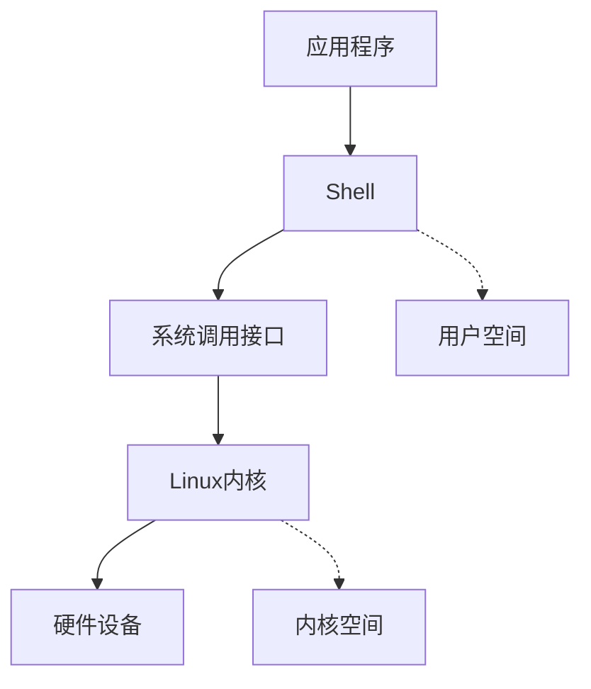

# Linux操作系统的特点与体系结构

## Linux 系统特点与体系结构

Linux 究竟是一个单纯的操作系统内核，还是包含工具链的完整生态？理解这一点是掌握《Linux编程》的前提。Linux 严格遵循 ==POSIX 标准==，具备多用户、多任务、支持多线程与多 CPU 的核心特点。其体系结构自底向上分为硬件层、内核层（进程/内存/文件/网络子系统）、Shell 命令解释器及应用程序层。其中，内核负责资源抽象与管理，而 Shell 作为用户与内核交互的桥梁，将文本指令翻译为系统调用。

> [!IMPORTANT]
> Linux 体系结构的核心分界是 ==用户空间与内核空间==。应用程序不能直接访问硬件，必须通过系统调用陷入内核态执行，这是保障系统稳定与安全的基础机制。

## 目录结构与用户模型

面对海量文件，Linux 如何组织？答案是完全遵循 FHS（文件系统层次标准）。所有文件挂载于单一根目录 `/` 下，形成倒置树形结构。例如，`/etc` 专存系统配置参数，`/dev` 存放设备文件，`/boot` 包含引导加载器（如 GRUB）及内核镜像。这种“一切皆文件”的设计极大简化了 I/O 操作接口。

在用户模型上，Linux 区分三类账户：==超级用户==（root，UID=0，拥有最高权限）、==普通用户==（受限操作）和 ==虚拟用户==（又称伪用户，如 bin、daemon，仅用于标识服务进程所有权，不可登录）。注意，“实体用户”并非 Linux 标准术语，考试中常作为干扰项出现。

| 用户类型 | UID 范围 | 可否登录 | 典型用途 |
| :--- | :--- | :--- | :--- |
| 超级用户 | 0 | 是 | 系统管理 |
| 虚拟用户 | 1~999 | 否 | 服务进程标识 |
| 普通用户 | ≥1000 | 是 | 日常开发使用 |

## Shell 基础语法辨析

编写脚本或交互式操作时，变量引用与命令组合是最易出错的地方。当执行 `echo "text"` 时，双引号内的纯字符串会被原样输出，不会触发变量替换；若需获取变量值，必须加 `$` 符号，即 `echo "$text"`。因此题干中无 `$` 前缀，输出结果就是字面量 `text`。

> [!WARNING]
> 双引号允许变量解析但保留空格，单引号则完全禁止解析。混淆两者是 Shell 编程中最常见的坑，务必养成 ==引用变量必加 `$`== 的习惯。

命令逻辑控制符也需精准区分：`&&` 表示前一条成功才执行后一条；`||` 则表示 ==前一条失败才执行后一条==；`;` 是无条件顺序执行；`|` 是管道传递数据流。例如 `cmd1 || cmd2` 正是实现“失败回退”逻辑的标准写法。至于分页显示，`more` 和 `less` 均支持翻页，而 `cat` 会一次性输出全部内容，`grep` 仅用于文本搜索，`pause` 甚至不是有效命令。

> [!TIP]
> 记忆口诀：与(`&&`)成同败停，或(`||`)败续成止。结合真题选项反向验证，可快速排除干扰项。
