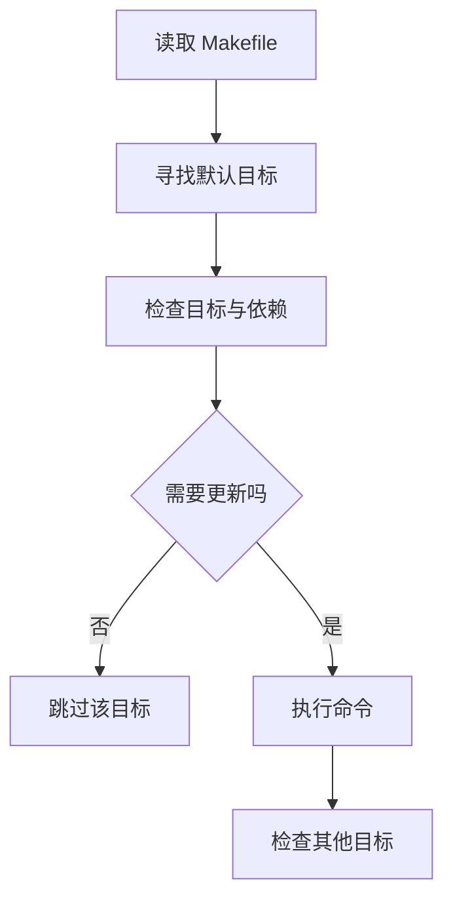

# Makefile的语法规则与make工具的使用

## 什么是 Makefile

Makefile 是一个描述“文件之间依赖关系”和“如何生成目标文件”的文本文件。`make` 会读取它，比较源文件、目标文件及依赖文件的时间戳，自动判断哪些内容需要重新编译或连接。

在 Linux 上使用 C/C++ 开发大型程序时，一个工程通常包含许多 `.c`、`.cpp`、头文件和目标文件。手动逐条执行编译命令既繁琐，又容易漏改或漏编译。Makefile 将这些操作组织成规则，使开发者只需执行 `make` 即可完成增量构建。

> [!IMPORTANT]
> Makefile 的核心是“目标、依赖、命令”三部分，以及基于文件时间戳的增量更新机制。

## 基本语法

一条规则的基本形式为：

```makefile
目标: 依赖列表
	命令
```

例如：

```makefile
exam: exam.o main.o
	gcc -o exam exam.o main.o

exam.o: exam.c
	gcc -c exam.c
```

其中：

- `exam` 是最终生成的可执行文件，称为目标；
- `exam.o` 是目标所依赖的文件；
- `gcc -o exam exam.o main.o` 是更新目标时执行的命令；
- 命令行必须以 ==Tab 缩进==，不能使用普通空格。

`make` 的处理过程可以概括为：



## 自动变量

在规则命令中，可以使用 `$` 开头的自动变量代替具体文件名。

| 自动变量 | 含义 | 常见用途 |
|---|---|---|
| `$@` | 当前目标的完整名称 | 生成输出文件 |
| `$^` | 当前规则的全部依赖文件 | 一次列出所有依赖 |
| `$<` | 第一个依赖文件的名称 | 编译第一个源文件 |
| `$?` | 比目标更新的依赖文件 | 只处理发生变化的依赖 |
| `$*` | 目标去掉扩展名后的名称 | 生成同名对象文件 |

例如：

```makefile
%.o: %.c
	gcc -c $< -o $@
```

当目标为 `main.o` 时，`$<` 是 `main.c`，`$@` 是 `main.o`。

> [!TIP]
> 记忆口诀：`@` 是目标，`^` 是全部依赖，`<` 是第一个依赖。

因此，题目中：

- `$@` 表示目标的完整名称，答案是 **D**；
- `$^` 表示所有依赖文件列表，答案是 **C**。

## 完整工程示例

根据课本程序 `5-2` 至 `5-5`，可以编写：

```makefile
exam: exam5-2.o exam5-3.o exam5-4.o exam5-5.o
	gcc -o exam exam5-2.o exam5-3.o exam5-4.o exam5-5.o

exam5-2.o: exam5-2.c
	gcc -c exam5-2.c

exam5-3.o: exam5-3.c
	gcc -c exam5-3.c

exam5-4.o: exam5-4.c
	gcc -c exam5-4.c

exam5-5.o: exam5-5.c
	gcc -c exam5-5.c

clean:
	rm -f *.o exam
```

在 Makefile 所在目录执行：

```bash
make
```

可生成 `exam`；执行：

```bash
make clean
```

可删除目标文件和可执行文件。

> [!WARNING]
> `clean` 是伪目标，用于执行清理命令，通常不会生成名为 `clean` 的文件。不要把清理命令写成普通空格缩进，否则可能出现 `missing separator` 错误。

## 常见问题

1. **命令前没有使用 Tab**  
   这是最常见的错误。Makefile 的命令行必须以 Tab 开头。

2. **依赖关系不完整**  
   如果 `exam5-2.c` 包含了 `head.h`，而 `head.h` 被修改，通常应写成：

   ```makefile
   exam5-2.o: exam5-2.c head.h
   	gcc -c exam5-2.c
   ```

   也可以使用自动依赖生成工具处理更复杂的头文件依赖。

3. **目标文件和依赖文件同名**  
   规则必须描述“怎样从依赖生成目标”。如果目标和依赖在同一位置，可能出现 `Circular xxx <- xxx dependency`。

4. **误以为 `make` 总会重新编译**  
   `make` 会根据时间戳判断是否需要更新。若源文件没有变化，相关目标通常不会重新编译。

5. **混淆 Makefile 与 Shell 脚本**  
   Makefile 主要描述依赖关系和构建规则；Shell 脚本主要描述一系列命令。Makefile 中也可以调用 Shell 命令。

> [!NOTE]
> 判断题“Linux 在运用 C++ 开发大规模软件时，软件的编译和连接常使用 Makefile”是正确的。Makefile 不仅适用于 C/C++，也广泛用于 Java、Go、Rust 等项目的自动化构建。
