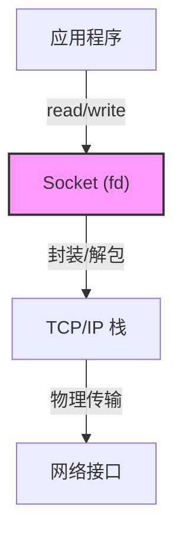

# 套接字Socket的概念与地址结构sockaddr_in

## 套接字 Socket 的本质

在 Linux 网络编程中，==Socket 是通信的端点==。你可以把它想象成电话插孔：应用程序通过它发送或接收数据。对于 TCP/IP 协议族，Socket 由 **IP 地址** + **端口号** + **协议** 唯一标识。

> [!IMPORTANT]
> 核心定义：Socket 是应用层与 TCP/IP 协议族通信的中间软件抽象层，表现为一个文件描述符（fd）。

为什么需要它？因为网卡只认识二进制流，而程序需要结构化的数据交互。Socket API 屏蔽了底层复杂的握手、分片细节，让程序员像读写文件一样操作网络。



## 地址结构 sockaddr_in

IPv4 地址结构 `sockaddr_in` 是配置网络身份的关键。由于历史原因，Linux 提供了通用结构 `sockaddr` 和专用结构 `sockaddr_in`。

| 字段 | 类型 | 含义 | 注意事项 |
| :--- | :--- | :--- | :--- |
| `sin_family` | `sa_family_t` | 地址族 | 必须设为 `AF_INET` |
| `sin_port` | `in_port_t` | 端口号 | **必须是网络字节序** |
| `sin_addr` | `struct in_addr` | IP 地址 | 需通过 `inet_pton` 转换 |
| `sin_zero` | `char[8]` | 填充 | 置 0，保持与 sockaddr 等长 |

> [!WARNING]
> 常见坑：直接赋值主机字节序的端口或 IP 会导致通信失败。必须使用 `htons()` 转换端口，`inet_pton()` 转换 IP。

## 怎么做：初始化步骤

1.  **声明结构体**：`struct sockaddr_in serv_addr;`
2.  **清零内存**：`memset(&serv_addr, 0, sizeof(serv_addr));` 防止脏数据。
3.  **设置属性**：
    *   `serv_addr.sin_family = AF_INET;`
    *   `serv_addr.sin_port = htons(8080);` // 假设端口 8080
    *   `inet_pton(AF_INET, "192.168.1.1", &serv_addr.sin_addr);`

## 辨析与示例

**Q: 为什么函数参数常强转为 `(struct sockaddr*)`？**
因为 `bind()` 等系统调用设计早于 IPv6，使用通用指针 `sockaddr*` 以兼容不同协议族。实际传输时，内核根据 `sin_family` 判断具体解析方式。

> [!TIP]
> 记忆口诀：家族 AF_INET，端口 htons，IP pton 转，清零保平安。

**典型代码片段（南邮实验常见）：**

```c
struct sockaddr_in cli_addr;
socklen_t len = sizeof(cli_addr);

// 接收客户端连接时获取地址
int connfd = accept(listenfd, (struct sockaddr*)&cli_addr, &len);

// 打印客户端 IP 和端口
printf("Client IP: %s, Port: %d\n", 
       inet_ntoa(cli_addr.sin_addr), 
       ntohs(cli_addr.sin_port)); // ==注意还原为主机字节序==
```

> [!CAUTION]
> 高危误区：`accept` 返回的 `sin_port` 是网络字节序，打印前务必用 `ntohs()` 转换，否则端口号会错误（如 8080 变成 35584 等非预期值）。
