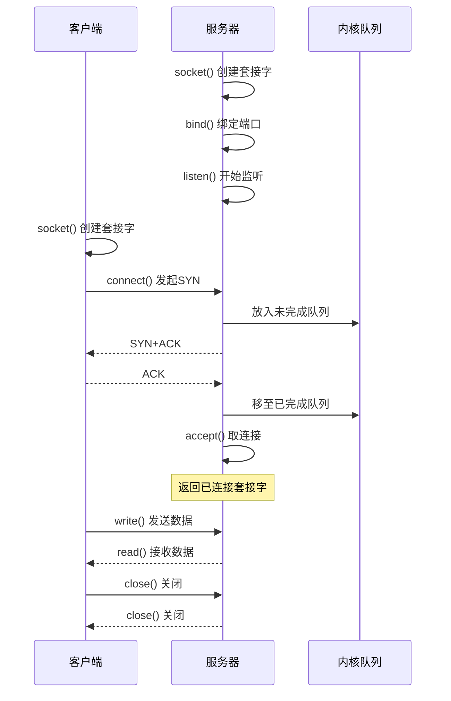

# TCP面向连接的客户端/服务器通信流程（socket、bind、listen、accept、connect）

## 它是什么

TCP 是面向连接的可靠字节流服务。通信前，双方必须通过三次握手建立连接；通信中，数据按序、无差错、不重复地到达；通信后，通过四次挥手释放连接。Socket 编程把这套机制封装成一组系统调用，让应用程序像读写文件一样收发网络数据。

> [!IMPORTANT]
> 服务器端必须依次调用 `socket()` → `bind()` → `listen()` → `accept()`，客户端则只需 `socket()` → `connect()`。==`accept()` 返回的是已连接套接字，用于后续数据收发；`listen()` 只是将套接字置为监听状态，本身不建立连接。==

## 为什么需要这些步骤

先想一个问题：如果服务器只调用 `socket()` 就阻塞等待数据，客户端直接 `connect()` 会成功吗？

答案是不会。因为操作系统还不知道这个套接字要绑定到哪个本地端口、是否允许外部接入。`bind()` 把套接字与本地 IP:端口绑定，`listen()` 告诉内核开始接收连接请求并维护未完成连接队列，`accept()` 则从已完成连接队列中取出一个，生成新的已连接套接字。客户端的 `connect()` 则触发 TCP 三次握手，握手完成后双方进入 `ESTABLISHED` 状态，才能调用 `read()`/`write()` 传输数据。

## 通信流程

## 关键函数对比

| 函数 | 调用方 | 作用 | 是否阻塞 |
|------|--------|------|----------|
| `socket()` | 双方 | 创建通信端点 | 否 |
| `bind()` | 服务器 | 绑定本地地址 | 否 |
| `listen()` | 服务器 | 置监听态，建队列 | 否 |
| `accept()` | 服务器 | 取已完成连接 | 是（默认） |
| `connect()` | 客户端 | 发起三次握手 | 是（默认） |

> [!WARNING]
> 常见错误：在客户端调用 `bind()` 并绑定固定端口。通常客户端不需要 `bind()`，由内核自动分配临时端口；若强行绑定，可能与本地其他进程冲突，导致 `connect()` 失败。

## 一个算对了的例子

服务器监听 8080 端口，客户端连接并发送字符串 `"hello"`。服务器 `accept()` 返回新套接字 `cfd`，执行 `read(cfd, buf, 5)` 后 `buf` 中为 `hello`，`read` 返回值为 5。若客户端调用 `close()`，服务器再次 `read` 返回 0，表示对端正常关闭。

> [!TIP]
> 记忆口诀：**服务器四步曲，客户端两步走；`listen` 只排队，`accept` 才见面；`connect` 成功即握手完成。**
