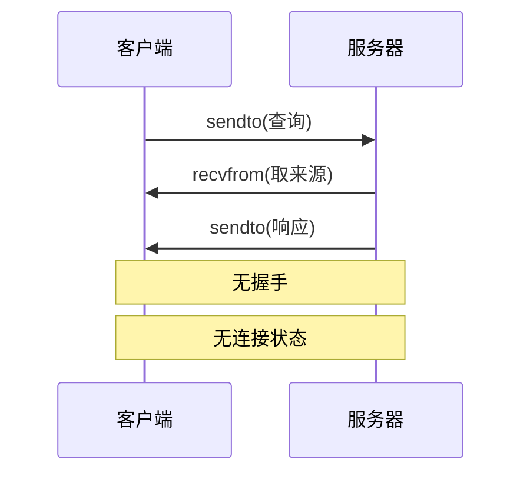

# UDP无连接的客户端/服务器通信流程（sendto、recvfrom）

## 是什么：无连接的数据报通信

UDP 是传输层中典型的==无连接协议==：客户端与服务器之间没有握手、没有连接状态，**每个数据报独立发送**。因此 Socket 编程里不用 `connect`/`listen`/`accept`，而是两个"边发送边指定对端"的系统调用：

| 系统调用 | 作用 | 关键参数 |
|---------|------|---------|
| `sendto` | 发送数据并指定目的地址 | `sockfd, buf, len, flags, dest_addr, addrlen` |
| `recvfrom` | 接收数据并取回来源地址 | `sockfd, buf, len, flags, src_addr, addrlen` |

[!IMPORTANT]
> 核心结论：UDP 的收发都带 `sockaddr` 地址参数，==地址是函数参数而非连接状态==。

## 为什么需要：无连接的取舍

TCP 需要三次握手建立连接，代价是时延与状态维护。UDP 直接发送，适合**小数据、低时延、可容忍丢包**的场景（DNS 查询、视频流、心跳包）。想一想：如果只是发一个 8 字节的 DNS 查询，为什么值得做三次握手？——不值得，所以 UDP 是更合适的选择。



## 怎么做：通信流程

### 服务器端

```c
int s = socket(AF_INET, SOCK_DGRAM, 0);
struct sockaddr_in serv = {AF_INET, htons(9000), INADDR_ANY};
bind(s, (struct sockaddr*)&serv, sizeof(serv));

struct sockaddr_in cli;
socklen_t len = sizeof(cli);
recvfrom(s, buf, sizeof(buf), 0,
         (struct sockaddr*)&cli, &len);   // 取出来源地址
sendto(s, resp, strlen(resp), 0,
       (struct sockaddr*)&cli, len);      // 用来源地址回发
```

### 客户端

```c
int s = socket(AF_INET, SOCK_DGRAM, 0);
struct sockaddr_in serv = {AF_INET, htons(9000)};
sendto(s, msg, strlen(msg), 0,
       (struct sockaddr*)&serv, sizeof(serv));
recvfrom(s, buf, sizeof(buf), 0, NULL, NULL);  // 不关心来源可传 NULL
```


## 与 TCP 面向连接的对比

| 维度 | UDP | TCP |
|------|-----|-----|
| 连接建立 | 无 | 三次握手 |
| 系统调用 | `sendto`/`recvfrom` | `send`/`recv` |
| 对端地址 | 每次传参 | 由连接隐含 |
| 数据边界 | ==保留报文边界== | 字节流，无边界 |
| 可靠性 | 不保证 | 保证有序无重复 |

[!NOTE]
> `recvfrom` 一次调用就 ==对应一个完整 UDP 报文==，不会像 TCP 那样"半包粘包"。

## 常见的坑

[!WARNING]
> - `recvfrom` 的第 6 个参数**传的是指针** `&len`，不是值；忘了会导致段错误。
> - UDP 缓冲区不够大会**丢弃多余字节**（不像 TCP 会留到下次），必须一次装下整个报文。
> - `sendto` 目标地址写成未 `bind` 的端口，对端收不到，但**本端不报错**——UDP 无连接，无法感知。
> - 服务器**必须显式 `bind` 固定端口**，客户端可以不 `bind`，由内核自动分配。

[!CAUTION]
> `recvfrom` 的阻塞不同于 TCP：UDP 收不到就一直等，但对端可能早已退出，==没有任何错误通知==。

## 一个算对了的例子

> 题：服务器 `bind` 到 9000，客户端 `sendto` 一串 `"abc"`（3 字节），服务器 `recvfrom(buf, 1024, ...)` 后 `sendto` 回显，问服务器 `recvfrom` 返回值为多少？

解：UDP 保留报文边界，一次 `recvfrom` ==返回本次报文的字节数==，与缓冲区大小无关。因此返回值为 ==3==（而不是 1024，也不是累积值）。

[!TIP]
> 记忆口诀：**UDP 一次 `recvfrom` = 一个报文 = 返回其字节数**。
