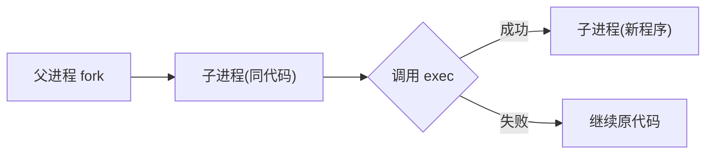

# exec函数族替换进程映像

---
title: exec函数族替换进程映像
requires: [Linux编程/fork系统调用]
---

`fork` 能创建子进程，但子进程默认执行和父进程相同的代码。如果我想让子进程去运行一个全新的程序（比如在 shell 里输入 `ls` 后执行 `/bin/ls`），该怎么做？这就需要 `exec` 函数族。

## 是什么与为什么需要

`exec` 函数族的作用是==用新的程序替换当前进程的映像（代码段、数据段、堆栈等）==。

> [!IMPORTANT]
> 核心结论：`exec` 成功后，原进程的代码和数据被新程序覆盖，但**进程 PID 不变**，也没有创建新进程。

它常与 `fork` 配合使用：`fork` 负责“生”出一个子进程，`exec` 负责让子进程“变身”去执行新任务。



## 怎么做：六个函数的命名规律

`exec` 不是单个函数，而是一族函数。它们的后缀字母代表了参数传递的规则：

| 后缀 | 含义 | 说明 |
| :--- | :--- | :--- |
| `l` | list | 参数逐个列出，以 `NULL` 结尾 |
| `v` | vector | 参数打包成指针数组传入，以 `NULL` 结尾 |
| `p` | path | 自动在环境变量 `PATH` 中搜索可执行文件 |
| `e` | env | 允许自定义新进程的环境变量数组 |

常用组合如 `execl`、`execv`、`execvp` 等。

> [!TIP]
> 记忆口诀：“`l` 散 `v` 聚，`p` 找路径，`e` 换环境”。考试最常考的是 `execl` 和 `execvp`。

## 算对了的例子

假设要在子进程中执行命令 `ls -l /tmp`：

```c
#include <stdio.h>
#include <unistd.h>
#include <sys/wait.h>

int main() {
    pid_t pid = fork();
    if (pid == 0) {
        // 子进程：替换为 ls 程序
        // 参数1: 程序路径; 参数2起: argv[0], argv[1]...; 最后必须跟 NULL
        execl("/bin/ls", "ls", "-l", "/tmp", NULL);
        
        // 只有 exec 失败时才会执行到这里
        perror("execl failed");
        _exit(1);
    } else if (pid > 0) {
        wait(NULL); // 父进程等待子进程结束
        printf("Child finished.\n");
    }
    return 0;
}
```

> [!WARNING]
> `execl` 的第二个参数 `"ls"` 是传给新程序的 `argv[0]`（惯例上写程序名），且参数列表**必须以 `NULL` 结尾**，否则会导致内存越界访问！

## 与相近概念的区别

初学者常把 `exec` 和 `system()` 混淆：

| 特性 | `exec` 函数族 | `system()` |
| :--- | :--- | :--- |
| **本质** | 系统调用封装，直接替换当前进程 | 调用 `/bin/sh -c` 执行命令 |
| **PID** | 不变 | 会额外产生 shell 子进程 |
| **安全性** | 高，无 shell 注入风险 | 低，易受 shell 元字符影响 |
| **返回值** | 成功不返回，失败返回 $-1$ | 返回 shell 的退出状态 |

> [!NOTE]
> `exec` 若执行成功，原进程后续代码将永远不会被执行；只有在出错时才返回 $-1$ 并设置 `errno`。因此，==`exec` 后面紧跟的通常是错误处理代码==。

## 常见的坑

> [!CAUTION]
> 高危误区：在 `fork` 出的子进程中调用 `exec` 失败后，直接用 `exit(0)` 退出。这会导致子进程刷新父进程继承来的标准 I/O 缓冲区，造成输出重复。正确做法是使用 `_exit()` 退出。
